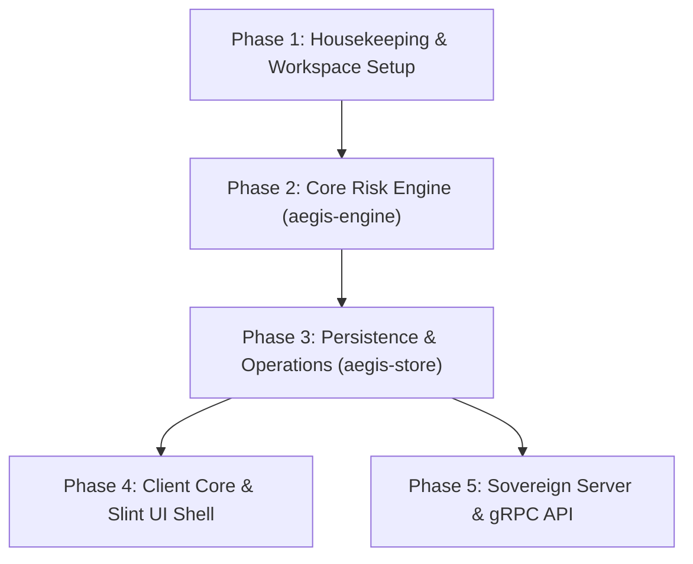

# AegisTARA Project Comprehensive Review

**Date:** 2026-10-20  
**Project:** AegisTARA (Threat Analysis and Risk Assessment Tool in Rust)  
**Repository State:** Commit `2c180d6` (`master`)  
**Scope of Review:** Architecture, domain modeling, code quality, safety, testing & performance budgets, dependency licensing, multi-agent factory workflow, and forward roadmap.

---

## Executive Summary

AegisTARA is designed with an ambitious dual mission:
1. **Commercial Product:** A native, client-server Threat Analysis and Risk Assessment (TARA) platform targeting the automotive cybersecurity sector (ISO/SAE 21434, UN R155/R156, UN R155 Annex 5), designed for customer-hosted sovereign deployments (air-gapped or private cloud).
2. **Software Engineering Learning Laboratory:** An exemplary Rust codebase adhering to uncompromising engineering standards—cache-conscious arena data structures, deterministic incremental graph algorithms, strict supply-chain and license enforcement, and empirical performance budgets verified via automated micro-benchmarks and allocation profiling.

### Current Implementation Status

| Component | Status | Assessment |
|---|---|---|
| **Architecture & Specifications** | Complete | Highly mature; comprehensive ADRs (0001–0004), product direction (`direction-v1.md`), and engineering standards (`engineering-standards.md`). |
| **GUI Framework Spikes** | Complete | Five native Rust toolkits (Slint, GPUI, iced, Freya, egui) evaluated with headless test harnesses. Slint selected (stable 1.x, built-in widgets, CPU fallback); iced retained as permissive fallback. |
| **Domain Model (`crates/aegis-model`)** | Production Grade | Arena-allocated attack graph (`AttackTree`), typed 32-bit index handles (`NodeIdx`), UUIDv7 stable IDs (`NodeId`), iterative Kahn's topological sorting, reachability DFS cycle rejection, and benchmarked parent storage. |
| **Licensing & Supply Chain** | Production Grade | Pinned `cargo-deny` 0.20.2 policy (`deny.toml`), runner script (`scripts/deny.sh`), and comprehensive test fixtures (`tools/deny-fixtures`) verifying D5 whitelist and rejection rules. |
| **Automated Agent Factory** | Operational | Multi-agent development lifecycle (`.claude/agents/`, `.claude/skills/factory/`) executing jobs 001–004 with 4-dimension reviews (code, security, UX, UI) and decision records. |
| **Engine / Store / Server / Client** | Pending | Outlined in roadmap; ready for construction based on `aegis-model`. |

---

## 1. Architecture & Design Review

### 1.1 Client-Server Sovereignty & Deployment
- **Single-Tenant Customer Hosting (D3):** Sensitive threat modeling data never leaves the customer environment. The backend is designed as a single static Rust binary container with PostgreSQL, authenticating via existing enterprise identity providers (Entra ID, Okta, Keycloak) over OIDC with PKCE (RFC 8252) and DPoP (RFC 9449).
- **Offline License Validation (D3, Section 12):** Ed25519-signed license tokens checked offline without telemetry or "phone-home" requirements, enabling compliance in air-gapped industrial and defense environments.
- **Engine Parity:** The exact same deterministic risk engine is compiled into both the desktop client (for optimistic, sub-50ms local feedback) and the server (for authoritative verification and audit recording).

### 1.2 Concurrency & Editing Model (D4)
- **V1 Editing Model:** Project-level lease-based lock (2-minute renewal) with live event streaming for read-only observers.
- **Append-Only Operations:** All project mutations are structured as discrete operations from day one. This avoids architectural lock-in, enabling a seamless transition to fine-grained module locks or CRDT/OT real-time co-editing in future versions without rewriting the model.

### 1.3 Canvas Engine & Display List Decoupling
- **Display List Abstraction (Section 5):** The graph rendering engine emits toolkit-agnostic primitive commands (rectangles, paths, text runs, icons).
- **Cross-Target Rendering:** A single display list pipeline drives the interactive desktop viewport (Slint), SVG vector exports, and high-fidelity Typst PDF executive reports, ensuring absolute visual parity across screen and paper.

---

## 2. Domain Model Review (`crates/aegis-model`)

The core domain model represents an exemplary implementation of Rust data structure design, directly adhering to standards D1–D12:

### 2.1 Memory Layout & Arena Allocation (ADR 0001, ADR 0004)
- **Arena Storage (D1):** `AttackTree` maintains nodes in contiguous `Vec<Node>` memory, eliminating pointer chasing, reference-counting cycles (`Rc<RefCell<T>>`), and heap fragmentation.
- **Handle Safety (D2, D3):** Internal node references use `NodeIdx(u32)`, saving 50% memory compared to `usize` while supporting up to 4.29 billion nodes (orders of magnitude above the 1M `stress` budget). Stable external identity is cleanly decoupled into `NodeId` (UUIDv7, time-sortable).
- **Struct-of-Arrays (D4):** Parallel vectors (`nodes`, `ids`, `owners`, `linked_parents`, `by_id`) segregate hot topological walk data from cold metadata.
- **String Interning (D5):** Node labels are stored as `Arc<str>`, allowing duplicated attack scenario text and labels to share heap allocations.
- **Parent Storage Optimization (ADR 0004):** Extensively benchmarked across `VecStore` (`Vec<Vec<NodeIdx>>`), `BoxStore` (`Vec<Box<[NodeIdx]>>`), and `SparseStore` (`BTreeMap<NodeIdx, Vec<NodeIdx>>`). While `SparseStore` saves 24 bytes per unshared node, it introduces a 5–20x latency penalty on full traversals due to scattered B-tree lookups. `VecStore` was empirically validated as optimal, consuming only ~1% of the 300 MB client memory budget at 100,000 nodes.

### 2.2 Invariant Enforcement & Cycle Prevention (ADR 0002)
- **Strict DAG Invariant:** Attack trees represent Directed Acyclic Graphs where subtrees can be shared across multiple gates (`AttackTree::link`).
- **Eager Cycle Rejection:** `link()` performs an iterative, non-recursive depth-first search (DFS) over reachable descendants. If an edge would close a cycle, it is immediately rejected with `ModelError::WouldCreateCycle`, preserving the tree's DAG invariant without runtime panic.
- **Kahn's Topological Sort (A2, A3):** `AttackTree::topological_order()` computes an iterative topological ordering in $O(V + E)$ time and $O(V)$ space. If an unexpected cycle is detected (e.g. from future deserialization), `extract_cycle()` reconstructs the deterministic cycle path for error diagnostics.
- **Type-State Representation (D12):** `Node` is an enum (`Gate` vs `Step`). Leaf `Step` nodes do not contain a child collection, making invalid configurations (steps possessing children) unrepresentable at the type level.

---

## 3. Code Quality, Safety & Rust Idiomaticity

The codebase demonstrates meticulous adherence to Rust best practices and project engineering standards:

```rust
// Verified crate attributes in crates/aegis-model/src/lib.rs:
#![forbid(unsafe_code)]
#![warn(missing_docs)]
#![warn(clippy::pedantic)]
```

### Key Highlights:
1. **Zero Unsafe Code (Q2):** The entire domain model is compiled under `#![forbid(unsafe_code)]`.
2. **Error Handling Integrity (Q3, Q4):** No `unwrap()` or `expect()` calls exist in production library code. All fallible operations return structured, strongly-typed errors via `thiserror::Error` (`ModelError`).
3. **Parse, Don't Validate (Q4):** `NodeId` enforces RFC 9562 UUID version 7 and RFC 4122 variant validation upon construction/parsing, guaranteeing that any instantiated `NodeId` is valid.
4. **Documentation & Doctests (Q5):** 100% documentation coverage with 32 executable doctests and 1 compile-fail verification doctest, ensuring that API documentation never drifts from code behavior.
5. **Linting Compliance (Q1):** Passes `cargo clippy --all-targets -- -D warnings` and `cargo fmt --check` with zero warnings or discrepancies.

---

## 4. Verification, Testing & Benchmarks

The project's test suite achieves outstanding rigor across multiple testing tiers:

### 4.1 Test Execution Results (2026-10-20)
- **Unit Tests:** 51/51 passed (0.29s).
- **Integration Tests:**
  - `tests/cycles.rs`: 3/3 passed (1.71s) — includes 100,000-node deep chain cycle rejection and property-based reference validation.
  - `tests/parents_storage.rs`: 11/11 passed (0.47s) — validates functional equivalence of storage candidates against `AttackTree`.
  - `tests/properties.rs`: 2/2 passed (5.87s) — randomized invariant verification using `proptest`.
- **Doctests:** 33/33 passed (including compile-fail test).
- **Benchmark Smoke Suite:** `cargo test --benches` executed successfully across both `parents_memory` (`dhat`) and `parents_time` (`divan`).
- **Cargo Deny Fixtures:** 8/8 automated test cases passed, verifying both allowed licenses and rejection of GPL, AGPL, LGPL, MPL, and unlicensed Slint.

### 4.2 Performance Budgets vs Empirical Measurements

| Operation / Budget Target | Standard Budget | Measured / Empirical (ADR 0001, 0004) | Status |
|---|---|---|---|
| Recompute / link latency | $\le 5$ ms (large: 100k nodes) | ~2.14 $\mu$s per `link` (large 10% shape) | **Exceeds Budget (~2300x faster)** |
| Full graph traversal (`parents_all`) | $\le 200$ ms (large) | 0.15 ms (large) / 1.55 ms (stress: 1M nodes) | **Exceeds Budget (>100x faster)** |
| Stack safety under deep chains | No overflow on large | Iterative DFS & Kahn verified on 100,000 nodes | **Verified** |
| Memory per node (resident) | $\le 300$ MB total (large) | 2.4 – 3.2 MB total for graph storage (~1%) | **Exceeds Budget** |

---

## 5. Security & License Governance

### 5.1 Supply Chain Enforcement (D5, Q7, ADR 0003)
- **Whitelisted Licenses:** Restricted strictly to 11 approved permissive licenses (MIT, Apache-2.0, BSD-2/3, ISC, Zlib, Unicode-3.0, BSL-1.0, CC0-1.0, MIT-0, OFL-1.1).
- **Prohibited Licenses:** Explicitly denies copyleft and non-commercial regimes (GPL, AGPL, LGPL, SSPL, BUSL, Commons Clause).
- **Tooling Version Pinning:** `cargo-deny` pinned to version `0.20.2` with exact CLI invocation structure documented and scripted (`scripts/deny.sh`).
- **Review-First Exception Mechanism:** Formal process for approving conditional licenses (e.g. Slint Royalty-Free 2.0 or MPL-2.0) requiring an explicit decision record entry in `docs/decisions.md` before adding pinned crate-version exceptions to `deny.toml`.

### 5.2 Application Security Posture
- **No In-Band Telemetry:** The architecture prohibits outbound telemetry, aligning with defense and automotive confidentiality constraints.
- **Memory Hygiene:** Sensitive material (keys, passwords, tokens) specified to use zeroization (`zeroize`).
- **Token Protection:** Client-side credentials stored in native OS keychains (`keyring`), bound via DPoP proofs to prevent token reuse upon exfiltration.

---

## 6. Factory Multi-Agent Architecture Review

The `.claude/` directory contains a sophisticated multi-agent development factory:
- **Roles:** `spec-writer`, `builder`, `approver`, and 4 specialized review agents (`review-code`, `review-security`, `review-ux`, `review-ui`).
- **Workflow:** Jobs flow through explicit rounds (`spec.md` $\rightarrow$ `build.md` $\rightarrow$ reviews $\rightarrow$ `rework.md` $\rightarrow$ `decision.md`).
- **Record of Jobs:** Jobs 001 through 004 demonstrate successful iterative progression, rigorous escalation on open questions or policy boundaries, and consistent artifact production.

---

## 7. Identified Gaps, Inconsistencies & Technical Risks

Despite the exceptional quality of the work completed to date, the following items require attention:

### 7.1 Documentation Drift
- **README Status:** `README.md` (line 11) states: `Status: direction set. No code yet.` This is now incorrect and contradicts the existence of `crates/aegis-model`, passing test suites, and ADRs 0001–0004.
- **Direction v1 vs Decision Log:** In `docs/direction-v1.md` Section 4, `iced` is still described as the "Lead" recommendation with a dated callout noting the spike results. `docs/decisions.md` (D7) records Slint as the selected toolkit.

### 7.2 Cargo Workspace Architecture
- **Missing Root Workspace:** `crates/aegis-model` is currently an independent crate with its own `Cargo.lock` at `crates/aegis-model/Cargo.lock`. There is no root `Cargo.toml` defining `[workspace]`.
- **Future Multi-Crate Cohesion:** As planned crates (`aegis-engine`, `aegis-store`, `aegis-server`, `aegis-client`) are created, having a unified workspace with `[workspace.dependencies]` will be essential for coherent dependency versioning, unified clippy/fmt runs, and shared lockfiles.

### 7.3 Unmerged Worktree Branch (`claude/factory-next-58b95b`)
- An unmerged git worktree exists at `.claude/worktrees/factory-next-58b95b` on branch `claude/factory-next-58b95b`. It contains commit `bf71348` ("Add desktop UI design mockups") with three comprehensive HTML mockups under `docs/design/` (`aegis-design.html`, `aegis-screens.html`, `aegis-vehicle.html`).
- This worktree is dangling and should either be merged into `master` or formally cataloged in the backlog.

### 7.4 Open Product & Legal Decisions
- **Decision D4 (Single-Editor Lock):** Marked as "Please confirm this interpretation" in `docs/decisions.md`.
- **Decision D7 (Slint Royalty-Free License Attribution):** Requires formal business decision on whether the Slint attribution requirement (About dialog and website download badge) is acceptable, or whether to activate the fallback to `iced` (MIT) or purchase a Slint commercial license.
- **Node Deletion & Mutation Semantics:** `AttackTree` currently supports tree creation, node addition, and DAG linking, but lacks node deletion or reparenting. When node removal is introduced, a strategy (tombstones vs index remapping) must be established to keep external references and indices consistent.

### 7.5 CI/CD Pipeline
- Automated scripts (`scripts/deny.sh`, `tools/deny-fixtures/run.sh`) exist, but there is no continuous integration workflow configuration (e.g. `.github/workflows/ci.yml`) to automatically execute these gates on push or pull request.

---

## 8. Strategic Roadmap & Recommended Next Steps

Based on the project's direction and current state, the recommended execution sequence is:



### Phase 1: Workspace Skeleton & Repository Hygiene
1. **Initialize Root Cargo Workspace:** Add root `Cargo.toml` configuring `members = ["crates/*"]` and centralizing workspace dependencies.
2. **Update Project Status:** Update `README.md` to reflect `aegis-model` v0.1 completion and current factory milestone.
3. **Resolve Worktree Branch:** Review and merge `claude/factory-next-58b95b` (desktop UI mockups in `docs/design/`).
4. **Establish CI Workflow:** Add GitHub Actions workflow running `cargo fmt --check`, `cargo clippy --all-targets -- -D warnings`, `cargo test --all-targets`, `cargo test --benches`, and `scripts/deny.sh`.
5. **Formalize Open Decisions:** Confirm D4 (single-editor lock) and D7 (Slint attribution acceptance or iced fallback).

### Phase 2: Core Risk Engine (`crates/aegis-engine`)
1. **Attribute Domains:** Implement pluggable rating domains for feasibility (attack potential, attack vector) and impact ratings.
2. **Deterministic Aggregation:** Implement AND, OR, and Sequential-AND aggregation algorithms utilizing topological order.
3. **Explain-Why Trace Engine:** Build execution tracing that outputs the exact calculation formula and contributing factors for every computed rating.
4. **Property Testing:** Implement property tests verifying monotonicity (e.g. adding an easier attack path never increases parent difficulty).

### Phase 3: Storage, Operations & Change Log (`crates/aegis-store`)
1. **Typed Operation Model:** Define invertible mutation operations (`AddNode`, `LinkNodes`, `UpdateRating`, `DeleteNode`).
2. **Snapshot & Undo/Redo Engine:** Implement $O(1)$ snapshots (via `imbl` or structural sharing) and undo/redo stacks.
3. **Data Serialization:** Define binary/JSON format for TARA projects and methodology packs.

### Phase 4: Desktop Client & Server
1. **Canvas Display List:** Build the headless canvas engine producing display lists for attack graphs.
2. **Slint Desktop Shell:** Connect Slint frontend to the client core based on spike findings.
3. **Customer-Hosted Server:** Implement `aegis-server` container with tonic gRPC, Cedar authorization policies, and PostgreSQL storage.

---

## 9. Conclusion

AegisTARA is in an outstanding initial state. The project combines visionary product scope with world-class engineering discipline. The foundational crate (`aegis-model`) is performant, memory-efficient, mathematically rigorous, and tested to extreme limits. With the domain foundation solidly in place, the project is primed for the construction of the risk engine and storage layer.
