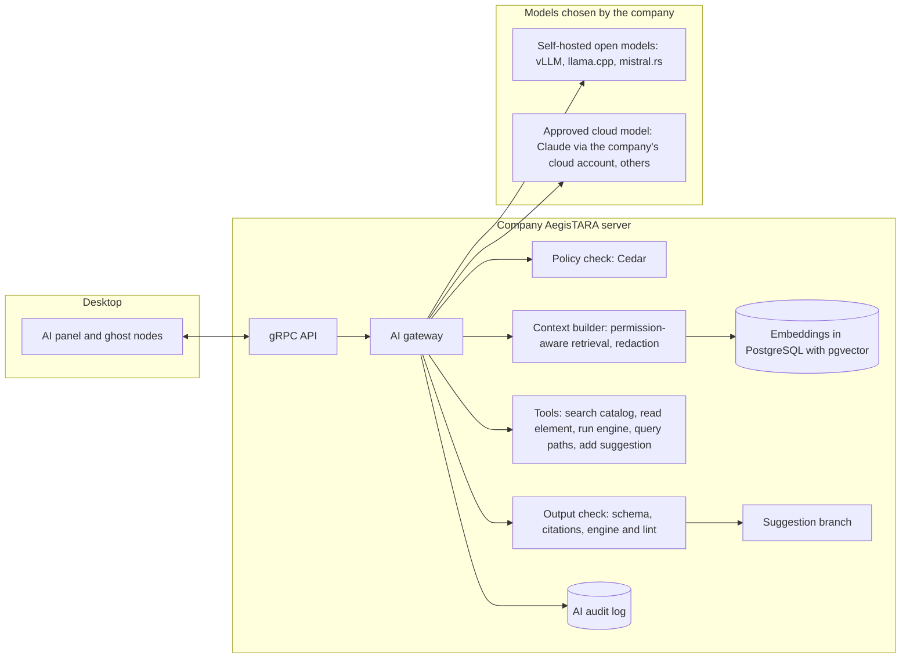

# AI Features: Brainstorm and Backlog

- Status: backlog. Nothing here is in v1.
- Date: 2026-10-10

## TLDR

1. **Rule:** AI proposes. The engine computes. A human decides. Numbers never come from a language model.
2. **Where AI lives:** one **AI gateway** inside the company's server. It applies policy, hides sensitive data, logs everything, and talks to the model. The desktop app never calls a model directly.
3. **Which models:** the company chooses. Self-hosted open models for secret projects. An approved cloud model (for example Claude through the company's own cloud account) where policy allows.
4. **Where AI output lands:** in a **suggestion branch**, shown as dashed "ghost" nodes on the canvas. The user accepts, edits, or rejects each one. Accepted items keep an "AI-suggested" tag.
5. **Best first features:** smart catalog search, threat suggestions for a selected asset, damage scenario wording, and executive summary wording.
6. **Do now, in v1, at almost no cost:** provenance on every element, suggestion branches, a typed operation API, catalog IDs everywhere, and an engine callable as a tool. Then AI plugs in later without a redesign.

---

## 1. Principles

1. **AI proposes, engine computes, human decides.** Risk values, feasibility, and matrices always come from the deterministic engine.
2. **Off by default.** The company admin turns features on, per feature and per project classification.
3. **Data stays where policy says.** Restricted projects use only self-hosted models. Nothing goes to an outside provider unless the admin allows it.
4. **Grounded and cited.** Suggestions cite catalog IDs (R155 Annex 5, CAPEC, ATT&CK, EMB3D) or project elements. A citation that does not exist is rejected automatically.
5. **Least privilege.** The model can read only what the current user can read. It can write only to a suggestion branch. It cannot export, change permissions, or reach the network.
6. **Everything is logged.** Prompt, context references, model name and version, response, cost, user, and accept or reject.
7. **Measured before trusted.** Each feature passes an evaluation against expert-made "golden" TARAs before it is turned on.

---

## 2. Architecture

### Parts

- **Provider adapters:** one small Rust trait over HTTP. Most self-hosted servers speak an OpenAI-compatible API. Cloud models come through the company's own account (for example Claude on AWS Bedrock, Google Vertex AI, or the Anthropic API).
- **Policy check:** "may this user use this feature on this project, with this provider?"
- **Context builder:**
  - Retrieves only data the user is allowed to see. This is critical: retrieval must never leak another project's data.
  - Optional redaction: part numbers, supplier names, and program code names become placeholders. The mapping stays on the server and is reversed in the answer.
- **Tools for the model:** read-only tools (search catalogs, read elements, run the engine, query attack paths) and one write tool (add a suggestion).
- **Output check:** structured output validated against a schema, turned into operations, then checked by the engine and linter. Only valid suggestions reach the user.
- **Embeddings:** a local embedding model (for example `fastembed-rs`) and `pgvector` in the PostgreSQL we already run. No new database.

### Security: prompt injection

Uploaded documents, vulnerability advisories, and supplier packages are untrusted input. A text inside them can try to steer the model.
Defenses:

- The model has no dangerous tools. Worst case, it creates a bad suggestion that a human rejects.
- Untrusted text is clearly marked as data in the prompt.
- Output is shown as plain text. No automatic links, no automatic actions.

---

## 3. Desktop experience

- **Ghost nodes:** suggestions appear dashed on the canvas. Accept, edit, or reject one by one, or in a batch.
- **Reason and sources** on each suggestion, with clickable catalog IDs.
- **AI panel:** a side panel aware of the current selection. "Suggest threats for this interface." "Why is this risk high, in plain words?"
- **Provenance badge:** accepted items show "AI-suggested, accepted by <name>, <date>".
- **Undo and history:** every AI change is a normal operation in the log.

---

## 4. Feature ideas

### A. Help while analyzing

| # | Feature | What it does |
|---|---|---|
| A1 | Smart catalog search | Search R155 Annex 5, CAPEC, ATT&CK, EMB3D by meaning, not keywords |
| A2 | Threat suggestions | For a selected asset or interface, propose threat scenarios with STRIDE category and catalog citations |
| A3 | Damage scenario writer | Draft damage scenarios in a consistent style, with a proposed impact rating and rationale |
| A4 | Attack tree drafting | Draft a candidate attack tree for a threat, reusing library patterns, into a suggestion branch |
| A5 | Feasibility helper | Propose attack potential factors with reasons, and show how similar steps were rated before |
| A6 | Goals and controls | Propose cybersecurity goals, claims, and controls mapped to R155 Annex 5 mitigations; write requirements in good form |
| A7 | Architecture extraction | Read an item definition or architecture document and propose components, interfaces, data flows, and assets |

### B. Quality and review

| # | Feature | What it does |
|---|---|---|
| B1 | AI reviewer | A second pair of eyes: gaps, illogical paths, odd ratings. Complements the deterministic linter. |
| B2 | Duplicate finder | Finds threat scenarios that say the same thing in different words |
| B3 | Wording cleanup | Consistent terms and clear sentences across the project |
| B4 | Translation | German, Japanese, Chinese, and others, for global teams and suppliers |

### C. Living TARA

| # | Feature | What it does |
|---|---|---|
| C1 | Vulnerability triage | Reads a new advisory, checks relevance to the SBOM and to attack steps, proposes feasibility updates |
| C2 | CRA report drafts | Drafts the early warning and notification texts when a reportable event is confirmed |
| C3 | Threat intel digest | Summarizes new catalog and intel updates that matter for your projects |

### D. Communication

| # | Feature | What it does |
|---|---|---|
| D1 | Executive summary wording | Writes the summary from engine numbers. A post-check confirms every number matches the engine. |
| D2 | Plain-language explain-why | Turns the engine's derivation trace into a short explanation for non-experts |
| D3 | Ask in plain words | "Show all paths from Bluetooth to braking with feasibility Medium or higher." Translated into the query language, and the query is shown for transparency. |
| D4 | Supplier documents | Drafts questionnaires and cybersecurity interface agreement text |

### E. Research

| # | Feature | What it does |
|---|---|---|
| E1 | Red team agent | Explores the architecture model and proposes new attack paths, ranked by plausibility |
| E2 | Workshop mode | Records a TARA workshop, transcribes it locally (Whisper-class model), and drafts items from the discussion |
| E3 | Test plan generation | Turns top risks into penetration test cases, and feeds results back as evidence |
| E4 | MCP server | Exposes AegisTARA to the company's own AI assistants through the Model Context Protocol (Rust SDK: `rmcp`), with the same permissions |
| E5 | Company memory | Learns the company's style and past decisions through retrieval over approved TARAs |

---

## 5. Backlog in waves

Ordered by value versus risk and effort.

| Wave | Features | Why this order |
|---|---|---|
| 1 | A1 smart search, A2 threat suggestions, A3 damage writer, D1 summary wording, B3 wording cleanup | High value, low risk, easy to check by a human |
| 2 | A4 attack tree drafting, A5 feasibility helper, B1 AI reviewer, B2 duplicates, D2 plain explain-why | Needs suggestion branches and a calibration history |
| 3 | A7 architecture extraction, C1 vulnerability triage, D3 plain-word queries, A6 goals and controls, B4 translation | Needs importers, feeds, and a query language |
| 4 | E1 to E5, C2, C3, D4 | Research or depends on later product features |

---

## 6. Evaluation

- **Golden set:** a few complete TARAs made by experts (public example systems, no customer data).
- **Measures:**
  - Threat suggestions: how many expert threats were found (recall) and how many suggestions were useful (precision).
  - Ratings: agreement with experts.
  - Citations: share of citations that are real and relevant.
  - Users: accept rate and edit rate in real use.
- **Regression tests:** run the set on every model or prompt change. A feature stays off until it passes.

---

## 7. What v1 must include so AI is cheap later

| Hook | Why AI needs it |
|---|---|
| Provenance on every element (human, import, catalog, AI) | Tag and audit AI output |
| Suggestion branches | A safe landing zone for AI output |
| Typed operation API | AI writes through the same validated path as humans |
| Catalog IDs on threats, steps, and controls | Grounding and citations |
| Engine callable as a tool | AI asks the engine for numbers instead of guessing |
| Derivation traces | Plain-language explanations |
| Language tag on text fields | Translation |
| Audit log | Log AI use like any other action |

---

## 8. Licenses for AI parts

- Libraries: check each against the policy in [decisions.md](decisions.md) (D5).
- **Model weights have their own licenses.** Some open models are Apache-2.0. Others have custom terms with use limits. Review every model before a customer uses it, and let the admin see the license in the provider settings.
- Cloud model terms: the company signs them with the provider directly. AegisTARA only connects.
