# AegisTARA Implementation Architecture

- **Date:** 2026-10-25 (Part II added and kept current with jobs 037 to 041)
- **Baseline Commit:** `b7ca167` for Part I; Part II follows the branch head
- **Scope:** Part I is the complete UML and activity reference for
  `crates/aegis-model`. [Part II](#part-ii-the-system) covers the whole
  system: every other crate, its structs and fields, the database schema,
  the network paths, the main flows, and the engineering rules each part
  follows. [Part III](#part-iii-the-target-system-planned-not-built) is the
  planned system for the v2 requirements. **Rule for maintainers: when a struct, enum, field, table, RPC or
  flow is added or changed, update Part II in the same commit.**

---

## 1. High-Level Architecture Overview

`aegis-model` is organized into six layers. Source state lives exclusively in `Methodology`, `AttackTree`, and `Project` (mutated only through validated `Op`s), while all derived state (`RefCounts`, `Evaluation<V>`, `TreeEvalCache<V>`, `ProjectEvalCache`, `ThreatRisk`, `AttackPaths`, `ChokePoint<V>`, `ThreatSensitivity`, `LintFinding`, `ProjectDiff`) is computed deterministically from the source state or maintained as an explicit, rebuildable cache (rule D10).

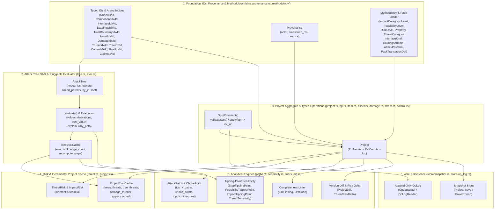

### Module Inventory (`crates/aegis-model/src/`)

| Module | Primary Types | Responsibility |
|---|---|---|
| `id.rs` | `NodeIdx`..`ClaimIdx`, `ComponentIdx`..`TrustBoundaryIdx` (`u32`), `NodeId`..`ClaimId`, `ComponentId`..`TrustBoundaryId`, `SuggestionId`, `ElementId` (`Uuid` v7) | 4-byte arena indices for $O(1)$ slice access and 16-byte time-ordered UUIDv7 external identifiers. |
| `provenance.rs` | `Provenance`, `ProvenanceSource` | Tracks `actor`, `timestamp_ms`, and `source` (`Human`, `Import`, `Catalog`, `Ai`) on every entity and mutation. |
| `methodology/` | `Methodology`, `MethodologyDef`, `ElementNamesDef`, `ElementNameDef`, `PackTranslationDef`, `InterfaceKind`, `AttackPotential`, `PotentialBand`, `CatalogRef`, `PropertySet`, scale `u8` newtypes | Validates and compiles methodology packs (built-in ISO/SAE 21434 + UN R155 Annex 5 with Japanese `"ja"` translation, medical-device demo, and EU CRA Annex I `eu-cra`), pack-defined element type names (`DOM-01`), per-language pack translations (`L10N-07`), interface kinds (`ARC-02`), plain likelihood (`DOM-02`) alongside CEM multi-factor attack potential scoring, 2D risk matrices, and catalog syntax (ADR 0053, ADR 0057, ADR 0059). |
| `tree.rs` | `AttackTree`, `Node`, `GateKind`, `RemovedNode`, `MAX_ATTACK_TREE_NODES` (4,096), `MAX_TREE_OP_NODES` (32) | Arena-allocated rooted DAG with `And`, `Or`, and `SeqAnd` gates, $O(1)$ end-of-arena append fast path and sliced index shifting on structural edits, eager DFS cycle prevention on `link()`, and iterative Kahn's `topological_order()`. |
| `eval.rs` | `AttributeDomain`, `MaxMin<T>`, `MinTime`, `Evaluation<V>`, `Derivation`, `Explanation`, `TreeEvalCache<V>` | Single-pass bottom-up DAG evaluator, step-by-step explain-why traces, and rank-ordered incremental tree evaluation cache with value-change early cutoff. |
| `item.rs` | `Component`, `Interface`, `DataFlow`, `TrustBoundary`, `MAX_COMPONENT_DEPTH` (16), `MAX_TRUST_BOUNDARY_MEMBERS` (64) | Item definition entities: hierarchical components, pack-typed interfaces (`InterfaceKind`), directed data flows between components (optionally via an interface), and trust boundaries grouping components (`ARC-02`, ADR 0059). |
| `asset.rs` | `Asset` | Item asset holding a `PropertySet` bitset of security properties, optional `ComponentIdx` binding (`ARC-02`), and `Provenance`. |
| `damage.rs` | `DamageScenario` | Adverse consequence rated across methodology impact categories (`Box<[Option<Level>]>`). |
| `threat.rs` | `ThreatScenario`, `ImpactRisk`, `ThreatRisk` | Threat targeting an `Asset`, violating `PropertySet`, linked to `CatalogRef`s, `DamageScenario`s, optional `AttackTree` / `direct_feasibility`, `RiskTreatment`, `CybersecurityGoal`, and `CybersecurityClaim`. |
| `control.rs` | `SecurityControl`, `StepMitigation`, `RiskTreatment`, `CybersecurityGoal`, `CybersecurityClaim` | Security controls, per-step feasibility mitigations, treatment decisions (`Avoid`, `Reduce`, `Share`, `Retain`), goals, and claims. |
| `description.rs` | `ElementRef`, `MAX_DESCRIPTION_CHARS`, `MAX_NOTES_CHARS`, `MAX_DESCRIPTION_TOTAL_BYTES` | Plain description text on the eleven entity kinds (`Component`, `Interface`, `DataFlow`, `TrustBoundary`, `Asset`, `Damage`, `Threat`, `Tree`, `Control`, `Goal`, `Claim`) and the project's notes (`ElementRef::Project`), kept in one ordered map on `Project`, set by `Op::SetDescription` (ADR 0051, ADR 0059). |
| `element.rs` | `ElementKind`, `KindDef`, `KINDS`, `Element`, `AttrValue`, `LinkTarget`, `TargetKind`, `MAX_ELEMENTS_PER_KIND`, `MAX_ELEMENT_LINKS`, `MAX_ELEMENT_ATTRIBUTES`, `MAX_ATTRIBUTE_TEXT_CHARS` | Generic element kinds the engine never reads, one kernel table row each (misuse case `MU` is the first), in one store on `Project` with six ops that have exact inverses (ADR 0068). |
| `library.rs` | `LibraryPack`, `LibraryItem`, `ItemNode`, `Facet`, `LibraryIndex`, `LibraryError`, `MAX_LIBRARY_*` | Attack tree library packs (versioned JSON, license, SHA-256 hash, decode caps), the built-in demo pack in `packs/`, and an inverted n-gram posting index (`postings: HashMap<String, Vec<(u32, u8)>>`) with precomputed facet counts that works for English and Japanese (ADR 0052). A step may suggest an attack type by key; an insert fills it in and counts it in the origin note. |
| `suggest.rs` | `SuggestionBranch`, `SuggestionItem`, `GhostPreview`, `GhostTreeNode`, `Citation`, `SuggestionError`, `MAX_SUGGESTIONS_PER_BRANCH`, `MAX_OPS_PER_SUGGESTION`, `MAX_CITATIONS_PER_ITEM` | Holds proposed AI operations apart from `Project`, overlays ghost nodes on a cloned `AttackTree` (`preview_tree`), and rebases/stamps accepted items with `ProvenanceSource::Ai` (`FND-05`, ADR 0055). |
| `op.rs` | `Op` (79 variants) | Complete set of validated, single-op-invertible project mutations (including 18 item-definition variants and 6 generic element variants, ADR 0068). |
| `project.rs` | `Project`, `Arena<Id, Idx, T>`, `TreeEntry`, `RefCounts`, `ProjectEvalCache` | Aggregate root owning the 11 entity arenas, the generic element store (`ElementStore`, ADR 0068), sparse reference counts (`RefCounts`), and incremental project evaluation cache (`ProjectEvalCache`). |
| `paths.rs` | `AttackPath<V>`, `AttackPaths<V>`, `ChokePoint<V>` | Lazy best-first minimal cut-set enumeration (`BinaryHeap<SearchState<V>>`), choke-point ranking, and greedy top-$k$ hitting sets. |
| `sensitivity.rs` | `StepTippingPoint`, `FeasibilityTippingPoint`, `ImpactTippingPoint`, `ThreatSensitivity` | Single-parameter $\pm 1$ tipping-point sensitivity analysis for attack trees and threat scenarios. |
| `lint.rs` | `LintSeverity`, `LintCode` (25 variants: 4 `Error`, 21 `Warning`), `LintFinding` | Deterministic completeness and consistency linter over `Project` (including `AssetUnbound` and `BoundaryCrossingDataFlowWithoutThreat`; zero entity names in output, rule R6). |
| `diff.rs` | `EntityDiff<Id>`, `RiskSnapshot`, `RiskChange`, `RiskDelta`, `ThreatRiskDelta`, `ProjectDiff` | Deterministic structural (across all 11 arenas and the generic elements) and inherent/residual risk delta comparison between two `Project` versions. |
| `store/` | `OpLogWriter<W>`, `OpLogReader<R>`, `StoreError` | Key-based JSON snapshot (`aegis-project`) and JSON Lines append-only operation log (`aegis-oplog`) with decode-time size caps (rule R3). |
| `store/workspace.rs` | `WorkspaceFile`, `MAX_WORKSPACE_FILES`, `MAX_WORKSPACE_FILE_BYTES` | A project as a folder of small JSON files (D32, ADR 0065): `to_workspace_files` and `from_workspace_files` do no disk I/O; the reader checks paths, layout and caps, then reuses `Project::load`. |
| `error.rs` | `ModelError` | Structured error enum for all domain, graph, capacity, and validation failures. |

---

## 2. Complete UML Class Diagrams (All Structs, Enums, Fields & Methods)

### 2.1 Identity, Provenance & Methodology (`id.rs`, `provenance.rs`, `methodology/`)

- **In-memory arena indices (`*Idx(u32)`)**: `NodeIdx(u32)`, `AssetIdx(u32)`, `DamageIdx(u32)`, `ThreatIdx(u32)`, `TreeIdx(u32)`, `ControlIdx(u32)`, `GoalIdx(u32)`, `ClaimIdx(u32)`. Each implements the crate-private `ArenaIndex` trait (`from_u32(i: u32) -> Self`, `position(self) -> usize`).
- **Public stable IDs (`*Id(Uuid)`)**: `NodeId(Uuid)`, `AssetId(Uuid)`, `DamageId(Uuid)`, `ThreatId(Uuid)`, `TreeId(Uuid)`, `ControlId(Uuid)`, `GoalId(Uuid)`, `ClaimId(Uuid)`. Each validates RFC 9562 UUIDv7 on construction (`new_v7()`, `from_uuid(Uuid) -> Result<Self, IdError>`, `as_uuid(self) -> Uuid`).
- **Vocabulary scale indices (`u8` newtypes)**: `ImpactCategory(u8)`, `Level(u8)`, `FeasibilityLevel(u8)`, `RiskLevel(u8)`, `Property(u8)`, `ThreatCategory(u8)`, `CatalogScheme(u8)`, `FeasibilityFactor(u8)`, `FactorLevel(u8)`.

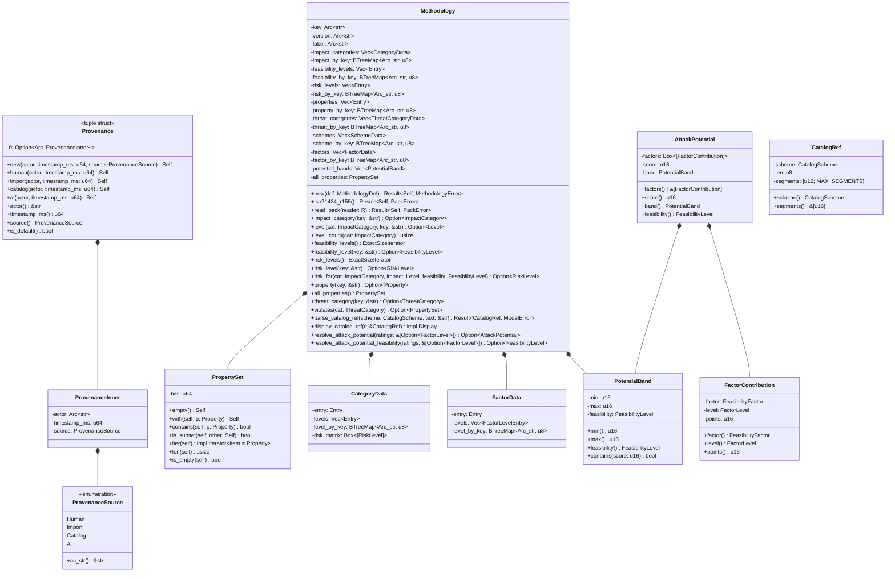

---

### 2.2 Attack Tree DAG & Evaluation Engine (`tree.rs`, `eval.rs`)

`AttackTree` stores nodes in parallel `Vec` arenas indexed by `NodeIdx(u32)`. Every non-root node has one primary `owner: Option<NodeIdx>` (forming a spanning tree) plus zero or more secondary DAG parents in `linked_parents: Vec<Vec<NodeIdx>>`.

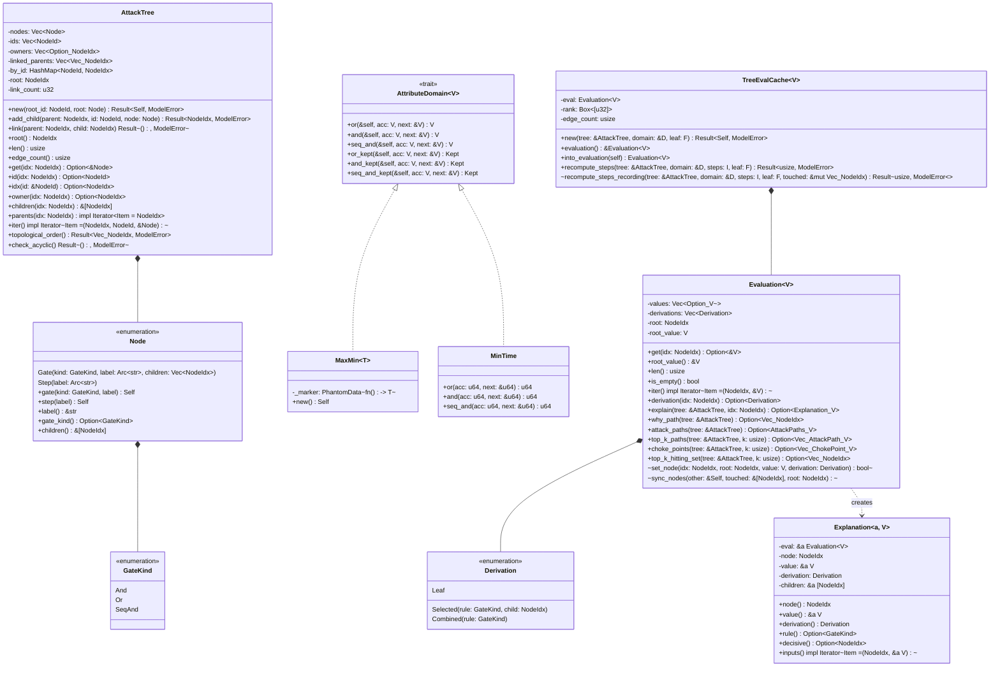

---

### 2.3 Domain Entities, `Project` Aggregate, `Arena` & `RefCounts` (`project.rs`, `asset.rs`, `damage.rs`, `threat.rs`, `control.rs`, `op.rs`)

```mermaid
classDiagram
    direction TB

    class Arena~Id, Idx, T~ {
        -slots: Vec~Option_T~
        -ids: Vec~Id~
        -by_id: BTreeMap~Id, Idx~
        -get(idx: Idx) Option~&T~
        -get_mut(idx: Idx) Option~&mut T~
        -idx(id: &Id) Option~Idx~
        -id(idx: Idx) Option~Id~
        -len() usize
        -slot_count() usize
        -next_idx(limit: u32) Option~Idx~
        -push(id: Id, value: T, limit: u32) Option~Idx~
        -remove(idx: Idx) Option~T~
        -iter() impl Iterator~Item = (Idx, Id, &T)~
    }

    class Project {
        -methodology: Arc~Methodology~
        -slot_limit: u32
        -assets: Arena~AssetId, AssetIdx, Asset~
        -damages: Arena~DamageId, DamageIdx, DamageScenario~
        -threats: Arena~ThreatId, ThreatIdx, ThreatScenario~
        -trees: Arena~TreeId, TreeIdx, TreeEntry~
        -controls: Arena~ControlId, ControlIdx, SecurityControl~
        -goals: Arena~GoalId, GoalIdx, CybersecurityGoal~
        -claims: Arena~ClaimId, ClaimIdx, CybersecurityClaim~
        -refs: RefCounts
        +new(methodology: Arc~Methodology~) Self
        +with_slot_limit(methodology: Arc~Methodology~, slot_limit: u32) Self
        +methodology() &Arc~Methodology~
        +validate(op: &Op) Result~(), ModelError~
        +apply(op: Op) Result~Op, ModelError~
        +apply_cached(op: Op, cache: &mut ProjectEvalCache) Result~Op, ModelError~
        +eval_cache() ProjectEvalCache
        +evaluate_tree(id: TreeId) Result~Evaluation_FeasibilityLevel, ModelError~
        +evaluate_residual_tree(id: TreeId) Result~Evaluation_FeasibilityLevel, ModelError~
        +evaluate_threat(id: ThreatId) Result~Evaluation_FeasibilityLevel, ModelError~
        +evaluate_residual_threat(id: ThreatId) Result~Evaluation_FeasibilityLevel, ModelError~
        +evaluate_risk(id: ThreatId) Result~ThreatRisk, ModelError~
        +evaluate_residual_risk(id: ThreatId) Result~ThreatRisk, ModelError~
        +top_k_tree_paths(id: TreeId, k: usize) Result~Vec_AttackPath, ModelError~
        +top_k_residual_tree_paths(id: TreeId, k: usize) Result~Vec_AttackPath, ModelError~
        +top_k_threat_paths(id: ThreatId, k: usize) Result~Vec_AttackPath, ModelError~
        +top_k_residual_threat_paths(id: ThreatId, k: usize) Result~Vec_AttackPath, ModelError~
        +tree_choke_points(id: TreeId, k: usize) Result~Vec_ChokePoint, ModelError~
        +residual_tree_choke_points(id: TreeId, k: usize) Result~Vec_ChokePoint, ModelError~
        +threat_choke_points(id: ThreatId, k: usize) Result~Vec_ChokePoint, ModelError~
        +residual_threat_choke_points(id: ThreatId, k: usize) Result~Vec_ChokePoint, ModelError~
        +tree_hitting_set(id: TreeId, k: usize) Result~Vec_NodeIdx, ModelError~
        +residual_tree_hitting_set(id: TreeId, k: usize) Result~Vec_NodeIdx, ModelError~
        +threat_hitting_set(id: ThreatId, k: usize) Result~Vec_NodeIdx, ModelError~
        +residual_threat_hitting_set(id: ThreatId, k: usize) Result~Vec_NodeIdx, ModelError~
        +tree_tipping_points(id: TreeId) Result~Vec_StepTippingPoint, ModelError~
        +residual_tree_tipping_points(id: TreeId) Result~Vec_StepTippingPoint, ModelError~
        +threat_sensitivity(id: ThreatId) Result~ThreatSensitivity, ModelError~
        +residual_threat_sensitivity(id: ThreatId) Result~ThreatSensitivity, ModelError~
        +lint() Vec~LintFinding~
        +diff(current: &Project) Result~ProjectDiff, ModelError~
        +save(writer: W) Result~(), StoreError~
        +load(methodology: Arc~Methodology~, reader: R) Result~Self, StoreError~
    }

    class Asset {
        -name: Arc~str~
        -properties: PropertySet
        -provenance: Provenance
        +name() &str
        +properties() PropertySet
        +provenance() &Provenance
    }

    class DamageScenario {
        -name: Arc~str~
        -impacts: Box~[Option_Level]~
        -provenance: Provenance
        +name() &str
        +impact(category: ImpactCategory) Option~Level~
        +impacts() impl ExactSizeIterator~Item = (ImpactCategory, Option_Level)~
        +provenance() &Provenance
    }

    class ThreatScenario {
        -name: Arc~str~
        -asset: AssetIdx
        -category: ThreatCategory
        -catalog_refs: Vec~CatalogRef~
        -damages: Vec~DamageIdx~
        -direct_feasibility: Option~FeasibilityLevel~
        -attack_tree: Option~TreeIdx~
        -treatment: Option~RiskTreatment~
        -goal: Option~GoalIdx~
        -claim: Option~ClaimIdx~
        -provenance: Provenance
        +name() &str
        +asset() AssetIdx
        +category() ThreatCategory
        +catalog_refs() &[CatalogRef]
        +damages() &[DamageIdx]
        +direct_feasibility() Option~FeasibilityLevel~
        +attack_tree() Option~TreeIdx~
        +treatment() Option~RiskTreatment~
        +goal() Option~GoalIdx~
        +claim() Option~ClaimIdx~
        +provenance() &Provenance
    }

    class TreeEntry {
        -tree: AttackTree
        -step_feasibility: Vec~Option_FeasibilityLevel~
        -step_factors: Vec~Box_Slice_Option_FactorLevel~~
        -step_mitigations: Vec~Box_Slice_StepMitigation~~
        -step_links: Option~Box_StepLinks~
        -provenance: Provenance
        -step_attack_potential(m: &Methodology, idx: NodeIdx) Option~AttackPotential~
        -effective_step_feasibility(m: &Methodology, idx: NodeIdx) Option~FeasibilityLevel~
        -residual_step_feasibility(m: &Methodology, idx: NodeIdx) Option~FeasibilityLevel~
    }

    class SecurityControl {
        -name: Arc~str~
        -targets: Vec~ItemIdx~
        -rules: Vec~ControlRule~
        -provenance: Provenance
        +name() &str
        +rules() &[ControlRule]
        +rule_for(attack_type: AttackType) Option~FeasibilityLevel~
        +provenance() &Provenance
    }

    class ControlRule {
        -attack_type: AttackType
        -ceiling: FeasibilityLevel
        +attack_type() AttackType
        +ceiling() FeasibilityLevel
    }

    class StepMitigation {
        -control: ControlIdx
        -feasibility: FeasibilityLevel
        +control() ControlIdx
        +feasibility() FeasibilityLevel
    }

    class CybersecurityGoal {
        -name: Arc~str~
        -controls: Vec~ControlIdx~
        -provenance: Provenance
        +name() &str
        +controls() &[ControlIdx]
        +provenance() &Provenance
    }

    class CybersecurityClaim {
        -name: Arc~str~
        -provenance: Provenance
        +name() &str
        +provenance() &Provenance
    }

    class RefCounts {
        -asset_properties: Vec~Box_Slice_PropertyCount~~
        -assets: Vec~u32~
        -damages: Vec~u32~
        -trees: Vec~u32~
        -controls: Vec~u32~
        -control_goals: Vec~u32~
        -goals: Vec~u32~
        -claims: Vec~u32~
        -threat(t: &ThreatScenario, violates: PropertySet, up: bool)
        -properties(a: AssetIdx, violates: PropertySet, up: bool)
        -property(a: AssetIdx, p: Property) u32
    }

    class PropertyCount {
        -property: Property
        -threats: u32
    }

    Project *-- Arena
    Project *-- RefCounts
    RefCounts *-- PropertyCount
    Arena o-- Asset
    Arena o-- DamageScenario
    Arena o-- ThreatScenario
    Arena o-- TreeEntry
    Arena o-- SecurityControl
    Arena o-- CybersecurityGoal
    Arena o-- CybersecurityClaim
    TreeEntry *-- AttackTree
    TreeEntry *-- StepMitigation
    SecurityControl *-- ControlRule
```

---

### 2.4 Risk, Incremental Project Cache, Attack Paths, Choke Points & Sensitivity (`threat.rs`, `project.rs`, `paths.rs`, `sensitivity.rs`)

```mermaid
classDiagram
    direction TB

    class ThreatRisk {
        -feasibility: FeasibilityLevel
        -tree_evaluation: Option~Evaluation_FeasibilityLevel~
        -entries: Vec~ImpactRisk~
        -deciding: Option~usize~
        +feasibility() FeasibilityLevel
        +tree_evaluation() Option~&Evaluation_FeasibilityLevel~
        +entries() &[ImpactRisk]
        +max_risk() Option~RiskLevel~
        +deciding_entry() Option~&ImpactRisk~
    }

    class ImpactRisk {
        -damage: DamageId
        -category: ImpactCategory
        -impact: Level
        -feasibility: FeasibilityLevel
        -risk: RiskLevel
        +damage() DamageId
        +category() ImpactCategory
        +impact() Level
        +feasibility() FeasibilityLevel
        +risk() RiskLevel
    }

    class ProjectEvalCache {
        -trees: Vec~Option_CachedTreeEval~
        -threats: Vec~Option_CachedThreatEval~
        -tree_threats: Vec~Vec_ThreatIdx~
        -damage_threats: Vec~Vec_ThreatIdx~
        -recomputed_nodes: u64
        -recomputed_threats: u64
        +new(project: &Project) Self
        +rebuild(project: &Project)
        +update(project: &Project, op: &Op)
        +evaluate_tree(project: &Project, id: TreeId) Result~&Evaluation, ModelError~
        +evaluate_residual_tree(project: &Project, id: TreeId) Result~&Evaluation, ModelError~
        +evaluate_threat(project: &Project, id: ThreatId) Result~&Evaluation, ModelError~
        +evaluate_residual_threat(project: &Project, id: ThreatId) Result~&Evaluation, ModelError~
        +evaluate_risk(project: &Project, id: ThreatId) Result~&ThreatRisk, ModelError~
        +evaluate_residual_risk(project: &Project, id: ThreatId) Result~&ThreatRisk, ModelError~
        +recomputed_nodes() u64
        +recomputed_threats() u64
        +reset_counters()
    }

    class AttackPath~V~ {
        -steps: Box~[NodeIdx]~
        -feasibility: V
        -bottleneck: NodeIdx
        +steps() &[NodeIdx]
        +bottleneck() NodeIdx
        +feasibility() &V
        +len() usize
        +is_empty() bool
        +contains(step: NodeIdx) bool
    }

    class AttackPaths~a, V~ {
        -tree: &a AttackTree
        -eval: &a Evaluation~V~
        -topo: Vec~NodeIdx~
        -has_shared: bool
        -heap: BinaryHeap~SearchState_V~~
        -yielded: BTreeSet~Box_Slice_NodeIdx~~
        +next() Option~AttackPath_V~
    }

    class SearchState~V~ {
        <<struct>>
        -bound: V
        -choices: Vec~u32~
        -steps: Vec~NodeIdx~
        -next_or: Option~NodeIdx~
        -worklist: Vec~NodeIdx~
        -expanded: Vec~bool~
    }

    class ChokePoint~V~ {
        -step: NodeIdx
        -path_count: usize
        -bottleneck_count: usize
        -easiest_path_feasibility: V
        +step() NodeIdx
        +path_count() usize
        +bottleneck_count() usize
        +easiest_path_feasibility() &V
    }

    class StepTippingPoint {
        -step: NodeIdx
        -node: NodeId
        -from_step: FeasibilityLevel
        -to_step: FeasibilityLevel
        -from_root: FeasibilityLevel
        -to_root: FeasibilityLevel
        +step() NodeIdx
        +node() NodeId
        +from_step() FeasibilityLevel
        +to_step() FeasibilityLevel
        +from_root() FeasibilityLevel
        +to_root() FeasibilityLevel
    }

    class FeasibilityTippingPoint {
        -step: Option~NodeIdx~
        -node: Option~NodeId~
        -from_step_feasibility: FeasibilityLevel
        -to_step_feasibility: FeasibilityLevel
        -from_threat_feasibility: FeasibilityLevel
        -to_threat_feasibility: FeasibilityLevel
        -from_risk: RiskLevel
        -to_risk: RiskLevel
        +step() Option~NodeIdx~
        +node() Option~NodeId~
        +from_step_feasibility() FeasibilityLevel
        +to_step_feasibility() FeasibilityLevel
        +from_threat_feasibility() FeasibilityLevel
        +to_threat_feasibility() FeasibilityLevel
        +from_risk() RiskLevel
        +to_risk() RiskLevel
    }

    class ImpactTippingPoint {
        -damage: DamageId
        -category: ImpactCategory
        -from_impact: Level
        -to_impact: Level
        -from_risk: RiskLevel
        -to_risk: RiskLevel
        +damage() DamageId
        +category() ImpactCategory
        +from_impact() Level
        +to_impact() Level
        +from_risk() RiskLevel
        +to_risk() RiskLevel
    }

    class ThreatSensitivity {
        -feasibility: FeasibilityLevel
        -max_risk: Option~RiskLevel~
        -feasibility_tipping_points: Vec~FeasibilityTippingPoint~
        -impact_tipping_points: Vec~ImpactTippingPoint~
        +feasibility() FeasibilityLevel
        +max_risk() Option~RiskLevel~
        +feasibility_tipping_points() &[FeasibilityTippingPoint]
        +impact_tipping_points() &[ImpactTippingPoint]
        +is_stable() bool
    }

    ThreatRisk *-- ImpactRisk
    AttackPaths ..> AttackPath : yields
    ThreatSensitivity *-- FeasibilityTippingPoint
    ThreatSensitivity *-- ImpactTippingPoint
```

---

### 2.5 Linter, Version Diff & Wire Persistence (`lint.rs`, `diff.rs`, `store/`)

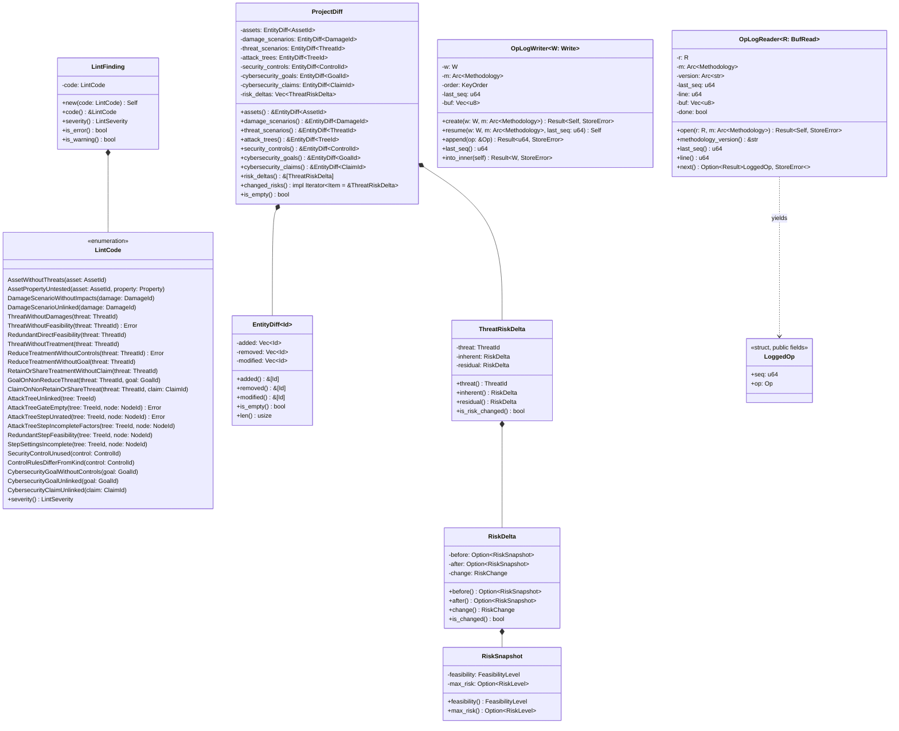

---

## 3. Detailed Activity Views & Function Call Interactions

### Activity 1: Validated Project Mutation & Single-Op Undo (`Project::apply`)

**Why these components interact:**
Every change to `Project` goes through `Project::apply(op: Op) -> Result<Op, ModelError>`. To guarantee strong exception safety (a failed `Op` leaves `Project` bit-for-bit untouched) and single-op invertibility (every `apply` returns a single `Op` that undoes the mutation in $O(\text{size of op})$ time, restoring original provenance), `apply` separates validation from mutation:
1. `Project::validate(&self, op: &Op)` checks name bounds (`check_name`), provenance actor bounds (`check_provenance`), methodology membership (`check_property_set`, `check_impacts`, `check_catalog_refs`, `check_step_feasibility`), referential integrity (`refs.assets`, `refs.damages`, `refs.trees`, `refs.controls`, `refs.goals`, `refs.claims`, `refs.property`), and arena slot capacity (`arena.next_idx(self.slot_limit)`).
2. Only after `validate` returns `Ok(())` does `apply` mutate the target `Arena`, update `self.refs: RefCounts` in place, and construct the exact inverse `Op`.

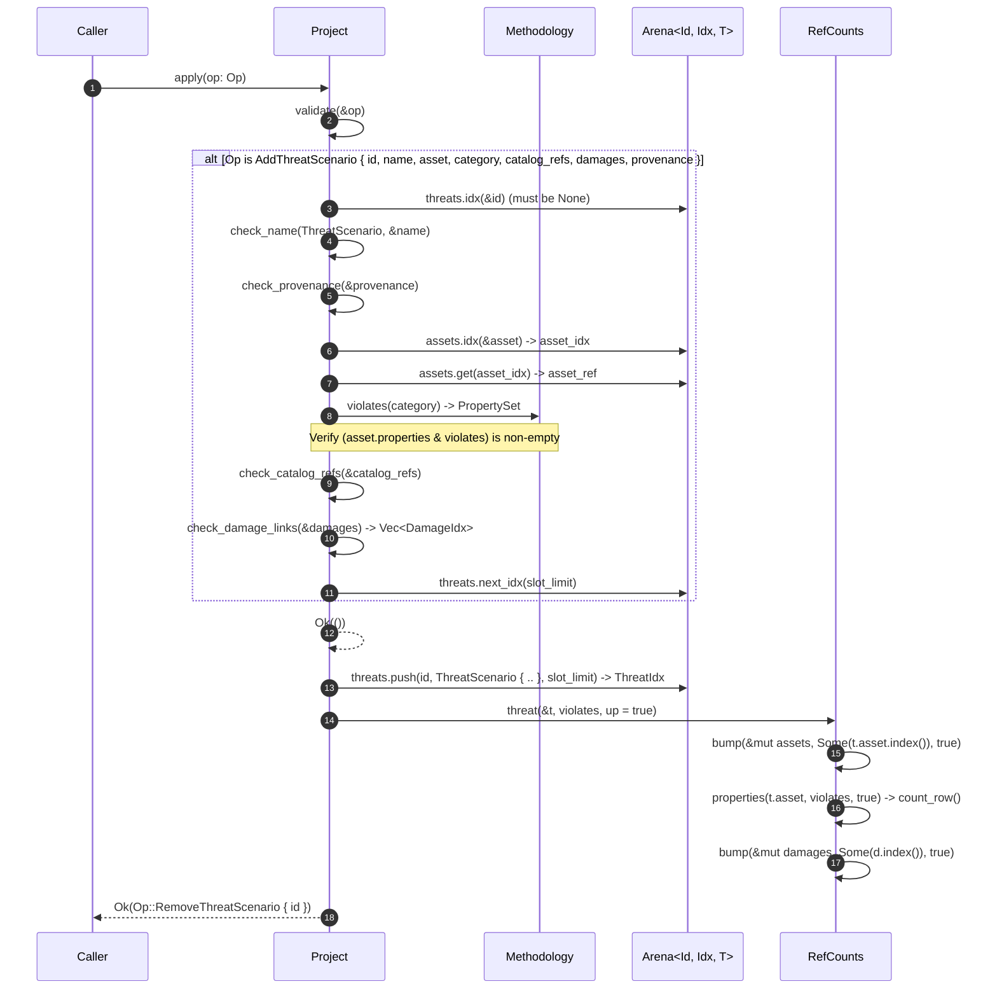

---

### Activity 2: Attack Tree DAG Construction, Cycle Detection & Single-Pass Evaluation (`AttackTree` & `evaluate`)

**Why these components interact:**
An `AttackTree` is a rooted DAG: `add_child(parent, id, node)` adds a tree edge (`owners[child] = Some(parent)`), while `link(parent, child)` adds a shared DAG edge (`linked_parents[child].push(parent)`).
- **Why `link` calls `can_reach(child, parent)`:** Adding `parent -> child` creates a cycle if and only if `child` can already reach `parent`. `link` checks this before mutating `children` or `linked_parents` and returns `Err(ModelError::WouldCreateCycle { parent, child })` on a cycle.
- **Why `evaluate` calls `topological_order()`:** Kahn's algorithm orders nodes top-down (`root` first, leaves last). Iterating that order in reverse (`order.iter().rev()`) visits every child before its parents, so each node is evaluated **exactly once** (rule A2) in $O(V + E)$ time:
  - Leaf (`Node::Step`): invokes caller closure `leaf(idx) -> Option<V>` and stores `Derivation::Leaf`.
  - Gate (`Node::Gate { kind, children }`): calls `fold(domain, kind, children, &values)` which calls `AttributeDomain::or_kept` / `and_kept` / `seq_and_kept` across children, recording `Derivation::Selected { rule: kind, child: best_idx }` (for `MaxMin` and `MinTime` OR/AND) or `Derivation::Combined { rule: kind }` (for `MinTime` SeqAnd).

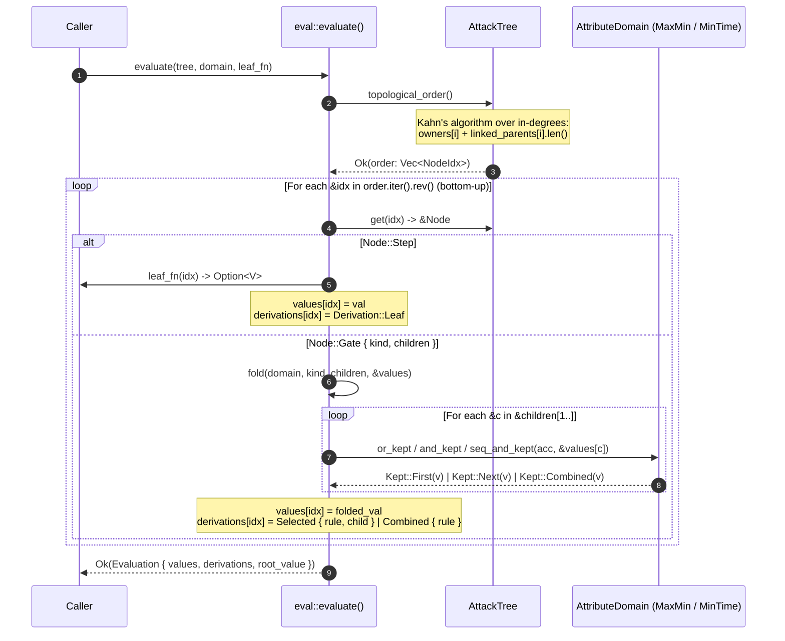

---

### Activity 3: Inherent vs. Residual Feasibility & 2D Risk Determination (`evaluate_risk` & `evaluate_residual_risk`)

**Why these components interact:**
A `ThreatScenario` obtains its feasibility either from a linked `AttackTree` (`t.attack_tree: Option<TreeIdx>`) or, if no tree is linked, from `t.direct_feasibility: Option<FeasibilityLevel>`.
- **Step feasibility resolution (`TreeEntry::effective_step_feasibility`):** If all 5 CEM/ISO 21434 attack potential factors (`step_factors[idx]`) are rated, `Methodology::resolve_attack_potential_feasibility` sums the factor points (`u16`) and maps the score through `potential_bands` to a `FeasibilityLevel`; otherwise it falls back to the coarse `step_feasibility[idx]`.
- **Residual mitigation (`TreeEntry::residual_step_feasibility`):** Takes `effective_step_feasibility(m, idx)` and folds `step_mitigations[idx]` with `.min(m.feasibility)` so security controls cap the step's residual feasibility. Evaluating the full DAG under `MaxMin<FeasibilityLevel>` automatically reveals whether another unmitigated OR branch bypasses the control.
- **2D Risk matrix lookup (`Project::risk_from_feasibility`):** Iterates `t.damages` (already sorted by `DamageId`), and for each rated `(ImpactCategory, Level)` calls `Methodology::risk_for(category, impact, feasibility) -> Option<RiskLevel>`, recording each `ImpactRisk` entry and tracking the first entry that achieves the maximum `RiskLevel` (`deciding: Option<usize>`).

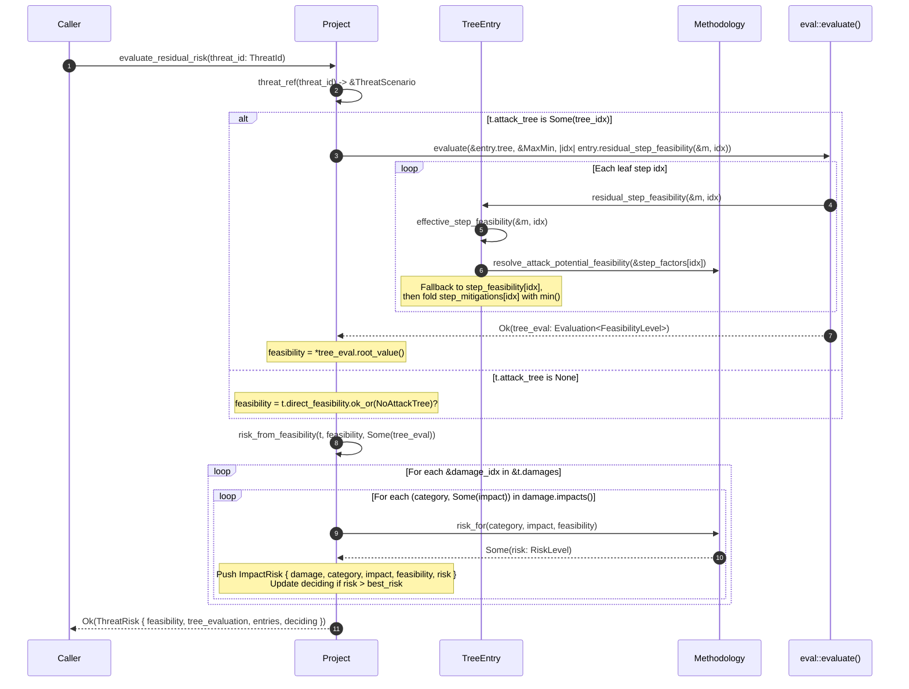

---

### Activity 4: Incremental Evaluation Cache (`TreeEvalCache::recompute_steps` & `ProjectEvalCache::update`)

**Why these components interact:**
On a 100,000-node project (`large`), re-evaluating an entire `AttackTree` and cloning its 100,000-element `Evaluation` into every linked `ThreatRisk` on each keystroke costs milliseconds and megabytes of allocation.
- **Why `TreeEvalCache` stores `rank: Box<[u32]>` and uses a max-heap `BinaryHeap<(u32, NodeIdx)>`:** `rank` is the node's position in `topological_order()`, so `rank[parent] < rank[child]` for every edge. Popping dirty ancestor gates in **descending** `rank` order guarantees that all changed descendants of gate `u` are updated before `u` is folded, so every affected ancestor gate is folded at most once (rule A2).
- **Why value-change early cutoff works:** A parent gate's `fold` depends only on its children's *values*, never their `Derivation`s. When gate `u`'s folded value equals its previous value (`new_val == old_val`), `u` updates its own `Derivation` and stops pushing its parents to the heap.
- **Why `ProjectEvalCache` calls `Evaluation::sync_nodes`:** Instead of cloning the entire `Evaluation<FeasibilityLevel>` into each dependent `ThreatRisk`, `recompute_steps_recording` records the tiny slice of `touched: Vec<NodeIdx>` ($O(\text{depth})$ nodes) and `sync_nodes` copies only those indices into `ThreatRisk::tree_evaluation` in place with zero heap allocations.

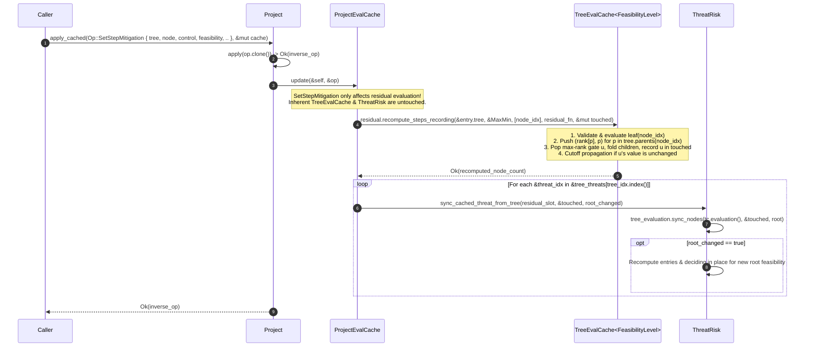

---

### Activity 5: Lazy Top-$k$ Attack Paths, Choke Points & Greedy Hitting Set (`AttackPaths`, `choke_points`, `top_k_hitting_set`)

**Why these components interact:**
An attack tree with $m$ binary OR gates under an AND gate has $2^m$ minimal cut sets (attack paths). Materializing all paths before sorting would blow up memory and time (violating rule A4).
- **How `AttackPaths` enumerates paths lazily:** It uses an AND/OR best-first search over a max-heap `BinaryHeap<SearchState<V>>` seeded with a single `SearchState` whose `worklist` starts at `tree.root()` and whose feasibility upper `bound` is `eval.root_value()`.
  - Each step pops the highest-bound `SearchState` and expands its `next_or` gate `g` (the next unexpanded `Or` in pre-order).
  - If `g` is `GateKind::Or`, it branches: for each child `c` of `g`, it pushes a successor `SearchState` that records the chosen rank in `choices` and tightens the successor's `bound` via `eval.get(c)`.
  - `GateKind::And` / `GateKind::SeqAnd` nodes met along the way are expanded in place: their `tree.children(g)` are pushed onto the `worklist` (reverse pre-order, so `pop` visits the next node in O(1)) and their leaf steps are appended to `steps`.
  - When a popped state has `next_or == None` and an empty `worklist`, its `steps` form a complete cut set. The `yielded: BTreeSet<Box<[NodeIdx]>>` set dedupes already-emitted paths, and the per-state `expanded: Vec<bool>` bitmask guarantees DAG-shared nodes are expanded at most once per path realization.
- **How `choke_points(tree, k)` works:** Calls `self.attack_paths(tree)?.take(k)`, counting in a `BTreeMap<NodeIdx, (usize, usize, V)>` how many of the top-$k$ paths contain each step (`path_count`), how many have `path.bottleneck() == step` (`bottleneck_count`), and the first (highest) path feasibility (`easiest_path_feasibility`), then sorts by `(path_count desc, bottleneck_count desc, step asc)`.
- **How `top_k_hitting_set(tree, k)` works:** Calls `self.top_k_paths(tree, k)?` and runs Chvátal's greedy set-cover loop: at each iteration it counts step frequencies across all still-uncovered paths, picks the step with maximum uncovered count (tie-breaking by lowest `NodeIdx`), marks those paths covered, and repeats until all top-$k$ paths are hit.

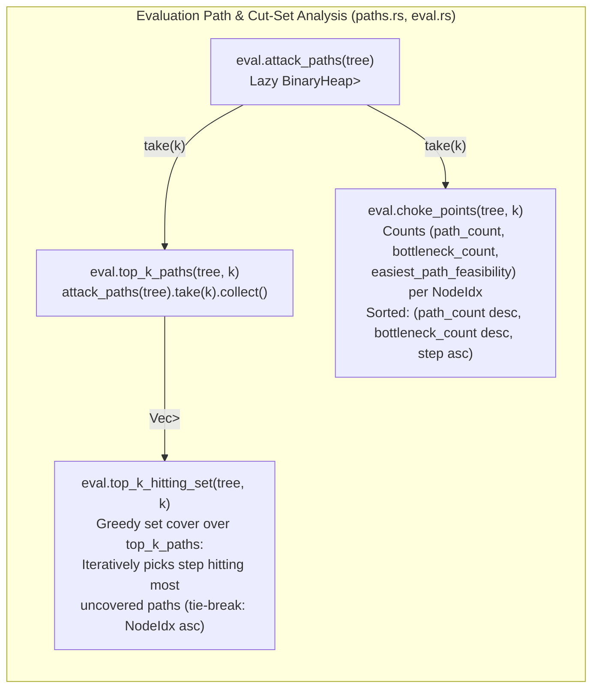

---

### Activity 6: Single-Parameter $\pm 1$ Tipping-Point Sensitivity (`tree_tipping_points` & `threat_sensitivity`)

**Why these components interact:**
Analysts need to know whether a $\pm 1$ step change on any single leaf step's feasibility, direct threat feasibility, or damage scenario impact rating flips the tree's root feasibility or the threat's `max_risk`.
- **Why `entry_tipping_points` uses `TreeEvalCache`:** Instead of running a full $O(V + E)$ `evaluate()` for every step perturbation, `entry_tipping_points` builds one `TreeEvalCache` over `entry.tree`, iterates each leaf `Node::Step`, computes its $\pm 1$ adjacent scale levels via `adjacent_feasibility(from_step, feas_count)`, calls `cache.recompute_steps(&entry.tree, &domain, [step_idx], ...)` to propagate the perturbation in $O(\text{depth} \times \text{fan-out})$ time, checks if `to_root != baseline_root`, and restores `from_step` via `cache.recompute_steps`.
- **Why `impact_tipping_points_for` tracks `(max1, max1_count, max2)`:** A threat can link to up to 256 damage scenarios across multiple impact categories. If two `(damage, category)` entries are tied at the highest risk `max1` (`max1_count >= 2`), lowering only one of them by $-1$ leaves the threat's overall `max_risk` unchanged at `max1`. By precomputing `max1`, `max1_count`, and the strictly second-highest risk `max2` in one linear pass, the maximum risk of all *other* entries when perturbing entry `e` is:
  $$\text{other\_max}(e) = \begin{cases} \text{max2} & \text{if } \text{risk}(e) = \text{max1} \text{ and } \text{max1\_count} = 1 \\ \text{max1} & \text{otherwise} \end{cases}$$
  Then for each $\pm 1$ adjacent impact level `to_impact`, the new worst-case threat risk is simply `other_max.max(methodology.risk_for(category, to_impact, baseline_feasibility))` in $O(1)$ time.

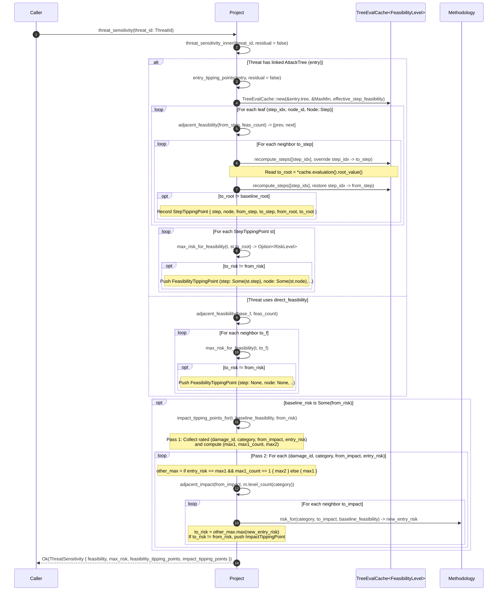

---

### Activity 7: Completeness Linter, Version Diff & Wire Persistence (`lint`, `diff`, `store/`)

**Why these components interact:**
1. **`Project::lint(&self) -> Vec<LintFinding>` (`lint.rs`, `project.rs`):**
   - Scans all 7 arenas in public-ID order (`assets`, `damages`, `threats`, `trees`, `controls`, `goals`, `claims`) and inspects `self.refs: RefCounts` to emit findings across 22 deterministic `LintCode` variants (4 `Error`s and 18 `Warning`s).
   - **Why `refs` is used:** Checking whether an asset, asset property, damage scenario, attack tree, control, goal, or claim is referenced is an $O(1)$ or $O(\log r)$ lookup in `self.refs` rather than a quadratic cross-arena scan.
   - Sorts all findings by `(LintSeverity, LintCode)` before returning so output order is 100% deterministic and never contains entity names (rule R6).
2. **`Project::diff(&self, current: &Project) -> Result<ProjectDiff, ModelError>` (`diff.rs`, `project.rs`):**
   - Verifies `self.methodology == current.methodology` (returning `Err(ModelError::MethodologyMismatch)` otherwise).
   - Runs a two-pointer merge scan (`diff_arena`) over the `BTreeMap<Id, Idx>` keys of each of the 7 arenas to classify IDs into `added`, `removed`, and `modified` (comparing logical entity content, resolving internal `*Idx` links to public `*Id`s via `threat_content_eq`, `tree_entry_eq`, and `goal_content_eq`).
   - For every threat in `self` or `current`, evaluates inherent and residual `(feasibility, max_risk)` snapshots (`eval_risk_snapshot`) and records `ThreatRiskDelta` whenever a threat is added, removed, or has a changed inherent/residual risk snapshot.
3. **Wire Persistence (`store/snapshot.rs`, `store/op_log.rs`):**
   - **Why vocabulary items are stored by string key (`&str`) instead of `u8` index:** Reordering a methodology pack's vocabulary must never silently change the meaning of saved projects or oplogs.
   - **Why decode-time caps (`Limit`, `BoundedReader`, `CapSeq`) run inside `serde::Deserialize`:** Untrusted files or oplog lines are rejected during deserialization before allocating unbounded `Vec`s or strings (`MAX_PROJECT_FILE_BYTES = 64 MiB`, `MAX_OP_RECORD_BYTES = 64 KiB`, `MAX_ATTACK_TREE_NODES = 4,096`, `MAX_TREE_OP_NODES = 32`, `MAX_DAMAGE_LINKS = 256`, `MAX_CATALOG_REFS = 16`, `MAX_STEP_MITIGATIONS = 16`, `MAX_GOAL_CONTROLS = 16`, rule R3).

```mermaid
flowchart TB
    subgraph LinterFlow["Project::lint(&self) -> Vec<LintFinding>"]
        L_SCAN["Iterate arenas in BTreeMap ID order\n(assets, damages, threats, trees, controls, goals, claims)"]
        L_REFS["Query self.refs: RefCounts in O(1) / O(log r)\nfor unreferenced entities & untested properties"]
        L_SORT["Sort findings by (LintSeverity, LintCode)\n(Errors first, then Warnings; UUIDv7 tie-break)"]
        L_SCAN --> L_REFS --> L_SORT
    end

    subgraph DiffFlow["Project::diff(&self, current: &Project) -> Result<ProjectDiff, ModelError>"]
        D_METH["Check self.methodology == current.methodology"]
        D_ARENA["diff_arena() across all 7 arenas\n(two-pointer merge over BTreeMap keys -> added, removed, modified)"]
        D_RISK["eval_risk_snapshot() for union of ThreatIds\nCompute inherent & residual RiskDelta -> ThreatRiskDelta"]
        D_METH --> D_ARENA --> D_RISK
    end

    subgraph StoreFlow["Persistence (store/snapshot.rs & store/op_log.rs)"]
        S_SAVE["Project::save(W) / OpLogWriter::append(&Op)\nMap *Idx -> UUIDv7 & vocab u8 -> string key\nWrite aegis-project / aegis-oplog JSON"]
        S_LOAD["Project::load(M, R) / OpLogReader::open(R, M)\nEnforce BoundedReader + CapSeq decode caps (Rule R3)\nResolve string keys via Methodology & replay through Project::apply"]
        S_SAVE -.->|"JSON / JSONL"| S_LOAD
    end
```

---

# Part II: the system

Part II describes everything outside `aegis-model`. It is kept current with
the branch head. Each section lists the main types with their fields, so a
reviewer can check them against the engineering standards
(`docs/engineering-standards.md`). Rule codes such as R3 or C1 refer to that
document.

## II.1 System context

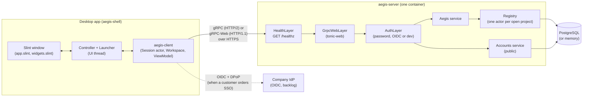

- The desktop app talks to one server. The server owns all project state.
- The app speaks gRPC over HTTP/2, or gRPC-Web over HTTP/1.1. gRPC-Web is
  the default for `https://` addresses, because many proxies (and Railway's
  edge) only forward HTTP/1.1.
- TLS ends at the load balancer. The server speaks plain HTTP behind it. The
  server can talk TLS to PostgreSQL (`AEGIS_DB_TLS`).
- Login has three methods, chosen per deployment: `password` (test and
  small deployments), `oidc` (company SSO, backlog for customer projects),
  and `dev` (trusted header, development only).

## II.2 Crate graph

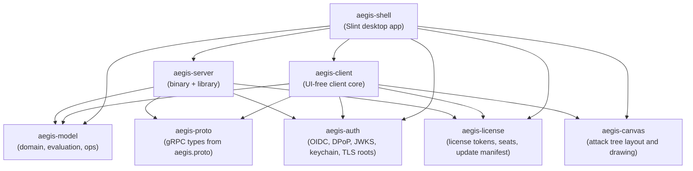

No crate depends on `aegis-shell`. `aegis-client` has no UI code, so every
client behavior is testable without a window (standards T-rules). The shell
tests start a real server in process. The shell also links `aegis-server` and
`aegis-license` itself, to run the embedded server of standalone mode (II.4.7).

## II.3 Wire contract (`crates/aegis-proto/proto/aegis/v1/aegis.proto`)

Two services.

**`Accounts`** is public. The auth layer lets `/aegis.v1.Accounts/` pass
without credentials.

| RPC | Purpose |
|---|---|
| `GetLoginOptions` | Says how to log in (`password`, `oidc` with issuer and client ID, or `development`), the server name, and `password_enabled`: a user name and password are also accepted. For `password` it is true, for `development` false, for `oidc` it follows the admin switch (II.4.3). |
| `LogIn` | User name + password + client name. Returns a session token, its lifetime and `UserInfo`. Answers `UNAUTHENTICATED` with one fixed message for every failure, and `RESOURCE_EXHAUSTED` with `retry-after` when throttled. |

**`Aegis`** needs a principal on every call.

| Group | RPCs |
|---|---|
| Server | `GetServerInfo`, `GetMethodology` |
| Projects | `CreateProject`, `ListProjects`, `OpenProject` (stream of chunks), `RenameProject`, `DeleteProject` (admin) |
| Edit lock | `AcquireLock`, `RenewLock`, `ReleaseLock`, `BreakLock` (admin) |
| Editing | `SubmitOps` (batch, at most `max_batch_ops`) |
| Looking | `GetProjectStatus` (newest sequence number and lock holder; no lease needed) |
| Results | `GetRisks`, `VerifyAudit` (admin) |
| Versions | `CreateBaseline`, `ListBaselines`, `GetBaseline` (stream of chunks) |
| Figures | `PutFigure`, `ListFigures`, `GetFigure` (stream of chunks), `UpdateFigure`, `DeleteFigure` |
| History | `ListHistory` (newest ops, capped by `max_history`) |
| Exports | `RecordExport` (writes an audit event; the file is made on the client) |
| Me | `WhoAmI`, `LogOut`, `ChangePassword` |
| Users (admin) | `ListUsers`, `CreateUser`, `UpdateUser`, `DeleteUser` |
| Event log (admin) | `ListEvents` (limit 0 = 200, capped at 1000; newest first; `no_event_log` when the server has no accounts) |
| Login switch | `GetServerSettings` (any logged-in user), `SetPasswordLogin` (admin). `ServerSettings { password_login_enabled, company_login_available }` |

There is no live stream (decision D23, job 108). A read-only client sees
the version it loaded; every `version_check` (30 s) it calls
`GetProjectStatus` and, if the server is ahead, offers a reload. Only
`OpenProject` and `GetBaseline` stream, and they end by themselves.

## II.4 Server (`crates/aegis-server`)

### II.4.1 Request path

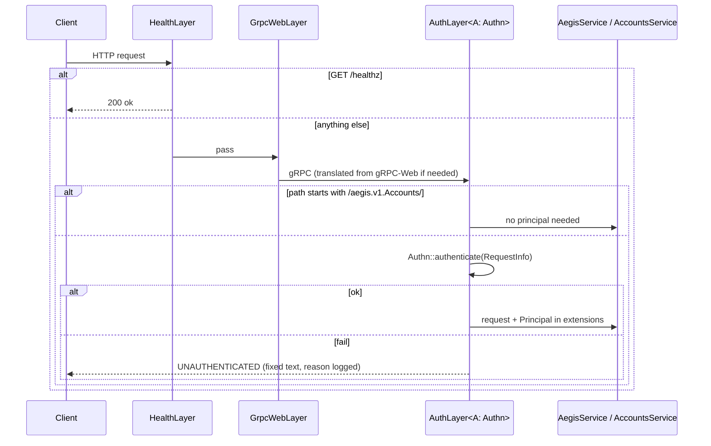

`server::router(service, public, auth)` builds this stack. `server::builder()`
sets the transport limits: `accept_http1(true)`, `CALL_TIMEOUT = 30 s`,
`MAX_CONCURRENT_PER_CONNECTION = 64`, HTTP/2 keep-alive 30 s / 10 s,
`TCP_NODELAY` (R6).

### II.4.2 Modules and types

| Module | Types | Notes |
|---|---|---|
| `main.rs` | | Reads environment variables (table in the module docs), opens the store and accounts, loads the license, restores seats, serves. `aegis-server import-folder <folder>` imports a standalone project folder instead of serving (II.4.7). `PORT` (Railway) means `0.0.0.0:$PORT` when `AEGIS_LISTEN` is unset. |
| `server.rs` | `Layers<A>`, `builder()`, `router()` | See II.4.1. |
| `health.rs` | `HealthLayer`, `Health<S>` | Answers `GET /healthz` before any other layer. |
| `auth.rs` | `AuthMethod { Oidc, Password, Dev }`, `Principal { subject, admin, method, groups }` | The principal is what every handler sees; `groups` carries SSO group names for role mapping (ACC-02, ADR 0061). |
| `auth_layer.rs` | `RequestInfo { headers, method, url }`, trait `Authn`, `OidcAuthn<H>`, `PasswordAuthn(Arc<Accounts>)`, `HybridAuthn<H>`, `DevAuthn`, `AuthLayer<A>`, `Authenticated<A, S>` | Static dispatch over the method (D11). |
| `accounts/mod.rs` | `Accounts`, `AccountBackend { Memory, Postgres }`, `UserRecord`, `SessionRecord`, `SessionKey`, `AuditKind`, `AuditEvent`, `AccountsConfig`, `NewSession`, `UserUpdate`, `LoadedAccounts`, `AccountError` | Users and sessions, see II.4.3. |
| `accounts/password.rs` | `PasswordRule`, `hash()`, `verify()`, `decoy()` | Argon2id: 19 MiB, 2 passes, 1 lane. At least 10 characters, at most 256 bytes. |
| `accounts/memory.rs`, `accounts/postgres.rs` | `MemoryAccounts`, `PostgresAccounts` | Storage backends. Postgres shares the project store's pool. |
| `accounts/service.rs` | `AccountsService`, `LoginOptions`, `PUBLIC_PATH_PREFIX`, `RETRY_AFTER_HEADER` | The public `Accounts` gRPC service. |
| `service.rs` | `AegisService<S>` | All `Aegis` handlers. Maps `ServerError` to a status. `with_accounts()` adds the account calls. |
| `access.rs` | `Access`, `Permission { Read, Write, Manage, Admin }`, `Member` | Built-in role table and per-project membership; `AegisService` checks `Permission` before every project RPC (`ACC-01`, ADR 0061). |
| `registry.rs` | `Registry<S>` | Owns the open project actors (map of `ProjectId` to `ProjectHandle`), caps (`max_open_projects`, `max_projects`), name checks, baselines, seat restore. |
| `actor.rs` | `ProjectHandle`, `OpenData`, `Status`, `RiskReport`, `ThreatRiskRow`, `Loaded` | One task per open project (C1). Bounded mailbox (`mailbox`, R4). Commands include `Status`, `Rename` and `Delete`. `Status` answers from memory (nothing is serialized). |
| `lease.rs` | `LeaseToken`, `Grant`, `LeaseState` | Edit lock with expiry (`lease`, default 120 s). |
| `license.rs` | `LicenseGate`, `LoadError`, `ClockSecs` | License check and seat ledger, `restore()` from recent editors. |
| `methodologies.rs` | `Methodologies`, `HostedMethodology`, `PackLoadError` | Built-in packs plus `AEGIS_PACKS_DIR`. |
| `config.rs` | `ServerConfig` | Every limit in one place, see II.4.4. |
| `store/mod.rs` | trait `ProjectStore`, `ProjectMeta`, `StoredOp`, `StoredSnapshot`, `LoadedProject`, `BaselineMeta`, `FigureMeta`, `FigureRecord`, `StoreFault` | Storage interface. |
| `store/blob.rs` | `SanitizedFigure`, `validate_and_sanitize_figure()`, `validate_caption()`, `validate_target()`, `MAX_FIGURE_BYTES` (5 MiB), `MAX_FIGURES_PER_PROJECT` (64), `MAX_PROJECT_FIGURES_BYTES` (50 MiB), `MAX_FIGURE_CAPTION_CHARS` (512), `MAX_IMAGE_DIMENSION` (16,384) | Validates PNG/JPEG headers and dimensions, sanitizes static SVGs (strict tag/attribute allowlist, no scripts/foreignObject/external URLs), and computes SHA-256 digests (`ARC-01`, ADR 0058). |
| `store/memory.rs` | `MemoryStore` | Tests and development. |
| `store/postgres.rs` | `PostgresStore`, `PostgresOptions`, `DbTls { Off, Encrypt, Verify }` | Both `Encrypt` and `Verify` verify the server certificate and hostname against OS roots or `PostgresOptions.ca_file` (`AEGIS_DB_CA_FILE`, capped at 1 MiB, `SEC-05`, ADR 0054). |
| `store/audit.rs` | `Hash`, `ChainVerifier`, `ChainReport`, `EventChainVerifier`, `event_genesis`, `event_link` | SHA-256 hash chain over stored ops (`aegis-audit-v1`) and server audit events (`aegis-event-v1`, `SEC-06`, ADR 0054). |
| `store/folder.rs` | `FolderStore`, `STREAM_BATCH_OPS`, `STREAM_BATCH_BYTES` | `ProjectStore` over one project folder (including `figures/<id>.bin` and `figures/<id>.json`), for standalone mode (II.4.7). |
| `import.rs` | `ImportReport`, `ImportError`, `Registry::import_folder` | Copies a standalone folder into the server's store with its history, baselines, and figures intact (II.4.7). |
| `ids.rs` | `ProjectId`, `BadProjectId` | |
| `error.rs` | `ServerError` | |

`ProjectStore` methods: `create`, `list`, `count`, `load`, `append`,
`verify_chain`, `save_snapshot`, `rename`, `delete`, `recent_ops`,
`active_editors`, `create_baseline`, `list_baselines`, `load_baseline`,
`put_figure`, `list_figures`, `load_figure`, `update_figure`, `delete_figure`.

`BaselineMeta { id, project, name, seq, created_by, created_ms, snapshot_bytes }`.
`FigureMeta { id, project, media_type, caption, target, width, height, byte_len, sha256, created_by, created_ms }`.

### II.4.3 Accounts

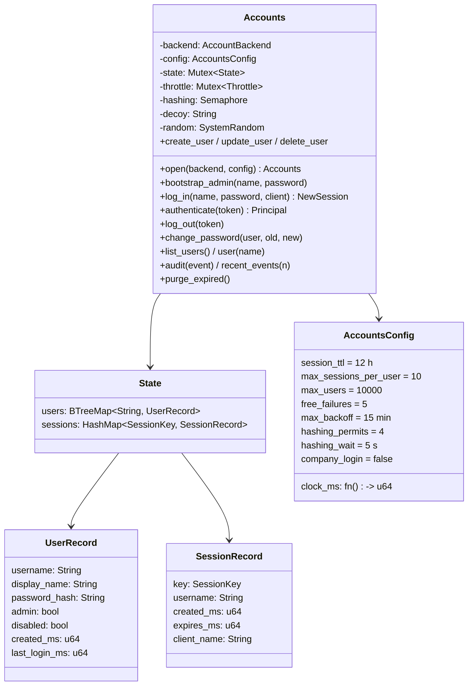

Rules the code follows:

- **Tokens.** A token is `ats_` plus 32 random bytes (base64url). Only its
  SHA-256 (`SessionKey`) is stored. Sessions end at an absolute time (no
  sliding). `spawn_purger` removes expired sessions.
- **Passwords.** Argon2id hashing runs on `spawn_blocking` (R5), behind a
  semaphore of `hashing_permits` with a `hashing_wait` timeout (R4, R6), with a
  per-address admission gate (`AddrThrottle`, `SEC-04`) in front of `LogIn` and
  a separate `auth_hashing` pool for authenticated operations. An unknown user
  name is checked against a decoy hash, so timing does not tell whether a user
  exists.
- **Throttle.** Per user name: after `free_failures` failures the wait
  doubles from 1 s up to `max_backoff`. The map is capped (R3) and evicts a
  single entry (preferring unknown and unblocked names, never clearing all,
  `SEC-01`) when full.
- **Locks.** The state mutex is never held across an `.await` (C2). The
  in-memory state is a cache of the backend and is rebuilt at start (D10).
  Multi-table account/session mutations run in one database transaction with
  in-memory rollback on error (`SEC-07`).
- **Safety.** The last enabled admin cannot be removed, disabled or demoted.
  Disabling a user or changing a password ends that user's sessions.
- **Audit.** `AuditKind`: `login_ok`, `login_failed`, `logout`,
  `password_changed`, `user_created`, `user_updated`, `user_deleted`,
  `export`, `project_deleted`, `baseline_created`,
  `password_login_changed`, `events_trimmed`. Hash-chained in `server_events`
  and verified by `VerifyAudit` (`SEC-06`). Never a password or token.
- **Login switch (job 045, ADR 0039).** `AEGIS_AUTH=both` runs the company
  login (OIDC) and password login side by side: `HybridAuthn` sends a bearer
  token with the `ats_` prefix to `PasswordAuthn` and everything else to
  `OidcAuthn`. `Accounts` holds an `AtomicBool` `password_enabled`
  (default on, stored as the `password_login` row of `aegis_setting`, loaded
  by `LoadedAccounts.password_login`). `set_password_login` first stores the
  value; when turning off it also deletes every session. While off,
  `authenticate` answers `None` and `log_in` answers
  `AccountError::PasswordLoginOff` (`password_login_off`,
  `FAILED_PRECONDITION`). Turning it off without
  `AccountsConfig.company_login` is refused as `NoCompanyLogin`
  (`no_company_login`), so nobody locks the server. `AEGIS_PASSWORD_LOGIN=on|off`
  forces the value at start, the way back in if the company login breaks.
  With `AEGIS_AUTH=oidc` there are no accounts and the form is always off.

### II.4.4 Limits (`ServerConfig`)

| Field | Default | Rule |
|---|---|---|
| `lease` | 120 s | Edit lock lifetime |
| `idle_unload` | 15 min | Unload a project actor nobody uses |
| `mailbox` / `mailbox_wait` | 64 / 5 s | R4 |
| `snapshot_every` | 1000 ops | Snapshot cadence |
| `max_batch_ops` | 1024 | Ops per `SubmitOps` |
| `max_open_projects` / `max_projects` | 256 / 10 000 | R3 |
| `chunk_bytes` | 256 KiB | Stream chunk size |
| `max_project_name_chars` | 256 | |
| `max_baselines` | 1 000 per project | R3 |
| `max_history` | 500 | `ListHistory` rows |

(The defaults are in `config.rs`; that file is the source of truth if this
table and the code ever differ.)

### II.4.5 Database schema

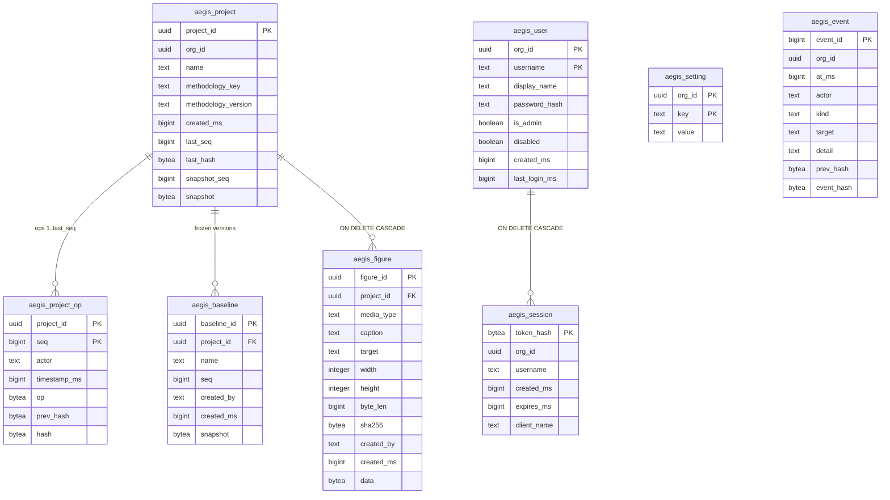

Migrations: `001_init.sql` (projects and ops), `002_accounts_baselines.sql`
(users, sessions, events, baselines, op time index), `003_settings.sql`
(`aegis_setting`: key and value per organization; today only
`password_login` = `on` or `off`, no row means on), `004_event_chain.sql`
(adds `prev_hash` and `event_hash` to `server_events` for `SEC-06` hash-chain
verification), `005_figures.sql` (`aegis_figure` attachment table, `ARC-01`).
Deleting a project deletes its baselines, figures, and ops in one transaction.

### II.4.6 Seat restore

The license counts active editors in a rolling window (`SEAT_WINDOW_SECS`).
After a restart the ledger would be empty, so a restart could let extra
editors in. At start the server reads `active_editors` (distinct actors with
ops inside the window, from the `aegis_project_op_time` index) and calls
`LicenseGate::restore()`. The ledger is derived state rebuilt from the store
(D10).

### II.4.7 Project folders and import (standalone mode, D22)

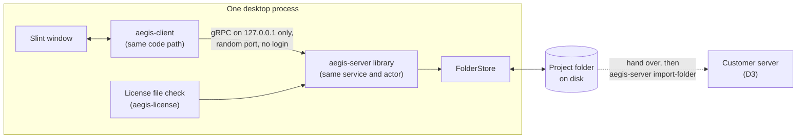

The standalone app is the same client talking to the same server code; only
the store and the login differ. The app checks the signed license file
(`TrustedKeys::vendor()`) **before** it binds the listener, then binds
`127.0.0.1:0` only. A bad license, a damaged folder or an unreadable manifest
never opens a port. The embedded server trusts the development header: any
process of the same machine that finds the port can act as the user. That is
the cost of "no login" on a single-user desktop (D22); it is not reachable
from the network.

**Folder layout** (`store/folder.rs`, one project per folder):

| File | Content |
|---|---|
| `ops.jsonl` | An `aegis-oplog` v1 stream, byte for byte what `OpLogWriter` writes: header line, then `{"seq":N,"op":{...}}` per accepted op. `OpLogReader` reads it. |
| `ops.meta` | Sidecar, same order: magic `AEGISOP1`, then per op `seq`, acceptance time, actor length, `prev` and `hash` of the audit chain, and the actor. These four facts are not in the op-log format. |
| `snapshots/<uuid>.aegis` | `Project::save` bytes: the current snapshot and one per baseline. Never rewritten; a new snapshot gets a new name. |
| `manifest.json` | The commit record, replaced atomically (write, fsync, rename, fsync the folder): project facts, `last_seq`, chain head, the snapshot name, size and SHA-256, and the baseline list. |
| `.aegis.lock` | OS file lock. One `FolderStore` (and its clones) owns a folder; a second open fails, also from another process. |

**Commit and recovery.** The manifest rename is the commit point. An append
writes and syncs the log, then the sidecar, then commits the manifest, so
ops past `last_seq` are uncommitted. Opening a folder reads the committed
history once (so damage is found at open and reported as `Corrupt`, never
repaired), cuts both files back to the committed lengths, and deletes
snapshot files and manifest temporaries that the manifest does not name. The
store keeps the committed lengths in memory, so a failed append is undone
before the next one in O(1), and an append never re-reads the log.
`ProjectStore` guarantees hold as for the other backends: atomic batches, gap
free sequence, `Sequence` on a stale writer, `verify_chain` over the stored
bytes. Reads that walk the history (`load`, `recent_ops`, `verify_chain`,
`active_editors`) stream it once: time O(history), space O(result). The
ceiling is a linear scan per call; a byte-offset index would make
`recent_ops` O(limit) if a standalone log ever grows that large.

**Import** (`Registry::import_folder`, command `aegis-server import-folder
<folder>`) copies; it does not replay. The project keeps its ID, every op
keeps its bytes, actor and acceptance time, the audit chain is recomputed
over identical inputs and so comes out identical, the folder's snapshot is
reused and baselines keep their IDs, names, authors and snapshots. Steps:
check the methodology is hosted at the same version, verify the folder's
chain, check the server's project limit, create the project from an empty
snapshot, stream the ops in batches of at most 256 ops or 4 MiB (memory
O(batch)), save the snapshot, copy the baselines, then compare the result:
chain head and count, stored state against the folder's, and a rebuild through
`Loaded::rebuild`. Any failure after the project exists deletes it again. A
project ID the server already holds is refused untouched. Imported actors keep
their names, so if their edits are inside the license's seat window they hold
a seat after the next start (II.4.6).

## II.5 Client core (`crates/aegis-client`)

### II.5.1 Modules and types

| Module | Types | Notes |
|---|---|---|
| `transport.rs` | `TransportKind { Grpc, GrpcWeb }`, `Transport { Grpc(Channel), Web { client, origin } }`, `check_url()` | `auto`: gRPC-Web for `https://`, gRPC otherwise. HTTPS uses rustls with the OS trust store. `CONNECT_TIMEOUT = 10 s`, `CALL_TIMEOUT = 30 s`. |
| `connection.rs` | `Connection<P>`, `ServerInfo`, `Downloaded`, `Public`, `LoginMethod { Password, Oidc { issuer, client_id, resource }, Development }`, `LoginOptions { method, server_name, password_enabled }`, `PasswordSession { token, expires_in, user }`, `PasswordLogin`, `DevLogin` | One typed call per RPC. `Public` reaches only the `Accounts` service. `PasswordLogin` holds the token and sends it as `authorization: Bearer`. |
| `error.rs` | `ClientError`, `ServerCode` | `ServerCode` maps status details to cases the UI can explain (`InvalidCredentials`, `Throttled { retry_after_s }`, `PasswordLoginOff`, `LockHeld`, ...). |
| `session.rs` | `Session`, `SessionConfig { user, clock_ms, retry_delay, transport, on_log_out, version_check, update_url, update_checker }`, `LogOutHook` | The session actor: one task owns the connection, the workspace and the edit lock; the UI sends `Command`s (`LoadEvents` among them) and watches `ViewModel` (C1, R4). Reconnects with epochs, so late answers from an old connection are dropped. Caches `cached_scene: Option<(TreeId, bool, Arc<Scene>)>` and `cached_lint_count: Option<usize>` on `Open` (invalidated on workspace mutations) so node selection and page switches reuse the Sugiyama layout and lint count in $O(1)$. |
| `workspace.rs` | `Workspace`, `Submission`, `Origin`, `WorkspaceError`, `MAX_SUBMIT_OPS` | Optimistic local copy. Local ops apply at once and are kept with their inverses until the server confirms. Pending ops are sent in batches of at most `MAX_SUBMIT_OPS`, so a long offline queue is never rejected as too large. `apply_labeled()` takes the label an edit gets in the undo list; a bulk edit passes `Label::bulk` ("remove 3 assets", UI-04). |
| `folder.rs` | `WorkspaceFolder`, `FolderError`, `SaveReport` | A workspace folder on disk: open with caps and a lock, changed-only journaled saves, recovery on open (ADR 0071). |
| `commands.rs` | `Edit`, `EditError`, `Command`, `GATES` | `Edit` is a user intent (add asset, rate a step, link a control, interactive tree node rename/gate change/add child/branch leaf step to gate/insert parent gate/add sibling/reorder/delete, ...). It expands to model `Op`s, including safe cascades (deleting an asset first unlinks what uses it). `Command` is everything the UI can ask of the session. `Edit::Batch(Vec<Edit>)` is several edits as one (UI-04): `to_ops` joins their ops, so the batch is one undo step and one redo and is refused whole if any item is; each item is built against the project before the batch, so an item that needs another one first (an asset and its threats) is refused. `Edit::bulk_label()` names it for the toast and the Undo tooltip. |
| `outline.rs` | `OutlineError`, `parse()`, `render()` | Text outline editor for attack trees (indent = child, `OR`/`AND`/`SEQ` gates, `- ` steps; lines with the same text are one shared node). The first line is always the tree's root. A step line may end with ` | through: C00 | type: key`, applied by `ReplaceTree` as `SetStepVia` and `SetStepAttackType`; the names there are `parse_outline`, `to_outline`, `parse_outline_annotated`, `to_outline_annotated`. |
| `library.rs` | `InsertMode`, `InsertOptions`, `insert_ops()`, `matching_labels()`, `LibraryView` | Copies a library item into the project as one batch (new tree, under a gate, in place of a step; origin note; ratings marked for review; no silent merging of names; a suggested attack type is filled in on the copy and counted in the origin note) and holds the Library panel's search, facet and pick state (ADR 0052). |
| `suggest.rs` | `Gear1Predictor`, `SuggestionRow`, `suggest_tree_nodes()`, `suggestion_rows()`, `MAX_MODEL_ARTIFACT_BYTES` | Runs Aegis-Core Gear 1 multi-head attack-tree inference (`tools/aegis-ai/artifacts/gear1_model.json` or built-in compact weights), verifies candidate steps against a cloned `Project`, and builds a `SuggestionBranch` for canvas ghost nodes and the inspector panel (ADR 0055). |
| `tree_diff.rs` | `replace_tree_ops()`, `clear_step_ops()`, `add_child_ops()`, `branch_step_ops()`, `insert_parent_gate_ops()`, `add_sibling_ops()`, `move_node_ops()`, `remove_node_ops()` | Reconciles outline edits and interactive node-level tree expansions (leaf/end and intermediate insertions, branching, sibling reordering, and subtree removal with shared-descendant reparenting) into minimal valid node ops using a Fenwick-tree Maximum-Weight Increasing Subsequence (`mwis_mask`) and `transfer_step_ops()` to preserve ratings, factors, controls, and review marks in one undo step (ADR 0014, job 065). |
| `excel.rs` | `ExcelWorkbook`, `ExcelSheet`, `ExcelMapping`, `ExcelColumn`, `ExcelPreview`, `UnmappedRow`, `ExcelError`, `read_workbook()`, `preview_import()`, `MAX_XLSX_*` | Dependency-free `.xlsx` reader (ZIP central directory + `flate2` Deflate + XML shared-strings/worksheet parser), bilingual header auto-detection (`auto_detect`), dry-run preview with unmapped rows, and single-batch import stamped with `ProvenanceSource::Import` (`INT-02`, ADR 0060). |
| `pages.rs` | `Vocabulary`, `Overview`, `ComponentRow`, `ComponentDetail`, `InterfaceRow`, `InterfaceDetail`, `DataFlowRow`, `DataFlowDetail`, `TrustBoundaryRow`, `TrustBoundaryDetail`, `AssetRow`, `AssetDetail`, `DamageRow`, `DamageDetail`, `ThreatDetail`, `RiskRow`, `TreeRow`, `ControlRow`, `ControlDetail`, `GoalRow`, `ClaimRow`, `GoalDetail<Id>`, `ProblemRow`, `Comparison`, `DiffLine`, `Count`, `Choice<Id>`, `LinkRow` | Pure functions from a `Project` to rows and details, one per TARA page. Sorted with `BTreeMap` where order reaches the screen (D7, P4). |
| `view.rs` | `Page` (14 pages, incl. `Page::Item`), `Selection` (incl. `Component`, `Interface`, `DataFlow`, `TrustBoundary`, `TreeNode(TreeId, NodeId)`), `AdminAction` (incl. `SetPasswordLogin`), `UiState`, `Inspector`, `TreeView`, `RiskView`, `ThreatRow`, `MitigationView`, `FactorView`, `Choice`, `tree_view_cached()` | What the window shows for the current page and selection, including item-definition inspectors, figure attachment filtering, Excel import preview state, and interactive node expansion metadata (`is_root`, `gate_index`, `can_move_up`, `can_move_down`) in `Inspector`. |
| `state.rs` | `ViewModel`, `ProjectView`, `PageData`, `ConnectionView`, `SyncView`, `Mode`, `LicenseView`, `LicenseKind`, `Notice`, `Severity`, `ProjectEntry`, `BaselineRow`, `FigureRow`, `ExcelPreviewView`, `ExcelUnmappedRow`, `HistoryRow`, `Me`, `UserRow`, `ServerSettingsView`, `NumbersCheck` (`ViewModel` also has `events`, `events_error`; `LicenseView` has dates, features and `lines()`) | The whole UI state, published on a `watch` channel. |
| `report/mod.rs` + `report/{doc,html,pdf,csv,xlsx,profile}.rs` | `ReportDoc`, `Block`, `Style`, `Figure`, `FigureAttachment`, `Panel`, `report_doc`, `report_doc_with_options`, `report_html`, `report_html_with_options`, `report_pdf`, `report_pdf_with_options`, `report_workbook_xlsx`, `risk_register_xlsx`, `risk_register_csv`, `tree_svg`, `ReportProfile`, `ReportOptions`, `ReportContext`, `ExportKind { Report, ReportPdf, ReportXlsx, RiskRegister, TreeSvg }`, `PdfError`, `MAX_PAGES` | One document model for HTML, PDF and XLSX (RPT-01, ADR 0056); section/filter/language/branding profiles (RPT-02 to RPT-04, including Item Definition section and component filter); the XLSX writer is a dependency-free ZIP of stored XML with the CSV formula guard (RPT-05). `krilla` writes the PDF with Inter plus a Noto Sans JP fallback (OFL) and renders `Block::Image` figures via `krilla::image::Image` (`from_png`, `from_jpeg`, and deterministic static-SVG `from_rgba8`, `RPT-06`, ADR 0058). |
| `i18n.rs` + `locales/{en,ja,pseudo}/main.ftl` | `Language`, `Catalog`, `Language::from_os()` | Fluent catalogs for pages, errors and reports; the report builder picks one per `ReportLanguage`. Missing keys render `[id]`; bidi marks are stripped (ADR 0057). |
| `settings.rs` | `Settings { server_url, transport, username, export_dir, update_url, standalone_folder, standalone_license, report_profiles, report_profile_name, language }`, `export_file_name()`, `write_private_file()`, `language()`, `report_profile()` | JSON in the OS config folder. Read capped at 64 KiB (R3). Atomic private write (`create_new`, `0600` on Unix, symlink check, `SEC-09`). Never a password or token. |
| `time.rs` | `date_ms()`, `date_time_ms()`, `format_ms_lang()` | UTC dates without a time crate; Japanese dates via `format_ms_lang` (L10N-05). |
| `audit.rs` | `EventRow`, `EventGroup { Logins, Exports, AdminActions, Other }`, `event_row`, `filter` | Event log entries in plain words, for the administration page (job 049). |
| `updates.rs` | `UpdateChecker`, `UpdateOffer`, `UpdateStatus`, `UpdateError`, `fetch_manifest` | Signed update manifest check. `fetch_manifest` GETs it over HTTPS with the `aegis-auth` client (no redirects, 10 s, 1 MiB; manifest at most 32 KiB; `https://` or loopback `http://` only). `Command::CheckForUpdates` runs it in the background and answers with a notice. The address is `Settings.update_url`, or `AEGIS_UPDATE_URL`; empty means none (air gapped). |
| `examples/smoke.rs` | | Smoke test of a running server: login options, password login, `WhoAmI`, `ListProjects`, logout (`docs/railway.md`). |

### II.5.2 Edit flow

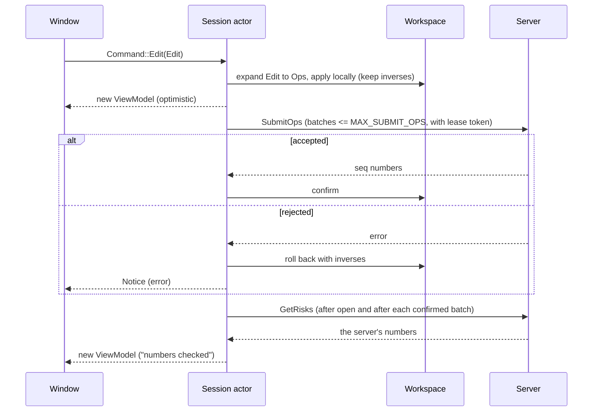

A lost lease shows in the answer to `RenewLock` (every third of the lease) or
to a save; either one rolls back unsaved edits and reloads read-only.
`GetRisks` is asked once at a time: a batch confirmed while a call is in
flight asks again when it returns.

### II.5.2a Read-only view and the newer version (D23)

```mermaid
sequenceDiagram
    participant UI as Window
    participant S as Session actor
    participant Srv as Server
    S->>Srv: OpenProject (snapshot, last_seq, lock holder)
    loop every version_check, read-only only
        S->>Srv: GetProjectStatus
        Srv-->>S: last_seq, lock holder
    end
    Note over S: last_seq ahead of confirmed_seq sets newer_version
    UI->>S: Command::Reload
    S->>Srv: OpenProject (resync, read-only)
```

The view shows the version that was loaded; it never changes by itself. The
band says "A newer version is available" and offers Reload (also in the
Project menu). Taking the edit lock on an old copy reloads first
(the lease carries the sequence number it was granted at). An editor makes no
status calls: it is the only writer.

### II.5.3 Baselines and comparison

`Command::CreateBaseline(name)` calls `CreateBaseline`; the server freezes
the current snapshot. `Command::Compare(baseline)` downloads it with
`GetBaseline` (a chunk stream, size capped), loads it as a `Project`, and
calls `Project::diff` against the live project. `pages::comparison()` turns
the `ProjectDiff` into `DiffLine`s for the Versions page.

### II.5.4 Exports

The client writes the file into the export folder with a safe name
(`export_file_name`: no path separators, so it cannot leave the folder) and
then calls `RecordExport` with the export kind and the profile summary
(`RecordExportRequest.detail`), so the server's event log shows who exported
what, with which profile.

### II.5.5 Language layers (built 2026-10-26, jobs 066 to 068)

```mermaid
flowchart TB
    OS["OS locale"] --> PICK["User setting:\nUI language, report language"]
    PICK --> SLINT["Slint @tr catalogs\n(bundled .po, en/ja/pseudo)"]
    PICK --> FLUENT["aegis-client Fluent catalogs\n(pages, errors, reports)"]
    PACK["Methodology pack\nlabels"] --> PAGES["Pages and reports"]
    FLUENT --> PAGES
    PAGES --> REP["Report language:\nen, ja, bilingual"]
```

Per-language labels on methodology packs (`L10N-07`, `PackTranslationDef` in
`crates/aegis-model/src/methodology/pack.rs`) supply localized element-type
names and scale/vocabulary labels (`element_names_for_lang`,
`*_label_for_lang`) for `report/doc.rs`, with automatic fallback to the pack's
default English labels when a key is absent.

### II.5.6 Report pipeline (built 2026-10-26, jobs 070 to 073)

```mermaid
flowchart LR
    PRJ["Project or baseline"] --> DOC
    PROF["Report profile\n(sections, filters,\nlanguage, branding, marks)"] --> DOC
    FIG["Figures (display list +\nPNG/JPEG/SVG attachments)"] --> DOC
    DOC["ReportDoc\n(one model)"] --> HTML["HTML (TOC, anchors,\ndata-URI figures)"]
    DOC --> PDF["PDF (krilla, Inter +\nNoto Sans JP, PdfImage)"]
    DOC --> XLSX["XLSX"]
    DOC --> AUD["Export audit event\n(profile, kind)"]
```

## II.6 Desktop app (`crates/aegis-shell`)

| File | Types | Notes |
|---|---|---|
| `src/main.rs` | | Starts a 2-thread tokio runtime and the window (software renderer). Reads `AEGIS_URL`, `AEGIS_TRANSPORT`, `AEGIS_DEV_USER`, `AEGIS_DEV_ADMIN`. |
| `src/launcher.rs` | `Launcher` | Owns the login steps: server screen, ask the server for `GetLoginOptions`, password or company login, start the `Session`, log out, change server. Saves `Settings`. Network results come back on a bounded channel and are handled on the UI thread in `pump()`. |
| `src/standalone.rs` | `Standalone` | The embedded server: reads and verifies the license, opens the `FolderStore`, restores seats, binds loopback, serves the normal gRPC service until `stop()` (which waits for the snapshots). `Launcher::open_standalone`/`create_standalone` run it and connect the `Session` with the development login; File > New/Open project folder and the server screen start it. `AEGIS_STANDALONE=<folder>` (with `AEGIS_LICENSE_FILE`) starts in this mode. |
| `src/adapter.rs` | `DrawItem`, `draw_items()`, `draw_layers()` | Converts a `DisplayList` into Slint `DrawItem` models, coalescing consecutive `Path` items that share stroke token and width into a single SVG path command string and splitting paths, rects, and texts into separate typed layers (`draw-paths`, `draw-rects`, `draw-texts`). |
| `src/controller.rs` | `Controller`, `Hooks`, `PasswordLogIn` | Diffs the incoming `Arc<ViewModel>` against the previous `ViewModel` (`prev`), updates only changed Slint models, defers screen-reader `AccessNode` formatting during pointer drag (`redraw_inner`), and turns window callbacks (including interactive tree-node expansion) into `Command`s. |
| `src/provider.rs` | `AppProvider { Oidc, Password, Dev }`, `OidcProvider`, `OidcSettings`, `PasswordProvider` | Credentials for each call. `PasswordProvider` can keep the session token in the OS keychain ("keep me logged in"); the password itself is never stored. |
| `src/headless.rs` | `Headless`, `Frame` | Software-rendered window for tests and screenshots. |
| `ui/theme.slint` | `Theme` | Tactical Obsidian & Tungsten Crimson-Amber color palette (with runtime `dark` toggle), semantic risk/feasibility tokens, and typographic scale, weight, and tracking tokens. |
| `ui/app.slint` | `AppWindow` | Menu bar (File, Edit, View, Project, Admin, Help), TARA steps sidebar, one page per `Page`, inspector panel (including interactive attack-tree node editing and leaf/intermediate expansion), status band. Connection screens: `connection` 4 = server, 3 = log in, 1 = online. |
| `ui/canvas.slint` | `Canvas`, `DrawItem`, `AccessNode` | Draws the separated `draw-paths`, `draw-rects`, and `draw-texts` layers. For screen readers the focusable area is a `list` with one `list-item` per node on screen (`AccessNode`: box, sentence, selected, position, count), made by `aegis_canvas::access::visible` in `Controller::redraw`; the default action selects the node. The canvas label is the selected node's sentence. |
| `ui/widgets.slint` | shared widgets | `SplashHeader`, `PageTitle`, `SectionTitle`, buttons, fields, cards, badges, icons. |
| `ui/brand/*` | | Brand vector/raster assets, macOS `.icns` and Windows `.ico` bundles, monochrome stencil/tray icons, and splash header artwork. |
| `ui/icons/*.svg` | | Lucide icons, ISC license (`ui/icons/LICENSE-lucide.txt`), allowed by the license policy (D5). |

### II.6.1 Password login flow

```mermaid
sequenceDiagram
    participant U as User
    participant L as Launcher
    participant P as Public (Accounts)
    participant A as Accounts (server)
    U->>L: server address + transport
    L->>L: check_url()
    L->>P: GetLoginOptions
    P-->>L: Password, server name
    L-->>U: password form
    Note over L,U: With a company login and password_enabled the company<br/>login leads and "Use a user name and password" opens this form.<br/>"Use company login" asks the server again.
    U->>L: user, password, keep me logged in
    L->>P: LogIn
    P->>A: log_in (throttle, Argon2id, decoy)
    A-->>P: token, expiry, user
    P-->>L: PasswordSession
    L->>L: PasswordProvider.set(token), keychain if kept
    L->>L: start Session (user = server subject)
    L-->>U: projects page
```

The session user is set to the subject the server returns. The edit lock
holder is compared with it, so the band says "editing" and not "someone
else".

## II.7 Other crates

| Crate | Main types | Role |
|---|---|---|
| `aegis-auth` | `OidcClient`, `Session<H, S>`, `Authenticator<H>`, `AccessTokenValidator<H>`, `DpopVerifier`, `DeviceKey`, `JwksCache<H>`, `Vault<S>`, `OsKeychain`, `HyperClient`, `tls::{system_roots, client_config, config_with_roots, https_connector, https_connector_with}`, `HyperClient::with_tls_config` | OIDC with PKCE and DPoP for SSO, token validation on the server, keychain access, and the shared rustls setup (OS trust store, ring). |
| `aegis-license` | `License`, `LicenseState`, `TrustedKeys`, `Issuer`, `SeatLedger`, `Admission`, `Manifest`, `Version`, `Artifact`, `Offer` | Signed license tokens, seat counting (`restore()` after restart), signed update manifests. |
| `aegis-canvas` | `access::{NodeAccess, VisibleNode, describe, sentence, visible}`, `Scene`, `Layout`, `Forest`, `DisplayList`, `Item`, `Viewport`, `SpatialIndex`, `Tone`, `Paint`, `Stroke`, `SvgOptions`, `RenderOptions` | Attack tree layout, hit testing, pixel and SVG drawing. `Tone` is `Ord`, so it can be a sort key. |
| `aegis-proto` | generated | `tonic` and `prost` code from `aegis.proto`. |

## II.8 Deployment

| File | Purpose |
|---|---|
| `deploy/Dockerfile` | Two-stage build. `ARG CARGO_FEATURES` (for example `dev-license` on the test server). Runs as a non-root user. `ENV PORT=50051`. |
| `railway.json` | Railway: Dockerfile builder, health check `/healthz`, restart on failure (5 tries). |
| `deploy/compose.test.yaml` | Local test stack: server with password login and dev license, PostgreSQL. |
| `docs/railway.md` | How the Railway test server is set up and used. |

## II.9 Guideline map

| Rule | Where it shows |
|---|---|
| R3 caps | `ServerConfig`, `AccountsConfig.max_users`, throttle map cap, settings read cap, stream size caps, `MAX_SUBMIT_OPS` |
| R4 bounded queues | actor mailbox, launcher event channel, hashing semaphore |
| R5 blocking work off async | Argon2id on `spawn_blocking` |
| R6 timeouts | `CALL_TIMEOUT` (server and client), `CONNECT_TIMEOUT`, `hashing_wait`, `mailbox_wait`, `version_check` (client, 30 s) |
| C1 one owner | project actor, client session actor |
| C2 no lock across await | `Accounts` state and throttle mutexes |
| D7 ordered output | `BTreeMap` in `pages.rs` and `Accounts` users |
| D10 derived state | accounts cache, seat ledger, project evaluation caches |
| D11 enum dispatch | `AccountBackend`, `AppProvider`, `Transport`, `DbTls` |
| P4 determinism | page rows sorted by stable keys, reports in fixed order |
| Q3 no unwrap in library code | library code returns typed errors; `expect` only in tests and with a proven, commented invariant |

---

# Part III: the target system (planned, not built)

Part III is the architecture for the work in
[requirements.md](requirements.md) (decisions D12 to D24, jobs 057, 058 and
060 onward). **Rule for maintainers: when a job builds a part described
here, move that part into Part I or Part II in the same commit and delete it
here.** Nothing in Part III is a promise about field names; the job's spec
and ADR decide those.

## III.1 Target system context

```mermaid
flowchart LR
    subgraph Desktop["Desktop app (aegis-shell + aegis-client)"]
        UI["Slint window\n@tr catalogs (en, ja)\ncommand palette, inspector,\nlibrary panel, AI panel"]
        CORE["aegis-client\nsession, workspace,\nFluent catalogs,\nreport model -> HTML/PDF/XLSX,\nReqIF and Excel import"]
        UI <--> CORE
    end
    subgraph Server["aegis-server (customer hosted, one container)"]
        ACCESS["Access check\n(roles + membership, D19)"]
        SVC["Aegis service\n(projects, ops, baselines)"]
        BLOB["Attachment store\n(figures, capped)"]
        LIB["Library service\n(packs, company items,\nn-gram index, facets)"]
        GW["AI gateway (D12)\npolicy, context builder,\noutput check, AI audit"]
        CON["Connector worker (D18)\nJira, Polarion, JAMA\nbounded queue, timeouts"]
        SEC["Secret store\n(provider keys, connector\ntokens, encrypted)"]
        ACCESS --> SVC & BLOB & LIB & GW & CON
        GW --> SEC
        CON --> SEC
        GW --> LIB
    end
    DB[("PostgreSQL")]
    MODELS["Models chosen by the customer\nOpenAI-compatible (vLLM, llama.cpp,\nOllama, Azure OpenAI) or\nAnthropic (direct, Bedrock, Vertex)"]
    ALM["ALM tools\nJira, Polarion, JAMA"]
    FILES["Files\nReqIF, XLSX, PDF, HTML,\nlibrary packs"]
    CORE -- "gRPC / gRPC-Web" --> ACCESS
    SVC & BLOB & LIB & GW & CON --> DB
    GW -. "opt-in, per provider policy" .-> MODELS
    CON -. "opt-in, per project" .-> ALM
    CORE <--> FILES
```

## III.2 Where new code goes

No new crate is planned. Each part starts as a module in the crate that
owns its data; a module moves into its own crate only when a second consumer
appears (the trigger is named in the table).

| Crate | New modules | Holds | Split trigger |
|---|---|---|---|
| `aegis-model` | `text.rs` | `Text { value, lang, translations }`: a language tag and translations on top of the description text of job 064 (FND-04) | |
| | `trace.rs` | `Requirement`, `Verification`, `TraceLink`, `ExternalRef`, suspect state (TRC-01 to TRC-03) | |
| `aegis-canvas` | `diagram.rs` | Data-flow diagram layout and drawing into the same display list (ARC-03) | |
| `aegis-proto` | new RPC groups | Access, library, report profiles, AI (suggest stream, accept, reject), connectors | |
| `aegis-server` | `access.rs` | Role table and membership, checked before every RPC (ACC-01) — **built** (`crates/aegis-server/src/access.rs`, ADR 0061; see Part II.4.2) | |
| | `library.rs` | Company library: states, publish permission, usage counts (LIB-05, LIB-06) | |
| | `secrets.rs` | Encrypted credentials, key from the environment or the cloud key service | |
| | `ai/` | Gateway: `Provider` enum over two adapters (rule D11 enum dispatch), policy table, context builder, schema and citation check, AI audit (AI-01 to AI-05) | `aegis-ai` crate when the MCP server (AI-10) needs it outside the server |
| | `connect/` | Connector worker: one adapter per ALM tool, field mapping, push and status pull (INT-03 to INT-06) | |
| `aegis-client` | `reqif.rs` | ReqIF exchange (INT-01) | |
| `aegis-shell` | `ui/` (panel slots, command palette, history panel, bulk edit) | UI-01 to UI-04 — **built**; bulk edit keeps the picked rows in `controller.rs` by element ID (`Table`, `click_marks`) and shows them through `Marks` on `DataTable` (job 084) | |
| `aegis-model` | `methodology/` (extended) | Catalog packs with text (DOM-04) — **built** as `catalog_pack.rs` and `methodology/stride.rs`, ADR 0062 | |
| `aegis-model` | `applicability.rs` | `Condition`, `Assumption`, `AttackFilter`, derived `Applicability` with reasons (APL-01 to APL-08, D27; III.6) | |
| | `blocks.rs` | `SharedStep`, the fragment role and references, bypass trees (BLK-01 to BLK-05, D29; III.7) | |
| | `party.rs` | `Party`, glossary terms, related documents, misuse cases: small project lists (FND-08, FND-11 to FND-13) | |
| `aegis-client` | `relations.rs` | The relation registry (D30; III.9.2) | |
| `aegis-server` | `review.rs` | Review notes outside the op log, hash-chained (REV-01 to REV-03) | |
| `aegis-canvas` | `trace_graph.rs`, `minimap.rs` | Column traceability graph (TRC-05) and the canvas minimap (UI-19) | |

Repository additions: `packs/catalogs/` (CAPEC, ATT&CK, EMB3D
where licenses allow). The i18n, report, figure attachment, item definition, and
Excel import additions named in an earlier version of this table are built
(`crates/aegis-model/src/item.rs`, `crates/aegis-server/src/store/blob.rs`,
`crates/aegis-client/src/excel.rs`, `crates/aegis-client/locales/`,
`crates/aegis-client/src/report/`, `crates/aegis-shell/translations/`,
`crates/aegis-client/assets/fonts/NotoSansJP-Variable.ttf`); see Part I and
II.4.2, II.5.1, II.5.5 and II.5.6.

## III.3 Target domain model (additions only)

```mermaid
classDiagram
    direction LR
    class Text {
        value: String
        lang: LangTag
        translations: BTreeMap~LangTag_String~
    }
    class Requirement {
        id: RequirementId
        name: String
        description: Text
        allocated_to: Vec~Allocation~
    }
    class Allocation {
        <<enum>>
        Item
        Component(ComponentIdx)
    }
    class Function {
        id: FunctionId
        name: String
        description: Text
        implemented_by: Vec~ComponentIdx~
    }
    class Verification {
        id: VerificationId
        method: VerificationMethod
        result: Option~VerificationResult~
    }
    class TraceLink {
        from: ElementRef
        to: ElementRef
        kind: TraceKind
        confirmed_seq: u64
    }
    class ExternalRef {
        system: ExternalSystem
        key: String
        url: Option~String~
        synced_ms: Option~u64~
    }
    CybersecurityGoal "1" <-- "*" Requirement : refines
    Requirement "1" <-- "*" Verification : verifies
    SecurityControl ..> Requirement : implements
    Requirement --> "*" Allocation : allocated to
    Function --> "*" Component : implemented by
```

ISO/SAE 21434 Figure 3 check (2026-11-07,
[design/reference-ui-review.md](design/reference-ui-review.md) section 8):
`Function` (ARC-06, job 160) and `Requirement::allocated_to` (TRC-06, job 077)
close the two missing links, and `ThreatScenario.goal` becomes a sorted
`goals` list (FND-14, job 161). The snapshot writes the old single `goal`
field when there is exactly one, so v1 fixtures and their files stay equal.

A link is suspect when its `from` element changed after `confirmed_seq`
(the op sequence number at confirmation). Suspect state is derived (D10),
never stored.

`VerificationMethod`, `VerificationResult` and `TraceKind`
are string keys from the methodology pack (D1: vocabulary is data).
`ExternalSystem` is Jira, Polarion, JAMA, ReqIF or a plain URL.

## III.4 AI suggestion flow

```mermaid
sequenceDiagram
    participant U as User (desktop)
    participant S as Server (access check)
    participant G as AI gateway
    participant P as Provider (customer's model)
    participant E as Engine + linter
    U->>S: Suggest(feature, selection)
    S->>S: role allows feature? project classification allows provider?
    S->>G: request with user's read scope
    G->>G: build context (only readable elements, catalogs, library), redact
    G->>P: prompt + JSON schema
    P-->>G: structured output
    G->>G: parse against schema, check every citation exists
    G->>E: turn into Ops, validate, lint
    E-->>G: valid ops + findings
    G->>G: AI audit row (model, refs, response, cost)
    G-->>U: SuggestionBranch (ghost nodes)
    U->>S: Accept(some) / Reject(rest)
    S->>S: accepted ops applied as normal ops, provenance = Ai + accepting user
```

The model never writes to the project, never sees elements the user cannot
read, and never computes a number.

## III.5 Connector push flow

```mermaid
sequenceDiagram
    participant U as User
    participant S as Server
    participant Q as Connector queue (bounded)
    participant A as ALM tool
    U->>S: Push(requirement ids, target = Jira project)
    S->>S: role allows connector? mapping exists?
    S->>Q: enqueue (reject with retry-after when full)
    Q->>A: create or update item (timeout, rate limit)
    A-->>Q: external key
    Q->>S: Op SetExternalRef (provenance = Import)
    S-->>U: ExternalRef shown, audit event written
```

A failed push leaves the project unchanged and shows the error on the
element; the user retries.

## III.6 Applicability: conditions, assumptions, attacker profile (D27; jobs 133 to 139)

Source: [design/reference-ui-review.md](design/reference-ui-review.md)
sections 2.3, 2.4 and 3.2 to 3.4. Requirements APL-01 to APL-08.

**Model (`aegis-model/src/applicability.rs`, new module).**

```mermaid
classDiagram
    direction LR
    class Condition {
        name: Arc~str~
        description: Text
        present: bool
        provenance: Provenance
    }
    class Assumption {
        name: Arc~str~
        description: Text
        holds: bool
        excludes_trees: Vec~TreeIdx~
        excludes_steps: Vec~StepRef~
        provenance: Provenance
    }
    class AttackFilter {
        factors: BTreeMap~FactorKey_BTreeSet~ValueKey~~
        scalability: ScaleFilter
        attacker_types: Option~BTreeSet~AttackerTypeKey~~
    }
    class Applicability {
        excluded: FixedBitSet per arena
        reasons: BTreeMap~Excludable_SmallVec~Reason~~
        +is_excluded(e) bool
        +reasons(e) slice
    }
    class Reason {
        <<enum>>
        ConditionOff(ConditionIdx)
        AssumptionHolds(AssumptionIdx)
        OutsideProfile(FactorKey)
        Scalability
        ViaExcluded(ItemRef)
        OwnerExcluded(Excludable)
        AllPathsExcluded
    }
    CybersecurityClaim --> "*" Assumption : ensures
    Condition <.. Applicability
    Assumption <.. Applicability
    AttackFilter <.. Applicability
```

- **Which conditions an element needs** is one sparse side table on
  `Project`, `condition_links: BTreeMap<ElementRef, SmallVec<[ConditionIdx; 2]>>`
  (the ADR 0010 pattern: most elements need none and pay nothing). Steps keep
  theirs in the lazily allocated per-node block of `TreeEntry::step_links`
  (the job 122 pattern), so `ElementRef` does not grow a step variant.
- **Ops**, each with an exact inverse: `AddCondition`, `RenameCondition`,
  `SetConditionPresent`, `RemoveCondition` (rejected while linked:
  `ConditionInUse`), `NeedCondition { element, condition }`,
  `UnneedCondition`, `NeedStepCondition`, `UnneedStepCondition`;
  `AddAssumption`, `RenameAssumption`, `SetAssumptionHolds`,
  `SetAssumptionExcludes` (whole sorted lists, inverse is the old lists),
  `RemoveAssumption` (rejected while a claim names it), `LinkClaimAssumption`,
  `UnlinkClaimAssumption`; `SetAttackFilter` (whole value, inverse the old
  value); `SetThreatScaling { threat, scales: Option<bool> }`.
- **Derivation** (`Applicability`, D10: never stored). Direct reasons first:
  a condition off, an assumption that holds, a factor value outside the
  profile, a scalability mismatch. Then propagation in a fixed order, each
  edge adding `OwnerExcluded` or `ViaExcluded`: component → child components,
  its interfaces, assets bound to it; asset → threats on it; component or
  interface → steps that go via it (CFG-01); threat → its tree. Goals and
  claims are excluded only by their own conditions; they are not dropped
  because a threat that uses them is.
- **Evaluation.** The attribute domain (ADR 0005, `AttributeDomain`) is lifted
  by a wrapper `Applicable<D>` with one extra value `Excluded`: OR ignores
  excluded children (all excluded gives `Excluded`), AND and SEQ give
  `Excluded` when any child is. An excluded root makes the threat's risk
  `NotApplicable` (a new variant beside the levels, never a level). Explain-why
  records the reason at the step and `AllPathsExcluded` at the gate.
- **Incremental cache** (ADR 0023). `SetConditionPresent` and
  `SetAssumptionHolds` mark the elements and steps linked to that condition
  or assumption, plus what they propagate to: O(linked + propagated).
  `SetAttackFilter` rechecks every rated step, O(steps); it is a rare op, and
  the bench gate is the same 5 ms edit budget at the large reference size
  (A1). A property test applies switch ops in shuffled order and compares the
  cache with a full evaluation.
- **Lints**: `AssumptionWithoutClaim` (warning), `ConditionUnused` (info),
  `ThreatAllPathsExcluded` (info, so a reviewer sees it), `ExcludedButTreated`
  (info: an excluded threat still has a reduce treatment).
- **Store**: snapshot `conditions`, `assumptions`, `condition_links`,
  `attack_filter`, claim `assumptions`, threat `scales`, all omitted when empty
  or default, so v1 fixtures load unchanged; decode caps `Limit::Conditions`,
  `Limit::Assumptions`, `Limit::ConditionLinks`. Diff lines per op kind.
- **Client**: `ExclusionRow { element, reasons }` for the inspector banner
  (section 2.4 of the review), the `Excluded` row style, the page line
  "N excluded", the undo toast count, the report's "Configuration and
  assumptions" section and the cover line. Names are looked up by the client
  (R6).

## III.7 Shared building blocks (D29; jobs 141 to 144)

Source: review sections 3.13 to 3.15. Requirements BLK-01 to BLK-05.

| Part | Model | Ops (exact inverses) | Guards |
|---|---|---|---|
| Shared step | `SharedStep { name, description, feasibility, factors, via, attack_type, attacker_type, provenance }` arena; a node slot `shared: Option<SharedStepIdx>` in the `step_links` block | `AddSharedStep`, `RenameSharedStep`, the existing rating ops widened to take a shared step as target, `UseSharedStep { tree, node, step }`, `UnuseSharedStep` | a node that uses a shared step holds no ratings of its own (`NodeIsRated`); removing a used shared step is rejected (`SharedStepInUse`) |
| Shared fragment | `TreeEntry::role: TreeRole { Threat, Fragment }`, fixed when the tree is added, so its visual ID prefix (`AT` or `TT`) never changes; a leaf node slot `fragment: Option<TreeIdx>` | the tree add op takes the role; `UseFragment { tree, node, fragment }`, `UnuseFragment` | the target must have role `Fragment`; a reference that would close a cycle is rejected with its path (`FragmentCycle`); a fragment used anywhere cannot be removed (`FragmentInUse`); caps: fragment references per tree, and fragment depth at most 8 so explain-why stays bounded |
| Bypass tree | `SecurityControl::bypass: Option<TreeIdx>` (a fragment) | `SetControlBypass` | as for fragments |

- **Evaluation order**: a topological order over the tree graph (tree → the
  fragments it uses), fragments first, each once (A2). Cycles cannot exist,
  because `UseFragment` and `SetControlBypass` run Kahn's check (ADR 0002) on
  the small fragment graph before they apply.
- **Cache**: a reverse index fragment → using nodes; a dirty fragment root
  marks those nodes dirty, transitively. A shared step edit marks its using
  nodes. Cost O(users).
- **Bypass ceiling**: when the control counts (D28: Implemented in the initial
  number, Implemented or Planned in the residual), its step mitigations take
  the bypass tree's feasibility instead of their typed level; attack-type
  rules (ADR 0064) keep their typed ceilings. `StepCeiling` gains
  `bypass: Option<TreeIdx>` so explain-why says "bypass Medium".
- **Client**: `Edit::MakeShared` (selection → a new shared step or a new
  fragment tree plus the reference, one batch; an existing tree never changes
  role), `Edit::Unshare` (copies values back, one batch), "Used in" rows from
  the relation registry (III.9), the canvas reference badge and read-only
  in-place expansion, the outline syntax `@L03` and `@TT02` (round trip).
- **Unchanged**: library insert copies (D14); no cross-system tree links for
  attack paths (D26).

## III.8 Planned database additions

| Table | Holds | Caps |
|---|---|---|
| `aegis_role_member` | user or SSO group, project (or all), role | rows per project capped |
| `aegis_library_item` | id, version, state (draft, approved, deprecated), pack JSON, hash, author, usage count | item size cap as for packs |
| `aegis_secret` | name, encrypted value, key id | admin only, never returned in clear |
| `aegis_ai_audit` | user, project, feature, provider, model, refs, response, accepted, cost | retention by age and count, as for the event log |
| `aegis_connector` | project, system, base URL, mapping, secret name | |
| `aegis_report_profile` | project or company, name, profile JSON | |
| `aegis_review_note` | project, element ID, op sequence written against, author, time, text, state, parent note, hash chain | notes per project and text length capped; standalone mode keeps them in a side file in the project folder |

Project content (item definition, trace links, external references,
descriptions) stays in the op log and snapshot like every other element, so
baselines, diff and audit cover it with no new table.


## III.9 Pages, relations and the element recipe (D30; jobs 127 to 131, 149, 150)

Source: review sections 2.1, 2.2 and 2.5. Requirements UI-13 to UI-19, NFR-12.

### III.9.1 Page table

`aegis-client/src/view.rs`: `Page` gains `group() -> PageGroup`
(`Overview, ItemDefinition, Impact, AssetsThreats, Feasibility, Risk, Outputs,
Project`) and `layout() -> PageLayout` (`Table(&'static [ColumnSpec])`,
`Canvas`, `Custom`). `Page::ALL` stays the one ordered list; the sidebar, the
menu bar and the command palette read it. A pack may hide pages through an
optional `pages` list (hidden pages keep their data). A `Table` page is a
`ColumnSpec` list (stable `key`, `kind: Id | Name | Links(RelationKey) |
Computed | Rating | Text`, a label that is a catalog message id or a
pack-named element type, default width, visible by default). `TableId` names
each table and owns its columns; `Page::tables()` lists a page's tables (the
goals page has two) and `aegis-client/src/table.rs` `table_rows` builds every
cell from the spec, so no table has its own column code and the GPUI
workbench (job 189) renders any of them. No Slint screen is built on it
(owner rule, 2026-11-11). Columns whose number depends on the pack (one per
attack factor) come with job 152; a `Links` cell is text until the relation
registry (job 149) resolves its targets.

### III.9.2 Relation registry

`aegis-client/src/relations.rs` (new):

```rust
pub struct Relation {
    pub key: RelationKey,            // stable, used in settings and report profiles
    pub from: ElementKind,
    pub to: ElementKind,
    pub label: MsgKey,               // Fluent key, en and ja
    pub many: bool,
    pub read: fn(&Project, ElementRef) -> SmallVec<[ElementRef; 4]>,
    pub link: Option<fn(ElementRef, ElementRef) -> Edit>,
    pub unlink: Option<fn(ElementRef, ElementRef) -> Edit>,
}
pub static RELATIONS: &[Relation] = &[ /* one row per link type */ ];
```

- Reverse lookups ("used by") are a scan of `RELATIONS` plus `read`; the
  table has tens of rows, so no index. Readers: inspector "Linked" sections,
  `Links` columns, the multi-link picker (UI-15), the traceability graph and
  matrix (TRC-04, TRC-05), find-in-page (UI-16) and report cross-references.
- `ElementKind` mirrors `ElementRef` (`description.rs`) plus the new kinds
  (condition, assumption, shared step, misuse case, party). Steps are
  addressed as `(TreeId, NodeId)` where a relation needs them.
- A test builds a sample project with one instance of every link kind and
  checks that each is reachable through `RELATIONS` in both directions, so a
  link added to the model without a registry row fails CI.

### III.9.3 The element recipe

Every new element type or link (jobs 132 to 159) is complete only when it has
all of these, in the crate named. The backlog lines refer to this list
instead of repeating it.

| # | Part | Where |
|---|---|---|
| 1 | Struct, arena, typed index, visual ID prefix (FND-06) | `aegis-model` |
| 2 | Ops with exact inverses; removal rejected while referenced, the client batch clears first | `op.rs`, `project.rs`, `error.rs` |
| 3 | Snapshot fields omitted when empty, op log lines, decode caps; v1 fixtures load | `store/` |
| 4 | Diff lines in canonical order | `diff.rs` |
| 5 | Lint rules, if any | `lint.rs` |
| 6 | Cache invalidation, if the element touches a number, with a shuffled-order property test | `eval.rs` |
| 7 | Relation registry rows | `aegis-client/src/relations.rs` |
| 8 | Page rows (`ColumnSpec`), inspector detail, `Edit` intents, undo label | `pages.rs`, `commands.rs`, `undo_label.rs` |
| 9 | Draft creation, row actions, read-only behaviour (UI-08, UI-09) | `aegis-shell` |
| 10 | Report section or column, XLSX sheet or column with the formula guard, Excel import mapping where it makes sense | `report/`, `excel.rs` |
| 11 | `@tr` and Fluent keys in en and ja; pseudo-locale screenshot | `translations/`, `locales/` |
| 12 | Headless screenshot of the page in light and dark | `aegis-shell` tests |

## III.10 Composite projects from several TARA files (D31; backlog, design session)

Not designed. Source: review section 4. Requirements MTA-01 to MTA-04.
Constraints the design must keep:

- Each member stays a normal project with its own op log, lease, undo
  history, audit chain and baselines (D4, D23); a member opened alone looks
  exactly as today.
- A composite refers to a member by project identity and a **pinned
  baseline** (ID and content hash), never to "latest"; updating the pin is an
  op in the composite, with the member's diff shown first.
- External results (MTA-01) are read-only elements in the composite carrying
  the source project, source element, baseline hash and the values; a step
  may use one like a shared step (III.7).
- No number in a member changes because a composite uses it.
- Standalone mode (D22): a member may be another project folder; the
  composite stores a relative path plus the hash.

## Step "through" item and attack type (job 122, CFG-01, CFG-02)

An attack step can name the one component or interface it goes through
(`Op::SetStepVia`, `ItemRef`) and one pack-defined attack type
(`Op::SetStepAttackType`, `AttackType`, from the optional `attack_types`
list of a pack, labels per language like `interface_kinds`). Both are stored
per tree in `TreeEntry::step_links`, a lazily allocated block with one slot
per node: a tree that uses neither costs 8 bytes, and the block is dropped
again when the last value is cleared, so equal trees compare equal. Both ops
reject gates (`NotAStep`) and return their exact inverse.

- `RemoveComponent` / `RemoveInterface` are rejected while a step goes
  through them (`ComponentHasSteps`, `InterfaceHasSteps`; a scan over the step
  slots). Removing a step or a tree that still has a through item or type is
  rejected too (`NodeIsRated`, `AttackTreeHasStepLinks`) so that the inverse
  of the removal stays exact. The client's removals clear these first
  (`clear_via_ops`, `clear_step_ops`), in one undo step.
- Snapshot: per tree, `step_via` (node to `{"component": id}` or
  `{"interface": id}`) and `step_attack_type` (node to key), both omitted when
  empty. Op log: `SetStepVia`, `SetStepAttackType`.
- `ProjectEvalCache::update` marks a step dirty when either `SetStepVia` or
  `SetStepAttackType` changes, because applied control rules depend on both.
- Outputs (job 122c): `aegis_client::view::tree_steps` lists a tree's leaf
  steps with feasibility, through item and attack type. The report puts a
  step table under each tree for the steps that name either; the XLSX
  workbook has an "Attack steps" sheet with every step. The outline text does
  not carry them yet (job 122d).

## Security settings on components and interfaces (job 123, CFG-03 to CFG-05, CFG-08; D26)

A setting is a `SecurityControl` that is applied to components and interfaces
and carries feasibility ceilings per attack type. No new entity was added; the
control gained two sorted lists (`control.rs`):

- `targets: Vec<ItemIdx>` (`Op::ApplyControl`, `Op::UnapplyControl`, up to
  `MAX_CONTROL_TARGETS = 64`; `DuplicateControlTarget`, `ControlTargetNotLinked`,
  `TooManyControlTargets`).
- `rules: Vec<ControlRule>` (`ControlRule { attack_type, ceiling }`,
  `Op::SetControlRule { control, attack_type, ceiling: Option<_> }`, `None`
  removes the rule, up to `MAX_CONTROL_RULES = 16`, `TooManyControlRules`).

Both lists are kept sorted, so two projects reached by different op orders
compare equal, and both inverses are exact (the old value, or the opposite op).

**Residual step feasibility** is derived and never stored:

$$\text{residual}(s) = \min\big(\text{inherent}(s),\ \text{manual mitigations}(s),\ \text{rule ceilings}(s)\big)$$

A rule of control $c$ for attack type $t$ caps step $s$ when $s$ has attack
type $t$ and $c$ is applied to the step's `via` item, or, when `via` is an
interface, to the component that owns it. Settings do not flow to child
components, and a control applied only to an interface does not cap steps
that go through its component as a whole. `Project::residual_step_feasibility`
is a minimum over at most 16 mitigations plus the rules of the controls on
two items.

**Explain-why**: `Project::step_ceilings(tree, node)` returns every
`StepCeiling` (`control()`, `control_id()`, `feasibility()`, `source()`) with
the deciding (lowest) one first. `source()` is a `CeilingSource`:
`StepMitigation` (attached to the step itself) or
`ControlRule { target, attack_type }` (which item the setting is applied to
and which attack type matched). Names are looked up by the client, never
stored in the model (R6).

**Incremental cache** (`ProjectEvalCache::update`): `SetStepVia` and
`SetStepAttackType` mark the one step dirty (the two arms that were no-ops
in job 122, now next to `SetStepMitigation`). `ApplyControl` and
`UnapplyControl` call `update_control_target`, which marks the steps whose
via is the target, or an interface of the target. `SetControlRule` calls
`update_control_rule`, which marks the steps with that attack type reached by
the control. Cost is O(steps with a via) per op, and a property test checks
that the cache agrees with a full evaluation.

**Removal guards** keep every inverse exact (the 122 pattern):
`RemoveComponent` and `RemoveInterface` are rejected while a control is applied
to them (`ComponentHasControls`, `InterfaceHasControls`);
`RemoveSecurityControl` is rejected while it has targets or rules
(`SecurityControlHasTargets`, `SecurityControlHasRules`) as well as while
steps or goals use it. The client's remove batches unapply and clear first,
in one undo step (`RemoveComponent`, `RemoveInterface`, `RemoveControl`), and
`DuplicateControl` copies rules but not targets.

**Lints**: `SecurityControlUnused` fires only when a control has no step
mitigations, no goal link and no targets. `ReduceTreatmentWithoutControls`
accepts a step ceiling from a rule as well as a manual mitigation.
`StepSettingsIncomplete` flags a step with an attack type but no through item
(or the reverse) while any control carries rules.

**Store**: snapshot controls carry `targets` (a list of `{"component": id}` or
`{"interface": id}`) and `rules` (attack type key to feasibility key), both
omitted when empty, so v1 fixtures load unchanged. The op log has
`ApplyControl`, `UnapplyControl` and `SetControlRule`. Decode caps are
`Limit::ControlTargets` and `Limit::ControlRules`. The version diff compares
targets and rules, so a changed setting is a modified control; the client's
comparison line says which of the two changed.

**Client and shell**: `Edit::ApplyControl`, `Edit::UnapplyControl`,
`Edit::SetControlRule` and `Edit::AddCustomSetting` (one batch: add control,
rules, apply). `ComponentDetail` and `InterfaceDetail` list `settings`
(`SettingRow`; `inherited` is true on an interface for a setting applied to
its component) and `available_controls`; `ControlDetail` has `targets` and
`rules`; the step `Inspector` has `ceilings`; canvas nodes carry
`NodeStyle::capped` (shield badge) and `NodeAccess::capped` (spoken as
"Capped by ..."). The undo toast after a settings edit counts the capped steps
and names the risks whose level moved. The shell adds `SettingsSection` and
`RulesTable` in `widgets.slint`: a custom setting is an inline draft with a
rules table, never a modal.

**Presets** (CFG-06, ADR 0070): a pack may declare `control_kinds`, named
setting presets with rules and, for interfaces, the interface kinds they fit.
`Edit::AddPresetSetting` copies a preset's rules into a new control and records
the kind with `Op::SetControlKind`; `Edit::UsePackValues` resets the rules to
the pack's current values in one undo step. `LintCode::ControlRulesDifferFromKind`
warns when they differ. `pages::add_setting_list` gives the "Add setting" list
(existing settings, fitting presets, custom entry) and `ControlDetail` carries
`preset` and `differs_from_preset`.
