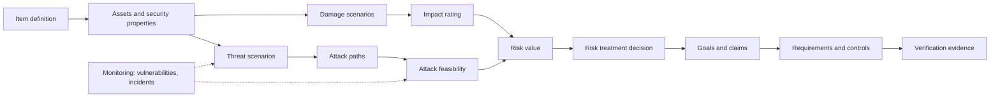
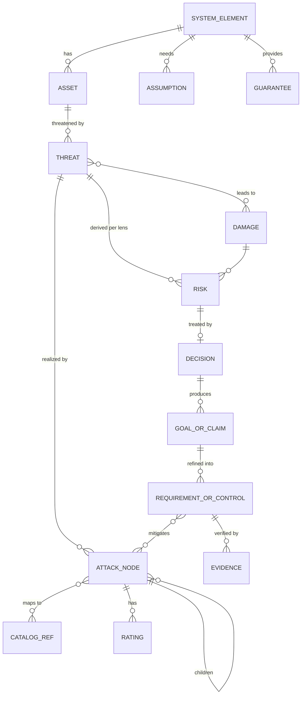
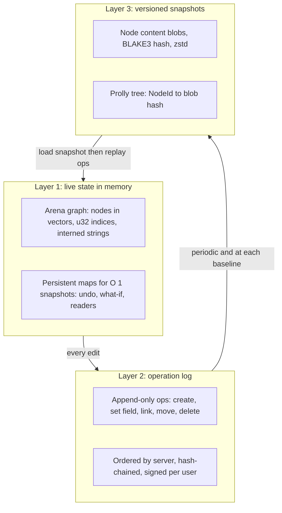
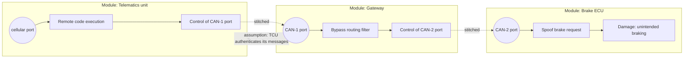
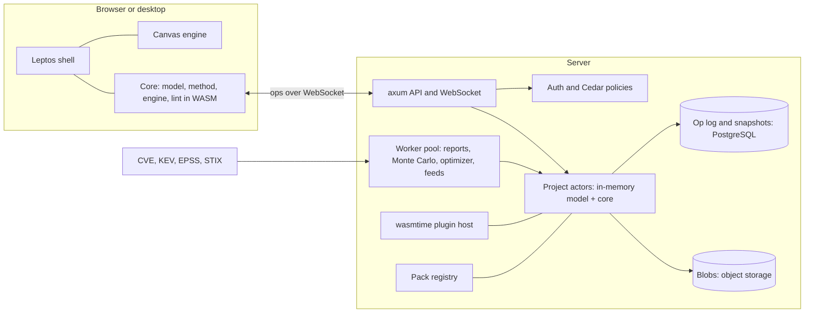

# AegisTARA: Initial Brainstorm

- Status: brainstorm only. This is not a design, not a plan, and has no code.
- Date: 2026-10-10
- Purpose: find out what is possible, what is feasible, where current tools fall short, and which engineering ideas could make AegisTARA stand out. It also works as a map for learning Rust.
- Update: first decisions are made. See [decisions.md](decisions.md), [direction-v1.md](direction-v1.md), and [ai-backlog.md](ai-backlog.md). Where they differ from this brainstorm, they win.

Each idea has a tag:

- **[Core]** needed for a useful first version.
- **[Edge]** a differentiator. This is where AegisTARA can beat existing tools.
- **[Research]** interesting but uncertain or hard. Try it later.

## Contents

1. [What a TARA is](#1-what-a-tara-is)
2. [Industries and methodologies to support](#2-industries-and-methodologies-to-support)
3. [The market today and its gaps](#3-the-market-today-and-its-gaps)
4. [Vision and principles](#4-vision-and-principles)
5. [Idea 1: Methodology as data](#5-idea-1-methodology-as-data)
6. [Idea 2: The data model](#6-idea-2-the-data-model)
7. [Idea 3: Storing huge, nested attack trees](#7-idea-3-storing-huge-nested-attack-trees)
8. [Idea 4: The risk engine (a "risk compiler")](#8-idea-4-the-risk-engine-a-risk-compiler)
9. [Idea 5: Composition, from component TARA to vehicle TARA](#9-idea-5-composition-from-component-tara-to-vehicle-tara)
10. [Idea 6: Libraries, packs, and plugins](#10-idea-6-libraries-packs-and-plugins)
11. [Idea 7: TARA as code](#11-idea-7-tara-as-code)
12. [Idea 8: The visual experience](#12-idea-8-the-visual-experience)
13. [Idea 9: Reports](#13-idea-9-reports)
14. [Idea 10: Security of the tool itself](#14-idea-10-security-of-the-tool-itself)
15. [A rough architecture shape (all Rust)](#15-a-rough-architecture-shape-all-rust)
16. [The unique ideas list](#16-the-unique-ideas-list)
17. [Reality check: what is hard](#17-reality-check-what-is-hard)
18. [A learning path](#18-a-learning-path)
19. [Open questions](#19-open-questions)
20. [References](#20-references)

---

## 1. What a TARA is

A TARA (Threat Analysis and Risk Assessment) answers four questions:

1. What do we protect? (assets and their security properties)
2. What bad things can happen? (damage scenarios and their impact)
3. How can an attacker make it happen? (threat scenarios and attack paths)
4. How likely is it, and what do we do about it? (feasibility, risk, treatment)

ISO/SAE 21434 (clause 15) gives the most structured flow, so it is a good reference:

Other methods use other words. But almost all of them share the same skeleton:
something valuable, something bad, a way to get there, a likelihood, a consequence, a decision.

**Key insight:** hard-code the skeleton. Make everything else configurable.

---

## 2. Industries and methodologies to support

| Domain | Standards and regulations | Methods and catalogs | What is special |
|---|---|---|---|
| Automotive | ISO/SAE 21434, UN R155 and R156, China GB 44495-2024, ISO/SAE PAS 8475 (CAL and TAF, at approval stage in 2026), ISO 24089 | 21434 attack potential, CVSS-based and attack-vector-based feasibility, HEAVENS 2.0, EVITA, R155 Annex 5 threat list, Auto-ISAC ATM | Impact in four categories (Safety, Financial, Operational, Privacy), deep supplier chains, many variants, long product life, type approval |
| Medical | FDA section 524B and premarket guidance (final June 2025), EU MDR with MDCG 2019-16, IEC 81001-5-1, AAMI TIR57, AAMI SW96 | STRIDE, attack trees, CVSS with the MITRE medical device rubric | Link to patient safety, SBOM is required, postmarket monitoring |
| Industrial / OT | IEC 62443-3-2, 62443-4-1, 62443-4-2 | Zones and conduits, Security Levels (target and achieved), ATT&CK for ICS | Security level vectors per foundational requirement |
| Consumer IoT | EU Cyber Resilience Act (reporting live since 11 Sep 2026, full from 11 Dec 2027), EN 18031 (RED), ETSI EN 303 645 | Generic risk matrices, MITRE EMB3D | Many products, fast releases, vulnerability handling |
| Aerospace | DO-326A / ED-202A, DO-356A / ED-203A | Security risk assessment with threat conditions | Link to airworthiness, strict assurance |
| Space | Mission and program rules | SPARTA (Aerospace Corporation) | Long missions, ground and space segments |
| Defense and government | NIST SP 800-30, NIST RMF (SP 800-37), SP 800-53, SP 800-160 | Mission-based, threat-informed, ATT&CK | Classification levels, air-gapped sites, need-to-know |
| Enterprise IT and apps | ISO/IEC 27005, NIST SP 800-30 | STRIDE, PASTA, DREAD, OCTAVE, EBIOS RM (ANSSI), FAIR (quantitative) | Fast cadence, close to developers |
| Privacy | GDPR DPIA | LINDDUN | Data flows, personal data categories |
| AI systems | EU AI Act, ISO/IEC 42001 | MITRE ATLAS, OWASP Top 10 for LLM apps | Models and data are assets, new attack classes |
| Rail | CLC/TS 50701 (IEC 63452 in progress) | 62443-based | Long-lived infrastructure |
| Maritime | IACS UR E26 and E27 | 62443-like | Ship systems, class societies |

What changes between these: vocabulary, rating scales, impact categories, how feasibility is scored,
how AND/OR combine, the risk function, assurance levels, workflow, and report structure.
What stays the same: the skeleton from section 1.

---

## 3. The market today and its gaps

### Kinds of tools

1. **Model-based TARA tools, mostly automotive.** Examples: Ansys medini analyze (SysML-based; covers 21434, R155, DO-356A, ISO 27005, attack trees), itemis SECURE (model-based; 21434 and R155; threat catalog with ASRG; now adds AI assistance), ThreatGet, CycurRISK, and others.
2. **IT threat modeling platforms.** IriusRisk, ThreatModeler, Microsoft Threat Modeling Tool, OWASP Threat Dragon.
3. **Threat modeling as code.** Threagile, OWASP pytm, the Open Threat Model (OTM) format.
4. **Attack simulation.** securiCAD and the Meta Attack Language (MAL) family (coreLang, vehicleLang) from KTH research.
5. **Spreadsheets.** Still very common. One vendor case study reports a project that took 400 hours in Excel and 56 hours in their tool. That shows how painful the Excel world is.

Vendors are now adding AI features. So "AI" alone is not a differentiator anymore.
Architecture, composition, history, explainability, and user experience are.

### Gaps

These are patterns across the market, based on public material and common user complaints.
They are not verified against the latest version of each product.
Before claiming "best of the best", try the competitor trials yourself.

| # | Gap | What users feel | AegisTARA answer |
|---|---|---|---|
| G1 | Methodology lock-in | The tool fits one standard. Other industries need vendor customization. | Methodology packs as data, plus lenses (section 5) |
| G2 | Weak composition | Component TARAs are copied into the vehicle TARA by hand. Supplier exchange is Excel. | Module interfaces, assume-guarantee, signed packages (section 9) |
| G3 | Attack trees are second class | Small trees only, poor layout, little reuse, simple scoring | Merkle/prolly storage, GPU canvas, pluggable math (sections 7, 8, 12) |
| G4 | Weak versioning | No branch, merge, or element-level diff. Change impact analysis is manual. | Git-like history and diff (sections 7, 9) |
| G5 | Static TARA | New CVEs do not update the analysis | Living TARA with feeds (section 16, idea 13) |
| G6 | Opaque scores | Hard to see why a risk is "High" | Every number explains itself (section 8.2) |
| G7 | One rater, no calibration | Ratings depend on who did them | Multi-rater, calibration, tipping points (section 8.5) |
| G8 | Code vs visual split | As-code tools have weak visuals. Visual tools have weak text and CI workflow. | Round-trip text format, CLI, LSP (section 11) |
| G9 | Deployment extremes | SaaS-only is hard for defense. Desktop-only is hard for teams. | Same binary for desktop, server, air-gapped (section 15) |
| G10 | Reports are data dumps | Executives do not read 200-row tables | Typst reports with stories and decisions (section 13) |
| G11 | No treatment optimization | "Which controls give the most risk reduction for our budget?" is answered by gut feeling | Control optimizer, choke points (section 8.4) |
| G12 | Safety and security are apart | HARA and TARA live in different tools | Links to HARA, FTA, STPA-Sec (section 16, idea 26) |
| G13 | Closed formats | Hard to move data in and out | OTM, STIX, CycloneDX, SysML v2, ReqIF (section 11) |
| G14 | Price barrier | Small teams cannot afford tools | Possible open core (your choice) |

### Regulatory pressure in 2026

- UN R155 has applied to all new vehicles in the EU since July 2024.
- China GB 44495-2024 applies to new vehicle types from 2026.
- The EU CRA reporting duties started on 11 September 2026: early warning in 24 hours, notification in 72 hours, for actively exploited vulnerabilities and severe incidents.
- FDA expects threat modeling and an SBOM for cyber devices.
- ISO/SAE PAS 8475 (CAL and TAF) is close to publication.

All of this pushes toward a **living** TARA with **evidence** and **history**, not a one-time spreadsheet.

---

## 4. Vision and principles

**One sentence:** AegisTARA is a risk compiler with a beautiful editor.
You describe the system and pick a methodology. It computes risk incrementally, explains every number, and keeps a full, signed history.

**Metaphors:**

- A compiler for risk: incremental, explainable, with lint warnings.
- Git for TARA: branch, diff, merge, baseline, signed history.
- Figma for attack trees: fast canvas, multiplayer.
- Lego for systems: component TARAs snap into system TARAs.
- Cargo for catalogs: packs with versions, lockfiles, and signatures.

**Principles:**

1. **Fixed skeleton, flexible flesh.** The core ontology is fixed. Methodologies add fields, scales, and formulas.
2. **Store decisions, compute the rest.** Store what humans decide. Derive scores. Derived data is cache, not truth.
3. **One core, everywhere.** The same Rust core runs on the server, in the browser (WASM), in the desktop app, in the CLI, and in CI. Same numbers everywhere.
4. **Every number explains itself.**
5. **History is a feature.** Append-only, signed, replayable.
6. **No code needed, code possible.** Extension in tiers (section 10).
7. **Secure by default, offline capable.**
8. **Open formats in and out.**
9. **A project fits in memory.** Design for up to 1 million nodes per project. Typical is 10k to 100k.

---

## 5. Idea 1: Methodology as data

**[Core] [Edge]**

### What varies between methodologies

| Aspect | Examples |
|---|---|
| Vocabulary | "damage scenario" vs "hazard" vs "loss event" |
| Extra entity fields | CAL, security level vector, FDA labeling notes |
| Security properties | Confidentiality, integrity, availability, plus authenticity, authorization, non-repudiation, privacy |
| Impact categories and scales | 4 categories x 4 levels (21434), security levels (62443), money ranges (FAIR) |
| Feasibility model | Attack potential with 5 factors, CVSS vector, attack vector only, probability, frequency |
| AND / OR aggregation | Easiest child, sum, max per factor, probability rules |
| Risk function | 4x4 matrix to risk 1 to 5, a formula, or a Monte Carlo distribution |
| Treatment | Avoid, reduce, share, retain, with thresholds and approvers |
| Assurance levels | CAL, security levels, development assurance levels |
| Workflow | States, roles, sign-offs |
| Outputs | Work products, report structure |
| Catalogs | R155 Annex 5, EMB3D, CAPEC, ATT&CK, ATLAS |

### Anatomy of a Methodology Pack

A pack is a versioned, signed bundle. It contains:

- **Manifest:** name, version, license, dependencies on other packs, minimum core version.
- **Vocabulary:** labels for core entities, with translations.
- **Facets:** extra fields per entity type, with types and validation.
- **Scales:** ordered levels with numeric values.
- **Formulas:** written in a small, safe expression language.
- **Aggregation domains:** how AND, OR, and sequential AND combine each attribute (section 8.3).
- **Matrices:** lookup tables, for example impact x feasibility to risk.
- **Rules:** lint checks for completeness and consistency.
- **Workflow:** states, roles, approvals.
- **Templates:** forms and report templates.
- **Crosswalks:** mappings to other methodologies.
- **Test vectors:** example inputs and expected outputs. The engine runs them when the pack is installed. A pack proves it computes what it claims. This also helps with tool qualification.

### The formula language

| Option | Good | Bad |
|---|---|---|
| CEL (Common Expression Language) | Standard, safe, no loops, fast | Less flexible |
| Rhai | Rust-native scripting, easy | Turing complete, harder to explain |
| Starlark | Deterministic, used by Bazel | Bigger than needed for formulas |
| Own small DSL | Exactly fits, great learning (parser, type checker, evaluator) | You maintain it |
| WASM component | Unlimited power | Heavy for a simple formula |

Requirements for formulas: pure, always terminates, deterministic, typed, and the evaluation produces a **trace** for "explain why".
Suggestion: build your own tiny DSL as a learning project, or use CEL. Use WASM only for logic a formula cannot express.

### Lenses: one model, many standards at once

**[Edge]**

Example: a supplier sells the same gateway ECU to an EU carmaker, a Chinese carmaker, and into an industrial product.
Today that means three analyses. With lenses it is one model and three views: 21434 + R155, GB 44495, and 62443-4-2.

The trick is to separate three kinds of data:

| Kind | Example | Who sets it |
|---|---|---|
| **Facts** | "needs physical access", "tool costs about 1,000 EUR", "public exploit exists", "needs a few days" | Analyst or feed, once |
| **Judgments** | "expertise = proficient", "impact on safety = severe" | Analyst, per methodology where needed |
| **Derived** | "attack potential = 14, feasibility = Medium, risk = 3" | Engine |

If facts are captured well, many lens values are computed automatically. Judgments are only asked where a methodology really needs a human.
This "fact-based rating" is one of the strongest ideas in this document.

### Crosswalks, pinning, and migration

- Crosswalks map between methodologies, for example 21434 attack potential to CVSS exploitability. They are always approximate. Show that clearly.
- Each project pins a pack version in a lockfile.
- Upgrading a pack shows the effect before you accept it: "47 risks change, 3 go up to level 4".

---

## 6. Idea 2: The data model

**[Core]**

### Core entities (neutral names; packs rename them)

- **System element:** item, component, function, interface/port, data flow, trust boundary, zone, conduit.
- **Asset:** a system element plus a security property.
- **Damage:** damage scenario, loss, or hazard, with impact ratings per category.
- **Threat:** threat scenario that links an asset property to damage.
- **Attack graph node:** goal, AND, OR, SAND (sequential AND), step (leaf), precondition, reference (to another tree or to a component port), pattern instance, countermeasure.
- **Rating:** facts, judgments, derived values.
- **Risk:** derived, per threat and damage, per lens.
- **Decision:** treatment with rationale, approver, date.
- **Goal, claim, requirement, control.**
- **Assumption and guarantee:** for composition.
- **Evidence:** test report, pen test, review, analysis.
- **Catalog reference:** CAPEC, ATT&CK technique, EMB3D threat, CWE, CVE.
- **Comment, review, approval.**
- **Variant condition.**

### Cross-cutting fields on every entity

- **Stable ID:** UUIDv7 (time-ordered, good for database index locality).
- **Provenance:** who, when, and source (human, import, catalog, generator, AI suggestion).
- **Classification label:** for access control.
- **Variant condition:** for product lines.
- **Facets:** methodology-specific fields, validated against the pack schema.

Core fields are typed Rust structs. Methodology fields are facets: typed attribute bags. Fields that are often filtered get promoted to indexes.

### Trees, DAGs, and graphs

- Attack "trees" in real life are DAGs. Sub-goals are shared.
- Across a system they become attack graphs, joined at ports.
- Real attack graphs can have cycles (lateral movement). Scoring needs acyclic structure. The engine detects cycles and reports them, or unrolls them with a depth limit.

---

## 7. Idea 3: Storing huge, nested attack trees

**[Core] [Edge]**

### Requirements

- Large: up to about 1 million nodes per project.
- Deep: dozens of levels.
- Shared subtrees and library reuse.
- Cheap edits, many small edits per second during collaboration.
- Cheap versions and fast diff (change impact analysis).
- Partial loading for very big projects.
- Tamper-evident history.

### Options

| Approach | Good | Bad |
|---|---|---|
| Adjacency list in SQL (node, parent) | Simple, cheap edits | Deep reads need recursive queries. DAG sharing needs a separate edge table. |
| Closure table | Fast subtree queries | Many rows (nodes x depth). Moves are expensive. |
| Nested sets | Fast reads | Edits rewrite large parts. Bad for collaboration. |
| Materialized path | Simple prefix queries | Moves rewrite the subtree. No DAG. |
| JSON blob per tree | One read | Every edit rewrites the blob. No sharing. No fine diff. |
| Graph database | Expressive queries | Heavy to run, often not Rust, overkill if the project fits in RAM |
| Pure Merkle DAG, children by hash (like git) | Free dedup, cheap versions, verifiable | An edit ripples up to the root. Hash references are unstable for humans. |
| **Stable IDs + content-addressed blobs + prolly tree index (like Dolt)** | Cheap edits, cheap versions, fast diff, dedup | More to build |

### Recommended shape: three layers

**Layer 1: live state in memory.**
An arena-based graph: nodes in vectors, `u32` indices instead of pointers, hot fields in struct-of-arrays layout, strings interned.
Persistent (immutable) maps (crates like `imbl` or `rpds`) make snapshots O(1). That gives undo, what-if branches, and lock-free readers almost for free.

**Layer 2: operation log.**
Every change is a small operation. The log is append-only, ordered by the server, hash-chained, and signed with the user's device key.
It is the source of truth for audit, undo, time travel, and sync.

**Layer 3: versioned snapshots.**

- Each node's content is a blob, addressed by its BLAKE3 hash and compressed with zstd. Identical content is stored once.
- The project state at a version is a map `NodeId -> blob hash`, stored as a **prolly tree** (a B-tree whose chunk borders come from content hashes). Two versions share every unchanged chunk. A diff only visits changed chunks, so its cost depends on the size of the change, not the size of the project.
- Edges are stored inside node content as child **NodeIds**, not child hashes. Editing a leaf does not ripple to the root.
- A Merkle commitment over the tree is computed on demand: for signatures, signed baselines, and redaction proofs (section 9).

**What this gives:**

| Operation | Cost |
|---|---|
| Edit | O(1) in memory, one small op on disk |
| New version | Only the changed chunks |
| Diff two versions | Proportional to the change |
| Library reuse | A reference, not a copy |
| Load | Latest snapshot plus replay of recent ops |
| Partial load | Chunk by chunk, driven by what the user looks at |

### Library reuse without copies

A **pattern instance** node points to `(pack, version, pattern id)`, plus parameter bindings, plus local overrides stored as a small patch.
The engine expands it virtually. 500 uses of "CAN message injection" cost 500 small references, not 500 copies.
When the pack updates, the user gets a three-way merge proposal: old pattern, new pattern, local overrides.

### Never store all paths

The number of paths can grow exponentially. An OR of 10 options, each an AND of steps that are themselves ORs of 10 options, explodes fast.
Store the DAG. Compute on demand:

- **Top-k easiest paths:** lazy enumeration with a priority queue.
- **Pareto front:** paths that are not worse than another path in every factor.
- **Minimal cut sets** compressed in ZDDs (zero-suppressed decision diagrams), as fault tree tools do. Rust has OxiDD for BDDs and ZDDs.

### Physical storage per deployment

| Deployment | Storage |
|---|---|
| Desktop, single user | One file per project. SQLite (`rusqlite`) or a pure Rust embedded store (`redb`). An encrypted, portable `.aegis` file. Easy to back up, delete, or send through an approved channel. |
| Team or enterprise server | PostgreSQL for op log, metadata, permissions, and indexes. Blobs in Postgres or the cloud provider's S3-compatible object storage. (Avoid Garage and MinIO: both are AGPL, see decision D5.) |
| Search | `tantivy` (Rust full-text search) over catalogs and projects |
| Portfolio analytics | Apache DataFusion or Polars over Parquet exports. Example: "top risks across all 40 vehicle programs". |

### Serialization

| Use | Format |
|---|---|
| Client to server ops | Compact binary (for example `postcard`) |
| Public API | JSON |
| Fast cache | `rkyv` zero-copy. Not for long-term archive, because it is tied to struct layout. |
| Archive and exchange | Stable, versioned, documented format (canonical CBOR, or the text format in section 11) with explicit migrations |
| Compression | zstd with a dictionary trained on threat and asset text |

### Size estimate (rough)

- A typical vehicle-level TARA: a few hundred assets, a few thousand threat scenarios, 10k to 100k attack graph nodes.
- 100k nodes at about 300 bytes each (with interned text) is about 30 MB in memory. 1 million nodes is about 300 MB.
- So one project fits in a laptop's RAM.

This drives a big simplification: no graph database. One in-memory actor per open project. The database is for durability, not for queries.

---

## 8. Idea 4: The risk engine (a "risk compiler")

**[Core] [Edge]**

### 8.1 Incremental computation

Model the TARA like a compiler does: inputs (ratings, structure, pack) and derived queries (feasibility, risk, lint results).
Memoize derived queries and track dependencies. The `salsa` crate (it powers rust-analyzer) does exactly this.
Change one rating, and only the values that depend on it are recomputed. What-if becomes instant.

### 8.2 Every number explains itself

Each derived value carries a **derivation trace**: the formula, the inputs, and which path dominated.

Example "Why is this risk 4?":

- Risk 4 = matrix(impact Severe, feasibility High)
- Feasibility High comes from path P3, the easiest path
- P3 is easy because step S7 has a public exploit (from the KEV feed, added 2026-09-30)

The UI shows this on a "Why?" button. The report includes it in an appendix. Auditors love it.

### 8.3 Pluggable math: attribute domains

Attack tree research (Mauw and Oostdijk 2005; Kordy and others on attack-defense trees) describes evaluation with **attribute domains**:
each attribute defines how OR children combine and how AND children combine.

| Attribute | OR | AND | SAND (sequential) |
|---|---|---|---|
| Minimum attacker cost | min | sum | sum |
| Minimum time | min | max (parallel) | sum |
| Skill needed | min | max | max |
| Feasible? (yes/no) | any | all | all |
| Probability (independent) | 1 - product(1 - p) | product(p) | product(p) |
| Attack potential (21434 style) | easiest child | defined by the pack | defined by the pack |
| Pareto set of factor vectors | union, keep non-dominated | combine pairs, keep non-dominated | same as AND |

A methodology pack picks a domain per attribute. The engine stays generic.
In Rust this is a trait with two combine operations and neutral elements, evaluated over the DAG with memoization. A very good learning exercise in traits and generics.

ISO/SAE 21434 leaves room for interpretation on how AND steps combine for attack potential, and tools differ.
That is exactly why the math must be pluggable.

**Caveat: shared subtrees.** For probability, naive bottom-up evaluation is wrong when a node is shared, because inputs are no longer independent.
The exact answer: build a BDD of the tree and evaluate on it. Offer a "fast approximate" mode and an "exact" mode.

### 8.4 Defense-aware analysis

Countermeasures are nodes that block a step or raise its cost (attack-defense trees). Then:

- **Residual risk** is computed with controls applied.
- **Choke points:** steps that appear on many top paths.
- **Min-cut:** the smallest set of steps to block that cuts every feasible path to a goal. This is where controls give the most value.
- **Control optimizer [Edge]:** given a control catalog with cost and effect, find the cheapest set of controls that brings all risks to an acceptable level. It is a set-cover or integer programming problem. Rust: `good_lp` with a pure Rust solver (`microlp`) or HiGHS.
  Output example: "With these 6 controls (about 140 person-days), all risks are at level 2 or lower."

### 8.5 Uncertainty and people

**[Edge]**

- **Interval ratings:** allow "Medium to High". Propagate intervals. Show where uncertainty changes the result.
- **Tipping points:** "If this one rating moves one step, this risk goes from 3 to 4." Reviews focus on fragile conclusions.
- **Multi-rater scoring:** experts rate on their own first (Delphi style). The tool shows the spread, flags disagreement, and records the final consensus with rationale.
- **Calibration library:** across projects, "similar steps were rated Medium in 80% of cases". Detect drift between teams.
- **Evidence-based ratings:** pen test results mark a step as "demonstrated", with real effort spent. Real data beats guessing.

### 8.6 Rules and linting ("clippy for TARA")

**[Core]**

Example rules:

- An asset has confidentiality and an external interface, but no threat.
- A risk of 4 or more is "retained", but has no approver.
- A claim has no evidence.
- An assumption has no matching guarantee.
- An attack path references a deleted port.
- A damage scenario is "Severe" on safety, but has no link to a HARA hazard.

Rules can be Datalog-like queries. The `ascent` and `crepe` crates compile Datalog rules into Rust. User-defined rules at runtime need a small interpreter.
Rules have severity levels and fix suggestions, and they run in CI.

### 8.7 Generate candidates from architecture

**[Research] [Edge]**

The MAL idea: rules like "if a component has an external wireless interface and runs software with a known CVE, add the step 'remote exploit' that reaches the component".
Run the rules on the system model to generate a candidate attack graph. A human accepts or rejects each candidate. Provenance is tagged "generated".
Threat identification becomes a review, not a blank page.

### 8.8 Quantitative lens

**[Research]**

FAIR-style Monte Carlo simulation to express risk in money ranges for executives. Rust: `rand`, `statrs`, and `rayon` for parallel runs.

---

## 9. Idea 5: Composition, from component TARA to vehicle TARA

**[Core] [Edge]**

**Problem:** a vehicle TARA is many component TARAs (from in-house teams and suppliers) plus vehicle-level paths that cross components. Today much of this is manual copy work.

### The TARA Module

A module is a component's analysis with a clear boundary:

- **Interface:** ports (CAN, Ethernet, Bluetooth, cellular, debug, OTA, physical) and exposed assets.
- **Assumptions:** what the module needs from its environment. Example: "the gateway filters diagnostic messages from OBD".
- **Guarantees (claims):** what the module promises. Example: "secure boot rejects unsigned firmware".
- **Internals:** assets, threats, attack graphs. Can be hidden.
- **Port summary:** for each port, the easiest feasibility to each internal goal. Like a function signature.

### How composition works

- **Stitching:** a path in module A that ends in "control of port X" becomes a precondition for paths in module B that start at port X. The engine builds a system attack graph across modules.
- **Summaries make it scale:** the system level uses each module's port summary, not its full internals. Like separate compilation in a compiler. A module is expanded only when you need detail.
- **Assume-guarantee check:** every assumption must be matched by a neighbor's guarantee or by a system-level decision. Unmatched assumptions are open obligations, shown in the dashboard and the report. This maps well to the 21434 cybersecurity interface agreement.
- **Fractal levels:** component, subsystem, vehicle, fleet and backend. The same mechanism at every level.

### Supply chain exchange

**[Edge]**

- A supplier exports a **signed TARA package**: interface, assumptions, guarantees, summaries, and optionally full internals.
- **Selective disclosure with Merkle commitments [Research]:** the supplier can hide subtrees but publish their hash and summary rating. Later, in an audit, the supplier reveals a hidden subtree and the carmaker verifies that it matches the commitment from delivery time. This proves nobody changed the history afterwards, without giving away IP up front.
- **Updates:** a new package version comes with a diff. The carmaker sees exactly what changed and which system risks move.

### Variants and product lines

**[Edge]**

- **150% model:** one model with all options. Each element can carry a variant condition, for example "market = EU and trim has Wi-Fi".
- Evaluate per variant, or for all variants at once. Show which risks exist only in some variants.
- **Market overlays:** the same vehicle under an EU lens (R155) and a China lens (GB 44495).
- This avoids copying projects per variant, which is a main source of inconsistency.

### Change impact analysis

**[Core]**

Diff two versions. Get the changed elements. Follow the engine's dependency graph to the affected risks. Produce a delta report.
ISO/SAE 21434 requires change impact analysis. Here it is automatic.

---

## 10. Idea 6: Libraries, packs, and plugins

**[Core] [Edge]**

### Content packs

- **Asset catalogs:** typical ECU assets, medical device assets, IoT assets.
- **Threat catalogs:** UN R155 Annex 5, MITRE EMB3D, CAPEC, ATT&CK (Enterprise, ICS, Mobile), MITRE ATLAS, Auto-ISAC ATM, SPARTA.
- **Attack pattern library:** parametric patterns (below).
- **Control catalogs:** IEC 62443-4-2 requirements, NIST SP 800-53, R155 Annex 5 mitigations, EMB3D mitigations.
- **Damage scenario templates.**
- **Methodology packs.**
- **Report templates.**

MITRE ATT&CK and EMB3D are published in STIX 2.1, so they can be imported directly.

### Parametric attack patterns

**[Edge]**

A pattern is a small attack graph with slots.
Example: "Inject messages on bus `{bus}` to trigger `{function}` on `{ecu}`".
Drag it onto the canvas, bind the slots to real system elements, and the engine instantiates it virtually. Ratings come as defaults and can be overridden.
Think of it as generics for attack trees.

### A registry like crates.io

- Packs have semantic versions, dependencies, signatures, and a license field.
- A public registry, a private company registry, and an offline mirror for air-gapped sites.
- A lockfile per project with exact versions and hashes. Results are reproducible.
- Pack updates arrive as merge proposals.

### Licensing note

- ISO standards are copyrighted. Do not ship ISO tables or text. Ship the structure. Users enter values from their licensed copy.
- UNECE regulations are free to read.
- MITRE ATT&CK, CAPEC, CWE, and EMB3D have their own terms of use, generally permissive with attribution. Check each one.

### Plugin system: WASM components

- Plugins are WebAssembly components run by `wasmtime`. Interfaces are defined in WIT.
- Plugin kinds: importer, exporter, scoring function, lint rule, feed connector, report section, layout algorithm, view widget.
- **Sandboxed:** no file or network access unless granted. Memory and CPU (fuel) limits. A broken plugin cannot crash the server or steal data.
- Write plugins in Rust, or in any language that targets WASM components.
- The same plugin runs on the server, on the desktop, and in the browser.
- **Security win:** parsers for untrusted files (ARXML, ReqIF, SysML v2, Excel) are classic attack surface. Run importers inside the sandbox.

### Extension tiers

| Tier | How | Example |
|---|---|---|
| 0: no code | Forms, drag and drop, install packs | Build a TARA, pick a methodology |
| 1: formulas | Expression language | Custom risk formula |
| 2: scripts | Rhai scripts | Bulk edits, custom checks |
| 3: WASM plugins | Rust or other languages | New importer, new algorithm |
| 4: API, SDK, CLI | External automation | CI gates, integration with requirements tools |

---

## 11. Idea 7: TARA as code

**[Edge]**

- **Canonical text format:** deterministic order, one element per block, stable IDs, line-oriented. Good git diffs and code review. Candidate syntaxes: KDL, TOML, YAML, or your own small language.
- **Round-trip:** edit in the visual editor or in a text editor. Both are the same model. Visual layout is stored separately, so text diffs stay clean.
- **CLI:** validate, compute, lint, diff, report, import, export.
- **CI gates:** fail the build if a new risk at or above a threshold has no decision, or if an assumption is unmatched.
- **Server API:** REST + JSON for integrations, a typed RPC for the app, optional GraphQL (`async-graphql`) for flexible graph reads, WebSocket or SSE for live updates.
- **Query language** for power users. Example: "all paths from external ports to the brake function with feasibility Medium or higher". Could be Datalog.
- **Rust SDK:** the same core crates. Python bindings with PyO3 are optional for data teams.
- **Language server (LSP)** for the text format: autocomplete IDs, inline risk values, errors as you type. The `tower-lsp` crate helps. A great learning project.

### Interoperability

| Format | Use |
|---|---|
| SysML v2 (API and textual notation) | Import architecture |
| AUTOSAR ARXML | Import ECU and network structure |
| ReqIF | Exchange requirements with DOORS, Polarion, codeBeamer |
| CycloneDX, SPDX | SBOM, link software components to assets |
| CycloneDX VEX, CSAF | Vulnerability status and advisories |
| OTM (Open Threat Model) | Exchange threat models |
| STIX 2.1 | Import ATT&CK, EMB3D, threat intelligence |
| OSCAL | Compliance data for NIST-based programs |
| CVSS 4.0, SSVC | Vulnerability scoring and decisions |
| Excel | Legacy import and export |

CycloneDX has a working group on a threat model BOM (TM-BOM). It is not released yet. Watch it. It may become the standard exchange format for threat models.

---

## 12. Idea 8: The visual experience

**[Core] [Edge]**

### Rust frontend options

| Option | Strengths | Weaknesses |
|---|---|---|
| Leptos | Fine-grained reactivity, server rendering with axum, web-first | Web only (desktop through Tauri) |
| Dioxus | React-like, targets web, desktop, mobile | Younger ecosystem for complex web apps |
| Yew | Mature | Older virtual DOM model, less momentum |
| egui | Immediate mode, very fast, easy | Looks like a tool UI, weaker text and accessibility |
| Slint, Iced | Native GUI toolkits | Less web-friendly |

### Rendering the canvas

- DOM or SVG is fine up to a few thousand nodes.
- Beyond that, use Canvas2D or WebGPU. Rust options: `wgpu` (WebGPU and native), Vello (GPU 2D vector renderer from Linebender), `lyon` (tessellation), `parley` or `cosmic-text` for text.
- Keep a fallback for browsers or GPUs without WebGPU.

**Suggested combination:** Leptos (or Dioxus) for panels, forms, and tables. A custom Rust canvas engine compiled to WASM for graphs. Tauri if you want a desktop app (Rust backend, system webview).

Honest note: the graph editor is the biggest single effort in this project.

### Canvas features

- Infinite canvas with smooth zoom and pan.
- **Semantic zoom:** far away you see colored blocks with risk heat; in the middle, titles and scores; close up, full ratings.
- **Fold and unfold** subtrees. A folded node shows chips: node count, easiest feasibility, worst risk.
- **Auto-layout:** tidy tree (Buchheim, linear time) for trees; layered layout (Sugiyama) for DAGs; orthogonal or force layout for architecture.
- **Stable incremental layout:** small edits do not reshuffle the whole picture. Users keep their mental map.
- **Typed drag and drop:** the editor knows the grammar. Drop a threat on an asset and the right link is created. Invalid drops are refused with a reason.
- **Pattern stamps** from the library with slot binding.
- **Critical path highlight:** toggle "top 5 easiest paths".
- **Attack path on the architecture map:** draw the path over the system diagram like a subway line: entry port, ECU, bus, target. Play it step by step as a storyboard for executives.
- **Heat maps:** feasibility and risk overlays on architecture and asset views.
- **Choke point markers.**
- **Diff view:** two versions side by side or overlaid. Added, removed, and changed use both color and shape.
- **Time-travel slider:** replay the op log.
- **What-if mode:** a sandbox branch. Toggle controls and watch risk drop live. Discard, or propose it as a change.
- **Multiplayer:** presence cursors, comments pinned to nodes, review mode.
- **Command palette** and keyboard-first editing.
- **Accessibility:** keyboard navigation of the graph, an outline view for screen readers, colorblind-safe palettes, never color alone.
- **Themes:** light and dark. Design tokens shared with the reports, so screen and PDF look like one product.

### Other views

- Architecture and data flow diagram
- Asset table
- Risk register (virtualized table, 100k rows)
- Risk matrix
- Traceability graph: damage, threat, goal, requirement, evidence
- Dashboard
- Sankey diagram from damage categories to treatment decisions

### Performance tricks

- GPU instancing for nodes and edges
- Spatial index (`rstar` R-tree) for hit testing
- Layout and engine in a Web Worker (WASM)
- Render only what is visible, with level of detail

### Collaboration model

| Option | Good | Bad |
|---|---|---|
| A: server-authoritative op log. The server orders ops; clients apply them optimistically and rebase. | Simpler, audit-friendly, easy permission checks | Needs a connection for live work |
| B: CRDT (Loro has a movable tree CRDT in Rust; also Automerge, Yrs) | Offline-first, peer-to-peer | Harder to check permissions and invariants; merges of structured data can surprise users |

Suggestion: option A for the main path. For long offline work, use git-like branch and merge with conflicts shown to the user. That fits TARA review culture well. Add CRDT ideas later if offline-first becomes important.

---

## 13. Idea 9: Reports

**[Core] [Edge]**

**Typst** is a modern typesetting system written in Rust. It can be used as a library.
Compile report templates inside the server or the desktop app straight to PDF, including PDF/A for archiving.
Templates per methodology and per company brand. Deterministic. Fast. All Rust.

### Executive report ideas

- **One-page risk posture:** count of risks per level, trend against the last baseline, top 5 risks in plain language.
- **Heat map** and **what changed since the last release**.
- **Accepted residual risks:** by whom, when, and why.
- **Coverage:** for example, every R155 Annex 5 threat is covered or marked not applicable with a reason. Same for EMB3D or ATT&CK.
- **Open obligations:** unmatched assumptions, missing evidence.
- **Recommended investments:** the control optimizer result with cost and benefit.
- **Attack story:** one critical path told as a short story with a small diagram.
- **Quantitative lens (optional):** exposure in money ranges.
- **Plain language** sentences from templates. Example: "An attacker with physical access and moderate skill can reach the brake controller in about a week. Two planned controls reduce this to Low."

### Other outputs

- Full work products and traceability matrices.
- **Interactive offline HTML report:** one self-contained file with a WASM viewer. Filter, zoom into trees, no server needed. Great for auditors.
- Excel (`rust_xlsxwriter`) and Word (`docx-rs`) when a company demands them.
- **Signed report bundles:** report + snapshot hash + pack lockfile. Anyone can verify that the report matches a specific version.

---

## 14. Idea 10: Security of the tool itself

**[Core]**

**Dogfooding:** AegisTARA ships its own TARA, made in AegisTARA.

### Identity and access

- SSO with OIDC or SAML. Passkeys (WebAuthn, `webauthn-rs`) for local accounts. mTLS between services.
- Authorization with roles plus attributes. **Cedar** (`cedar-policy`, written in Rust by AWS) is a good fit: readable policies that can be analyzed.
- Granularity: tenant, workspace, project, element.
- Element-level classification labels. Examples: Public, Internal, Confidential, Restricted, or CUI and ITAR markings for defense. Need-to-know compartments.
- **Redacted views:** a supplier sees only their module. A reviewer sees only what they need.

### Data protection

- TLS 1.3 with `rustls`.
- Encryption at rest with a key per project (envelope encryption). Keys in a KMS or an HSM (PKCS#11). Deleting the key destroys the data (crypto-shredding).
- **Optional end-to-end mode [Research]:** because the core runs in the browser as WASM, the server can store only ciphertext and still sync. The client computes risk. Trade-off: no server-side search, feeds, or reports in this mode, unless a trusted client runs them.
- Field-level encryption for very sensitive text.

### Integrity

- Hash-chained, signed op log (ed25519 key per user device). Tamper-evident audit trail.
- Signed baselines, packs, plugins, and reports.
- Reproducible builds. An SBOM for AegisTARA itself (`cargo-auditable`, `cargo-cyclonedx`).

### Runtime hardening

- Forbid `unsafe` code in core crates.
- Fuzz every importer (`cargo-fuzz`). Property tests for the engine (`proptest`).
- Plugins only inside the WASM sandbox, with limits.
- Secrets wiped from memory after use (`zeroize`).
- Rate limits and input size limits (`tower` middleware).
- Supply chain checks: `cargo-deny`, `cargo-audit`, `cargo-vet`. Keep dependencies few.

### Deployment for sensitive industries

- **Air-gapped mode:** one static binary, offline pack mirror, no telemetry, no outbound calls.
- **FIPS 140-3** validated crypto through `aws-lc-rs` in FIPS mode, when needed.
- **Data residency:** on-premises or regional hosting.
- **AI features:** off by default. Local models only (`candle` or `burn` in Rust). Every AI suggestion is tagged and needs human acceptance.

---

## 15. A rough architecture shape (all Rust)

This is a shape to test feasibility, not a design.

### Crates

| Crate | Role | Runs in WASM? |
|---|---|---|
| `aegis-model` | Ontology, IDs, operations. No IO. | Yes |
| `aegis-method` | Pack loading, expression language, scales, matrices | Yes |
| `aegis-engine` | Incremental computation, attribute domains, BDD/ZDD, optimizer | Yes |
| `aegis-lint` | Rules engine | Yes |
| `aegis-store` | Op log, snapshots, prolly tree, blobs; SQLite and Postgres backends | Partly |
| `aegis-sync` | Client-server protocol, op rebase | Yes |
| `aegis-server` | axum HTTP and WebSocket, auth, Cedar policies, project actors | No |
| `aegis-canvas` | Rendering, layout, hit testing (wgpu, Vello) | Yes |
| `aegis-web` | Leptos app shell | Yes |
| `aegis-desktop` | Tauri wrapper (optional) | No |
| `aegis-report` | Typst templates and rendering | Yes |
| `aegis-plugin-host` | wasmtime host, WIT interfaces | No |
| `aegis-cli` | Command line | No |
| `aegis-feeds` | CVE, KEV, EPSS, STIX feeds | No |

**Key property:** model, method, engine, and lint compile to both native code and WASM. One source of truth for every number.

### Deployment modes

| Mode | Shape |
|---|---|
| Solo desktop | Tauri app or local binary + browser. Project files on disk. |
| Team server | One binary + PostgreSQL. |
| Enterprise | Several API nodes + PostgreSQL + object storage + worker pool. |
| Air-gapped | Same as team or enterprise, with offline registry mirror and no outbound traffic. |

### An honest view of scalability

- TARA is not a high-traffic workload. The real scale problems are: big models, many editors on one project, many projects, and heavy jobs (reports, Monte Carlo, optimization, feeds).
- Pattern: one actor (a tokio task) per open project holds the in-memory model and orders ops. Stateless API nodes route requests to the right actor by project ID. Heavy jobs go to a worker pool. Start with a queue in PostgreSQL. Add NATS later if needed.
- Scale out by sharding projects. Simple, and enough even for very large companies.

---

## 16. The unique ideas list

| # | Idea | Why it matters | Tag |
|---|---|---|---|
| 1 | Fact-based rating: capture technical facts once, derive ratings per methodology | One analysis serves many standards and markets | Edge |
| 2 | Methodology lenses | One model, many standards at the same time | Edge |
| 3 | Risk compiler: incremental and explainable | Instant what-if; auditors see how numbers came to be | Edge |
| 4 | Pluggable attack math (attribute domains) | Any scoring scheme without new code | Edge |
| 5 | Pareto attack paths | Shows trade-offs ("cheap but slow" vs "fast but expensive") instead of one number | Research |
| 6 | Git for TARA: branch, merge request, diff, baseline, signed history | Real change control; automatic change impact analysis | Edge |
| 7 | Prolly tree storage | Versions and diffs cost only the size of the change | Edge |
| 8 | Parametric attack patterns | Reuse without copies; updates arrive as merge proposals | Edge |
| 9 | Module interfaces with assume-guarantee | Component TARAs compose into vehicle TARAs; open obligations are visible | Edge |
| 10 | Port summaries (like separate compilation) | System analysis scales to hundreds of components | Edge |
| 11 | Redacted supplier packages with Merkle proofs | Share less IP and still prove integrity later | Research |
| 12 | 150% variant TARA | No copy-paste per variant or market | Edge |
| 13 | Living TARA: SBOM + CVE, KEV, EPSS + EMB3D and ATT&CK feeds trigger re-scoring | The TARA stays current; supports CRA vulnerability handling and reporting clocks | Edge |
| 14 | Tipping-point sensitivity | Review effort goes where conclusions are fragile | Edge |
| 15 | Multi-rater scoring and a calibration library | Less subjectivity; consistent teams | Edge |
| 16 | Evidence-based feasibility from pen tests | Ratings grounded in real data | Edge |
| 17 | Choke points and min-cut | Shows where one control blocks the most paths | Edge |
| 18 | Control optimizer | Best controls for the budget; ready for executives | Edge |
| 19 | TARA linter in CI | Quality gates like code | Core |
| 20 | Candidate attack graphs generated from architecture rules | No blank page | Research |
| 21 | Attack path storyboard on the architecture map | Executives understand in 30 seconds | Edge |
| 22 | Interactive single-file HTML report | Auditors explore without a server | Edge |
| 23 | Signed, reproducible reports | Verifiable evidence for type approval and submissions | Edge |
| 24 | Optional end-to-end encryption, possible because the core runs in the browser | Strongest privacy option for sensitive programs | Research |
| 25 | Packs with test vectors | Packs prove they compute correctly; helps tool qualification | Edge |
| 26 | Safety-security links (HARA, FTA, STPA-Sec) | One place for safety-relevant cyber risks | Research |
| 27 | Quantitative lens (FAIR-style Monte Carlo) | Money language for executives | Research |
| 28 | Cybersecurity case as an argument graph (claims, arguments, evidence; GSN) | A clear assurance story, linked to CAL | Research |
| 29 | Language server for the TARA text format | Power users work at code speed | Edge |
| 30 | AegisTARA ships its own TARA | Trust, and a showcase | Core |

---

## 17. Reality check: what is hard

1. **The canvas in Rust and WASM.** This is the biggest effort. The Rust UI ecosystem is younger than JavaScript's. Text layout, input handling, and accessibility take time.
   Mitigation: start with SVG/DOM in Leptos for small trees. Move to a GPU canvas later behind the same interface.
2. **Methodology fidelity.** Standards leave gaps for interpretation. You need domain expertise. ISO text is licensed.
3. **Collaboration correctness.** Op rebase, conflicts, and per-element permissions are subtle.
4. **Scope.** This document is years of work for a team. Pick a narrow vertical slice first.
5. **Interop formats.** ARXML, ReqIF, and SysML v2 are large and messy.
6. **Trust.** Companies expect support, tool qualification, and certifications (ISO 27001, SOC 2 for SaaS). Not needed for learning, but good to know.
7. **"Best of the best" needs users.** Talk to TARA practitioners. Try competitor trials. Let real pain decide priorities.

**Realistic for one learner:** core model + one methodology pack (21434-style, with your own labels) + engine with explain-why + CLI + text format + Typst report + a simple web editor.
That alone already beats spreadsheets and teaches most of Rust.

---

## 18. A learning path

| Phase | Build | Rust skills |
|---|---|---|
| 1 | Core model and operations | Ownership, enums, serde, newtype IDs, arenas |
| 2 | Engine with attribute domains | Traits, generics, iterators, property tests, `salsa` |
| 3 | Methodology packs and the expression language | Parsing (`winnow`, `chumsky`), type checking, error reports (`miette`) |
| 4 | Storage | `rusqlite` or `sqlx`, BLAKE3, zstd, prolly trees, migrations |
| 5 | CLI, text format, language server | `clap`, `tower-lsp` |
| 6 | Reports | Typst as a library |
| 7 | Server | tokio, axum, actors, auth, Cedar |
| 8 | Web app | Leptos, WASM, `web-sys` |
| 9 | Canvas | `wgpu`, Vello, layout algorithms, spatial index |
| 10 | Plugins | wasmtime, WIT, component model |
| 11 | Composition and supply chain | Graph algorithms, Merkle proofs, signatures |
| 12 | Living TARA | Feeds, background jobs, STIX parsing |

---

## 19. Open questions

1. Which domain first? Suggestion: automotive, because it is the most structured.
2. Web first or desktop first?
3. Multi-user collaboration from the start, or single user first?
4. Open source? Which license?
5. Do you have access to the ISO/SAE 21434 text and to real example TARAs?
6. Do you want AI assistance at all, and only local models?
7. How big are the biggest TARAs you have seen (nodes, assets, threats)?

---

## 20. References

Market and regulation:

- [itemis SECURE](https://itemis.com/en/products/itemis-secure) and [its AI features](https://www.itemis.com/en/products/itemis-secure/ai-powered/)
- [Ansys medini analyze for cybersecurity (PDF)](https://ansys.com/content/dam/product/safety-analysis/ansys-medini-analyze-for-cybersecurity.pdf)
- [Ansys medini cybersecurity analysis help](https://ansyshelp.ansys.com/public/Views/Secured/medini/v26101/en/medini_analyze_ug/sec_cybersecurity_intro.html)
- [Ansys case study: Aumovio (400 h in Excel vs 56 h)](https://www.ansys.com/resource-center/case-study/aumovio)
- [ISO/SAE 21434](https://www.iso.org/standard/70918.html)
- [ISO/SAE PAS 8475 (CAL and TAF)](https://www.iso.org/standard/83187.html)
- [GlobalPlatform update on PAS 8475 and TR 8477 (PDF)](https://globalplatform.org/wp-content/uploads/2025/12/2025-12-09-Global-Platform-Update-on-ISO-SAE-PAS-8475-and-TR-8477.pdf)
- [EU CRA reporting duties from 11 September 2026 (Jones Day)](https://www.jonesday.com/en/insights/2026/07/eu-cyber-resilience-act-24hour-reporting-duties-start-september-11-2026)
- [CRA reporting obligations now live (Travers Smith)](https://www.traverssmith.com/knowledge/knowledge-container/the-eu-cyber-resilience-acts-vulnerability-and-incident-reporting-requirements-are-now-live/)
- [CRA obligations for manufacturers (Bootlin)](https://bootlin.com/blog/cyber-resilience-act-cra-obligations-for-manufacturers/)
- [FDA premarket cybersecurity guidance 2025 (PDF, HHS copy)](https://www.hhs.gov/guidance/sites/default/files/hhs-guidance-documents/FDA/GUI00001825-final-PremarketCybersecurity-2025.pdf)

Catalogs and formats:

- [MITRE EMB3D](https://emb3d.mitre.org/)
- [MITRE ATT&CK](https://attack.mitre.org/), [CAPEC](https://capec.mitre.org/), [ATLAS](https://atlas.mitre.org/)
- [CycloneDX working groups (TM-BOM)](https://cyclonedx.org/about/working-groups/)
- [CycloneDX specification overview](https://www.cyclonedx.org/specification/overview)
- [Open Threat Model (OTM)](https://github.com/iriusrisk/OpenThreatModel)
- [Threagile](https://threagile.io/), [OWASP pytm](https://github.com/OWASP/pytm)
- [Meta Attack Language (MAL)](https://mal-lang.org/)

Rust building blocks:

- [salsa](https://github.com/salsa-rs/salsa) (incremental computation)
- [Loro](https://www.github.com/loro-dev/loro) (CRDT with movable tree)
- [Typst](https://typst.app/) (typesetting)
- [wasmtime](https://wasmtime.dev/) (WASM runtime)
- [Cedar](https://www.cedarpolicy.com/) (policy engine)
- [OxiDD](https://github.com/OxIDD/oxidd) (BDD and ZDD)
- [Leptos](https://leptos.dev/), [Dioxus](https://dioxuslabs.com/)
- [Vello](https://github.com/linebender/vello) (GPU 2D renderer)
- [Prolly trees in Dolt](https://docs.dolthub.com/architecture/storage-engine/prolly-tree)
