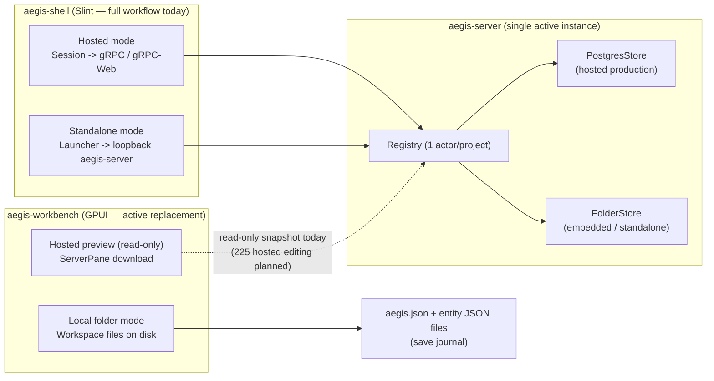

# AegisTARA — Current-State Architecture Overview

- **Status:** Post-hardening baseline (jobs `214`–`224` complete on `master`)
- **Scope:** Concise entry point for all nine workspace crates, runtime modes, authoritative state, save/acknowledgement semantics, identity, methodology/engine compatibility, and deployment boundaries.
- **Deep dives:** Detailed struct-by-struct references live in [`docs/architecture.md`](architecture.md) and the decision records in [`docs/adr/`](adr/).

---

## 1. Workspace Topology (9 Production Crates)

Defined in root [`Cargo.toml`](../Cargo.toml) (`members = ["crates/*"]`, Rust edition 2024, MSRV `1.99.1`):

| Crate | Role | Key Entry Points / Tests |
|---|---|---|
| [`aegis-model`](../crates/aegis-model) | Deterministic TARA domain model, DAG attack-tree evaluation, explain-why, applicability, lint, diff, methodology pack pins, compatibility contract, snapshot/op-log/workspace-file persistence | `crates/aegis-model/src/{lib.rs,project.rs,compat.rs,methodology/mod.rs,store/}` · tests: `methodology_pins.rs`, `store.rs`, `workspace.rs` |
| [`aegis-proto`](../crates/aegis-proto) | Shared gRPC/Protobuf schema (`aegis.v1`) and metadata header constants (`x-aegis-error`, `x-aegis-current-seq`, `x-aegis-engine-semantics`, `x-aegis-protocol-version`) | `crates/aegis-proto/{proto/aegis/v1/aegis.proto,src/lib.rs}` |
| [`aegis-auth`](../crates/aegis-auth) | OIDC authorization code + PKCE, DPoP proofs (RFC 9449), JWT/JWKS validation with `issuer`, OS keychain store, shared rustls/TLS config | `crates/aegis-auth/src/{lib.rs,validate.rs,layer.rs,tls.rs}` |
| [`aegis-license`](../crates/aegis-license) | Ed25519 offline license files, grace period, seat ledger, signed update manifests | `crates/aegis-license/src/lib.rs` |
| [`aegis-server`](../crates/aegis-server) | Single-instance modular monolith gRPC/gRPC-Web server: one actor per open project, edit lease (D4), `MemoryStore` / `FolderStore` / `PostgresStore`, hash-chained audit & event logs, qualified identity directory, compatibility write guard | `crates/aegis-server/src/{main.rs,service.rs,registry.rs,actor.rs,identity.rs,methodologies.rs,store/,accounts/}` · tests: `api.rs`, `cli.rs`, `folder.rs`, `postgres.rs` |
| [`aegis-canvas`](../crates/aegis-canvas) | Toolkit-agnostic attack-tree layout (Buchheim), R-tree hit testing, display list, SVG adapter, screen-reader semantics | `crates/aegis-canvas/src/lib.rs` |
| [`aegis-client`](../crates/aegis-client) | Toolkit-agnostic client core: origin-bound sign-in flow, `Connection` with compatibility headers, `Session` optimistic editing & drain handshake, `Workspace`, `ViewModel`, `ReportDoc` (HTML/PDF/XLSX), i18n | `crates/aegis-client/src/{connection.rs,session.rs,signin/flow.rs,workspace.rs,report/doc.rs}` · tests: `auth_origin.rs`, `session.rs`, `engine_compatibility.rs`, `report_builder.rs` |
| [`aegis-shell`](../crates/aegis-shell) | Current full-workflow Slint desktop app (hosted + embedded standalone loopback server) — slated for retirement only after GPUI parity (`192-retire-slint`, `[design]`) | `crates/aegis-shell/src/{main.rs,launcher.rs,controller.rs}` |
| [`aegis-workbench`](../crates/aegis-workbench) | Next-generation GPUI desktop workbench: local standalone workspace-folder editing, server sign-in/project list (read-only download today), grids, inspector | `crates/aegis-workbench/src/app/{shell.rs,files.rs,server.rs,table_edit.rs,workbench.rs}` · tests: `folder_view.rs`, `start_server.rs` |

---

## 2. Runtime Modes, Authoritative State, and Recovery Paths

### Authoritative State & Save/Acknowledgement Matrix

| Mode | Authoritative State | Write / Save Path | Recovery Path on Failure | Source / Test Proof |
|---|---|---|---|---|
| **Slint Hosted** (`aegis-shell` → remote `aegis-server`) | Server `PostgresStore` (snapshot + gap-free op log + hash-chained audit) | `Session` acquires edit lease (D4, 2 min), applies ops optimistically in `Workspace`, submits via `SubmitOps`. On close/switch/disconnect/shutdown, `Session::drain_and_shutdown` commits or surfaces uncommitted work before releasing the lease. | On ambiguous store commit (`StoreFault::Uncertain` / `Sequence`), server unloads/reloads the actor and reconciles idempotent repeat submissions (`reconcile_repeat`); client reloads server truth on `StaleBase` or `LockInvalid`. | `crates/aegis-server/src/{actor.rs,registry.rs,store/postgres.rs}`, `crates/aegis-client/src/session.rs` · tests: `crates/aegis-client/tests/session.rs`, `crates/aegis-server/tests/postgres.rs` |
| **Slint Embedded Standalone** (`aegis-shell` + loopback `aegis-server`) | Local `FolderStore` (`manifest.json` + snapshots + op log) | Same `Session` handshake over `127.0.0.1`; `Launcher::shutdown` awaits `Session::drain_and_shutdown` before stopping the embedded server. | `FolderStore` distinguishes pre-rename failure from post-publish uncertainty, never deletes snapshots referenced by the visible manifest, and stops further writes after uncertain durability. | `crates/aegis-shell/src/launcher.rs`, `crates/aegis-server/src/store/folder.rs` · tests: `crates/aegis-server/tests/folder.rs` |
| **GPUI Local Folder** (`aegis-workbench`) | Local workspace file set (`aegis.json` + entity files, ADR 0065 / 0071) | `commit_active_editors()` flushes open cell drafts; save journal writes only workspace file-set paths atomically; all workspace replacements route through Save / Don't save / Cancel. | Failed save keeps dirty state and offers Save / Don't save / Cancel; entering local mode invalidates any in-flight remote download (`accept_open`). | `crates/aegis-workbench/src/app/{files.rs,table_edit.rs,shell.rs,server.rs}` · tests: `crates/aegis-workbench/tests/{folder_view.rs,start_server.rs}` |
| **GPUI Hosted Preview** (`aegis-workbench`) | Server (read-only download in GPUI today) | Read-only snapshot inspection; **hosted editing in GPUI is planned (`225-gpui-hosted-editing`, `[design]`)** and will route through the shared `Session`. | Server remains authoritative; local edits are never treated as a separate hosted authority. | `crates/aegis-workbench/src/app/server.rs` |

---

## 3. Hardened Security, Identity, and Compatibility Boundaries

1. **Deployment topology (single active hosted instance + TLS proxy):**
   - `aegis-server` is a **single-instance modular monolith** (one in-process actor and edit lease per open project; no multi-replica coordination).
   - Production deployments terminate TLS at a reverse proxy (or run HTTPS directly) and connect to PostgreSQL with `AEGIS_DB_TLS=encrypt|verify` (`crates/aegis-server/src/store/postgres.rs`, `docs/deployment.md`).
   - **Production auth guard (`221`):** `AEGIS_AUTH=dev` / `AEGIS_DEV_AUTH=1` are compiled out of normal release binaries and container images (`deploy/Dockerfile`, `deploy/verify-image.sh`). Even when opted into via Cargo feature `dev-auth`, dev auth is restricted to loopback (`crates/aegis-server/src/main.rs`, `crates/aegis-server/tests/cli.rs`, `SECURITY.md`).
2. **Authentication origin isolation (`214`, ADR 0072):**
   - Sign-in attempts and discovery results carry an attempt generation and normalized `Origin`; stale completions after server switch or sign-out are dropped, and credentials are never sent to or stored under a different origin (`crates/aegis-client/src/signin/flow.rs`, `crates/aegis-client/tests/auth_origin.rs`).
3. **Qualified identities (`220`, ADR 0073):**
   - Local accounts and OIDC `(issuer, sub)` identities map to opaque internal `UserId` (`uid:<uuid>`) entries in `IdentityDirectory` (`crates/aegis-server/src/identity.rs`). Equal strings across local and OIDC or across two issuers never implicitly link; ambiguous legacy memberships require explicit resolution with backup/rollback while preserving historical audit bytes.
4. **Atomic audit event-chain retention & verification (`222`):**
   - `PostgresEventLog::trim_events_bounded` deletes bounded batches and advances `tail_hash` in one atomic CTE transaction; `verify_events` reads the anchor and retained rows in a single `REPEATABLE READ` read-only snapshot (`crates/aegis-server/src/accounts/postgres.rs`, `crates/aegis-server/tests/postgres.rs`).
5. **Immutable methodology pins (`223`, ADR 0074):**
   - Snapshots and workspaces persist `methodology.digest` (`sha256:<hex>` over canonical pack JSON). `Methodologies` indexes hosted packs by digest; `Registry::load` resolves pinned projects strictly by digest and refuses mismatched matrices even when `key` and `version` match. Legacy unpinned v1 files remain explicitly unpinned (`MethodologyPin::LegacyUnpinned`) rather than guessing (`crates/aegis-model/src/methodology/mod.rs`, `crates/aegis-model/tests/methodology_pins.rs`).
6. **Engine and protocol compatibility contract (`224`, ADR 0075):**
   - Calculation semantics (`ENGINE_SEMANTICS_VERSION`), wire/op protocol (`PROTOCOL_VERSION`, `MIN_SUPPORTED_PROTOCOL_VERSION`), file format (`FORMAT_VERSION`), and methodology pack digest evolve independently (`crates/aegis-model/src/compat.rs`).
   - `GetServerInfo` advertises the contract; `Connection` attaches `x-aegis-engine-semantics` and `x-aegis-protocol-version` on write RPCs; `AegisService` rejects incompatible writes with `FAILED_PRECONDITION` (`incompatible_client`); incompatible clients stay read-only with an actionable reason; baselines and `ReportDoc` covers record engine + semantics + pack digest (`crates/aegis-client/tests/engine_compatibility.rs`).

---

## 4. Planned / Design-Gated Capabilities (Not Yet Shipped)

Items marked `[design]` or open in [`factory/backlog.md`](../factory/backlog.md) are **not** yet shipped:

- **GPUI parity & Slint retirement:** GPUI hosted editing (`225`), attack-tree canvas tab (`187`), item-definition Markdown/schematic tab (`195`), bottom dock (`191`), embedded versions timeline (`203`), legacy-folder migration (`227`), GPUI reports/settings (`209`), app settings (`213`), and Slint removal (`192`).
- **Domain extensions:** Assumptions (`136`), attacker profile (`137`), control status (`140`), shared steps/fragments/bypass trees (`141`–`144`), traceability graph & ReqIF/Jira connectors (`076`–`079`, `094`, `151`).
- **AI gateway & assistants (Phase 7):** Server AI gateway (`088`), golden set (`090`), AI wave 1 (`091`), semantic search (`092`), translation (`093`). (Suggestion branches `089` are already implemented in `aegis-model`.)
