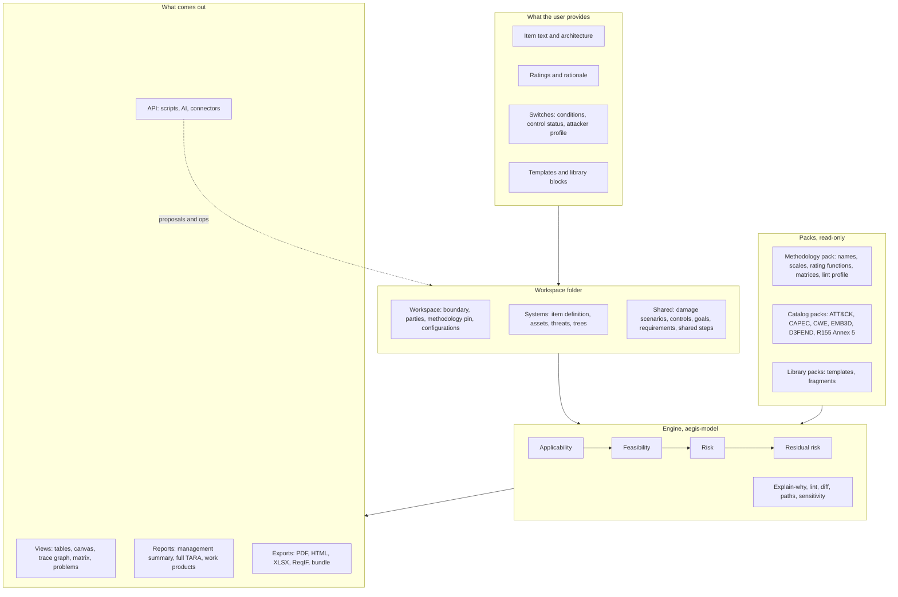
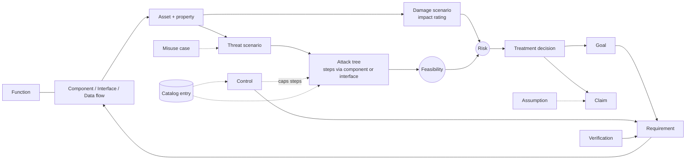
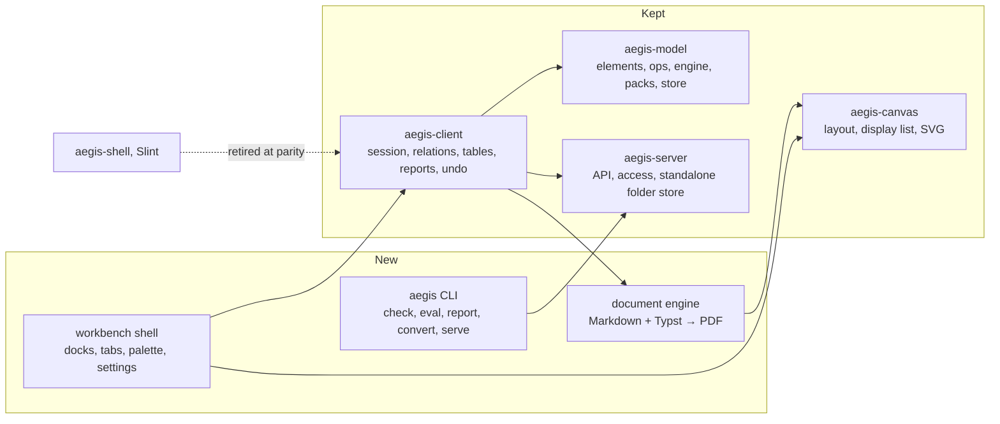

# Workbench architecture: the whole system, before the breakdown

- Date: 2026-11-10
- Status: for agreement with the owner. No code changed. After agreement this is cut into requirements and jobs.
- Builds on: [brainstorm-workbench-v2.md](../brainstorm-workbench-v2.md) (accepted direction), [decisions.md](../decisions.md) D1 to D31, [architecture.md](../architecture.md), [reference-ui-review.md](reference-ui-review.md).
- Update: [workbench-gui-first.md](workbench-gui-first.md) (D40) replaces the "source view of every tab" idea: files are storage, the user works in grids, forms and a canvas.
- Changes to the brainstorm: the file format is JSON, not TOML (section 7); scripts change a project through a scoped API, not by writing files (section 8).

## TLDR

- AegisTARA holds one **security case** per product: a typed graph of elements, read through a **methodology pack**, computed by a **deterministic engine**, shown as **views** and **reports**.
- There are three scope levels, and every element lives at exactly one: **workspace** (the vehicle or product), **system** (one item with its own boundary), **component**. Section 3 says which element lives where. This is what keeps project, system and component information coherent.
- One **trace spine** links everything in both directions: item → asset → damage and threat → attack path → risk → treatment → goal or claim → requirement → control → verification. Every screen and every report is a walk along it.
- A methodology is **data**. The kernel has fixed element kinds and fixed kinds of calculation; a pack supplies names, scales, tables and catalogs. ISO/SAE 21434, HEAVENS, ETSI TVRA, IEC 62443, STRIDE and the EU CRA fit without new code. MITRE ATT&CK, CAPEC, CWE, EMB3D and D3FEND are **catalogs**, not methodologies: they attach to steps, components and controls.
- Storage: a folder of small **JSON** files plus Markdown, with one single-file bundle for handover. The existing strict JSON reader is kept.
- Scripts, AI and outside tools all use **one API with scopes**. The default scope can only propose.

## 1. What the product is

One sentence: **a workbench where a security analyst builds, configures and proves a threat analysis and risk assessment for a product made of several systems.**

Three words in that sentence carry the design:

| Word | Means | Consequence |
|---|---|---|
| builds | The analyst creates elements and links them | A typed graph with ops, undo and validation (exists) |
| configures | The same analysis is read under different variants and methodologies | Layers and switches change numbers; nothing is copied (D26 to D28) |
| proves | Every number can be traced to its cause and every claim to its evidence | The trace spine, explain-why, reports, file history |

What it is not: a requirements manager, a vulnerability scanner, a test manager, or a diagram tool. It links to those (section 10).

## 2. The whole system on one page



Five rules hold everywhere:

1. **Stored or derived, never both.** People store facts and decisions. The engine derives exclusions, feasibility, risk, coverage and suspect links (existing rule D10).
2. **One writer path.** Every change, from the UI, a script, AI or an import, is an op that the model validates.
3. **One reader path for links.** Every relation is a row in the relation registry (D30). The inspector, trace views, search and reports read that table.
4. **The methodology is never in code.** No Rust file names a standard except the pack loader.
5. **A number always states its context.** Which systems, which configuration, which methodology version, which revision.

## 3. Scope levels and who owns what

### 3.1 The three levels

| Level | What it is | Its boundary | Example |
|---|---|---|---|
| **Workspace** | One product or vehicle programme. One methodology, one set of scales, one history. | Everything analysed together and reported together. Another product is another workspace. | `vehicle-x` |
| **System** | One item in the ISO sense: a set of components with its own item definition and its own TARA. | Its components. A component is in exactly one system (D26). What crosses the boundary is an interface to a component of another system. | Gateway, Brake ECU, Backend |
| **Component** | A part inside a system: hardware, software, a service. | Its interfaces. | Gateway application core, HSM |

A workspace with one system is the simple case and looks like today's project.

### 3.2 Ownership table

This table is the answer to "the relationship between project, system and component information must be coherent". Each kind has one home. A kind at workspace level can be used by any system.

| Element kind | Home | Used by | Why there |
|---|---|---|---|
| Methodology pin, scales | Workspace | all | Totals across systems need one scale |
| Party (us, customer, supplier) | Workspace | goals, claims, controls | One list of who is responsible |
| Attacker profile | Workspace | engine | One attacker model per analysis; a configuration may override it |
| Configuration (named set of switches) | Workspace | engine, reports | A variant covers the whole product |
| Glossary, related documents | Workspace | reports | Project facts |
| Damage scenario | Workspace | assets and threats of any system | Harm is to the road user or the company, not to an ECU |
| Security control (definition) | Workspace | applied to components and interfaces | "Secure boot" is defined once |
| Control application (target, status) | System | engine | Whether it is on, and where, differs per system |
| Cybersecurity goal, claim | Workspace | threats of any system | A goal may cover threats in two systems |
| Requirement, verification | Workspace | allocated to a system or component | ISO/SAE 21434 Figure 3 |
| Shared step, shared fragment | Workspace | trees of any system | Rated once (D29) |
| Item text (description, scope) | System | reports | Each item has its own |
| Component, function, interface, data flow, trust boundary | System | assets, steps | The item definition |
| Condition | System, or workspace when product-wide | any element | "Has Ethernet" belongs to the system that has the port |
| Assumption | System | steps, trees, claims | Made about one item |
| Asset | System, bound to a component, function, interface or flow | threats, damage scenarios | An asset is something in the item |
| Misuse case | System | threats | Optional; a pack may hide it |
| Threat scenario | System | risks | Asset plus violated property |
| Attack tree | System, one per threat | engine | The path analysis |
| Treatment decision | On the threat and damage pair | goals, claims | The decision is about one risk |
| Review note | Next to the element it is about, outside the analysis data | reviewers | Never changes a number (REV-01) |
| **Risk, feasibility, exclusion, coverage** | **Nowhere: derived** | everything | Rule 1 |

One model change follows from this table: today a control carries one status. For per-system settings the status moves to the **application** of a control in a system, and resolves through the layers (template, workspace, system, configuration).

### 3.3 What a project boundary means in practice

- **Inside the workspace:** all systems of the product, their variants, shared parts, the reports.
- **Brought in by reference:** templates and library blocks (pinned version), another team's TARA as **external results** (a pinned bundle whose risks are read, not edited).
- **Outside, linked only:** requirements in the ALM tool, tickets, test results, vulnerability reports, SBOMs. Each is an external reference on an element (TRC-01).

## 4. The trace spine



Round nodes are derived. Dashed lines are optional links.

- **Forward** answers "what follows from this?": select an interface and see its assets, threats, risks, goals, requirements.
- **Backward** answers "why does this exist?": select a requirement and see the goal, the risk, the threat, the asset, the interface.
- **The loop closes.** A control implements a requirement and also caps attack steps, so the residual risk shows whether the requirement did its job.
- **Suspect links** are derived: when the source of a link changed after the link was confirmed, the link is marked until someone looks (TRC-02).
- **Coverage** is derived: assets with no threat, threats with no tree, risks with no decision, goals with no requirement, requirements with no control or verification. These are linter rules and columns of the trace matrix.

Every link in the picture is one row of the relation registry. A new element kind adds rows; no view is written again.

## 5. The component inventory

Every part the reference tool shows, and a few it lacks. "State" says what exists in the code today.

### 5.1 Workspace level

| Part | What it holds or shows | Stored or derived | State |
|---|---|---|---|
| Overview | Systems, risk totals, open problems, what changed since the last tag | derived | partly (Overview page) |
| **Management summary** | Risk distribution before and after treatment, top risks, treatment status, accepted risks and who accepted them, the configuration and revision it is true for, plus one written paragraph | derived, plus one text | planned |
| Project details | Name, product, parties, languages, glossary, related documents, notes | stored | partly (FND-08, 11, 12) |
| Methodology | The pinned pack and its version; scales shown read-only | stored pin | built |
| Attacker profile | Allowed values per feasibility factor; scalability | stored | built (D27) |
| **Configurations** | Named sets of switches ("with Ethernet", "production", "customer assumptions on") | stored | new: today there is one unnamed set |
| Shared elements | Damage scenarios, controls, goals, claims, requirements, shared steps and fragments | stored | built or planned per kind |
| Library | Templates, fragments, catalog search | read-only packs | partly (library pack, phase 0) |
| Reports | Profiles: sections, filters, language, branding, scope, configuration | stored profile, derived output | partly (D17) |
| Changes | File history, meaning diff, tags as baselines, review notes | git plus derived diff | replaces History and Versions pages |

### 5.2 System level

| Part | What it holds or shows | State |
|---|---|---|
| Item definition | Markdown text with the structure block: components, functions, interfaces, flows, trust boundaries, and the diagram drawn from it | elements built (job 074), text built (ARC-05), Markdown and diagram new |
| System settings | Template it extends, conditions, control applications and status, added controls, each with its source layer | rules built (D26 to D28), layers new |
| Assumptions | Text, holds or not, what it excludes, the claim it leads to | built (D27) |
| Assets | Name, bound item element, security properties, linked damage scenarios | built |
| Misuse cases | Name, text, linked threats | planned (FND-13) |
| Threat scenarios | Asset, property, category, scaling, feasibility source, goals | built |
| Attack trees | Canvas and table; steps with via, attack type, factors, rationale, catalog references | built |
| Risk register | One row per threat and damage pair: impact, feasibility, risk, decision, rationale, residual | built |
| Goals, claims, requirements for this system | The shared lists filtered to this system | goals and claims built; requirements planned |
| Problems | Linter findings for this system | built |

### 5.3 Cross-cutting

| Part | What it does | State |
|---|---|---|
| Trace graph and matrix | The spine as columns with counts; the matrix with coverage numbers | planned (TRC-04, TRC-05) |
| Go to anything, find | Search by ID, name, text, catalog ID | find built; palette new |
| Explain-why | The chain that produces a number, down to the step, control or switch | built (ADR 0006) |
| Compare | Two configurations, or two revisions, side by side | diff built; view new |
| Review | Notes on any element, open or resolved | planned (REV-01 to 03) |
| Application settings | Theme, keymap, language, AI providers, library folders, trusted workspaces | partly |
| **Admin** | Server mode only: users, roles, sessions, license, audit log, connectors. Standalone shows only the license. | built for the server |

"Configuration management" means two different things in this product, and they stay apart:

| Meaning | Answered by |
|---|---|
| Variants of the **product** (with or without an interface, a control on or off) | Conditions, control status, named configurations. These are ops and change numbers. |
| Versions of the **analysis** (who changed what, what was released) | Files and git: a commit is a change, a tag is a baseline, a report records the tag and the configuration. |

## 6. Methodologies and catalogs

### 6.1 The principle

The owner's rule: the product must hold several methodologies **as they are**, without inventing a new one and without bending an existing one. The design that gives this:

- **The kernel fixes the shape:** the element kinds of section 3, the spine of section 4, and four kinds of calculation.
- **A pack fills the shape:** names, scales, tables, which optional kinds are shown, which lint rules apply, which report sections exist.
- **A pack never contains code.** It is data the reader validates with size caps (ADR 0011), so a pack from a customer cannot run anything.

### 6.2 The four kinds of calculation

Every methodology looked at reduces to these. Each is a declared function, so explain-why can print it.

| Kind | Input → output | Declared by the pack | Used for |
|---|---|---|---|
| **Factor rating** | Several ordinal factors → one level | Factors and their values; how to combine (sum, maximum, minimum, average, lookup); bands from result to level | Attack potential, HEAVENS threat level, TVRA likelihood, DREAD, attack-vector rating |
| **Direct rating** | A person picks a level | The scale | Plain likelihood (DOM-02), impact ratings |
| **Tree combination** | Children's levels → parent level | Rule per gate (OR: easiest child; AND: hardest child, or combine factors) | Attack trees |
| **Matrix** | Two levels → one level | The table, one per impact category if needed | Risk determination, security level, target level |

Built today: attack potential (a factor rating with sum), direct rating, the tree rule, the risk matrix. To generalise: let a pack declare any factor rating, not only attack potential. CVSS is the one special case: its formula has constants and rounding, so it is a built-in function a pack may select, not a table.

A pack may also declare **extra attributes** on an element kind (a key, a label, a type: level, choice or text). The engine ignores them; tables, the inspector, filters and reports show them. This is how a cybersecurity assurance level on a goal or a target security level on a zone exists without code.

### 6.3 How each methodology maps

| Kernel | ISO/SAE 21434 + UN R155 | HEAVENS 2.0 | ETSI TVRA | IEC 62443-3-2 | STRIDE (services, cloud) | EU CRA product pack |
|---|---|---|---|---|---|---|
| System | Item | Target of evaluation | Target of evaluation | System under consideration | Application | Product with digital elements |
| Trust boundary, interface | Trust boundary, interface | same | Interface | **Zone, conduit** | Trust boundary, data flow | Boundary, interface |
| Asset + property | Asset with cybersecurity property | Asset with security attribute | Asset | Asset in a zone | DFD element | Asset |
| Damage scenario | Damage scenario | Damage scenario | Unwanted incident | Consequence | Impact | Harm to user or business |
| Impact categories | Safety, financial, operational, privacy | Safety, financial, operational, privacy and legislation | One scale | Health and safety, environment, finance, others set by the owner | Set by the pack | Set by the pack |
| Threat scenario | Threat scenario | Threat (STRIDE per asset) | Threat | Threat | Threat (STRIDE per element) | Threat |
| Feasibility | Attack potential, CVSS or attack vector → 4 levels | Threat level from 4 factors | Likelihood from attack potential, 3 levels | Likelihood, direct | Direct or DREAD | Direct likelihood |
| Risk | Matrix → 1 to 5 | Security level: QM to Critical | Likelihood × impact → minor, major, critical | Matrix, compared with tolerable risk | Matrix | Matrix |
| Treatment | Avoid, reduce, share, retain | same | Countermeasure | Countermeasure, target security level | Mitigate, eliminate, transfer, accept | Treat, document |
| Goal / claim | Cybersecurity goal / claim | Security requirement | Security objective | Target security level per zone (extra attribute) | Mitigation | Essential requirement met |
| Requirement source | Cybersecurity concept | same | Functional security requirements | IEC 62443-3-3 system requirements (catalog) | Design change | CRA Annex I (catalog) |
| Report sections | Clause 9 and 15 work products | HEAVENS report | TVRA report | Zone and conduit report | Threat model report | Risk assessment for the technical file |

Packs shipped today: ISO/SAE 21434 + R155, EU CRA, STRIDE for services and cloud. HEAVENS, TVRA and IEC 62443 are new packs that need the general factor rating and extra attributes, and no other kernel change. Medical (ISO 14971 harm and severity with an exploitability rating) fits the same way.

**Not supported, on purpose:** quantitative models in money or probability (FAIR, Monte Carlo). The engine is ordinal. Saying so now is cheaper than half-supporting it.

### 6.4 MITRE and other catalogs

MITRE publishes **knowledge bases**, not a rating method. They do not replace a pack; they plug into three places on the spine.

| Catalog | What it lists | Attaches to | What the user gets |
|---|---|---|---|
| ATT&CK (Enterprise, Mobile, ICS) | Tactics and techniques | Attack steps | Pick a technique when writing a step; a coverage map of techniques analysed |
| CAPEC | Attack patterns | Attack steps, library fragments | Search patterns; starter fragments |
| CWE | Weaknesses | Steps, components | "This step uses this weakness" for the developers |
| EMB3D | Device properties → threats → mitigations | Components (properties), threats, controls | Tick a component's properties and get proposed threats and mitigations |
| D3FEND, ATT&CK mitigations | Defensive techniques | Controls | Name controls in a common vocabulary |
| UN R155 Annex 5 | Threats and mitigations | Threats, controls | The coverage table a type-approval authority asks for |
| IEC 62443-3-3, CRA Annex I | Requirements | Requirements | Start from the standard's list |

Rules for catalogs:

- A catalog pack is separate from a methodology pack, so ISO with ATT&CK and STRIDE with ATT&CK are both possible.
- A catalog reference is an ID plus a version. The engine never uses it for a number.
- Cross-maps between catalogs (EMB3D property → threat → mitigation; CAPEC → CWE) are data in the catalog pack and drive **proposals**, never automatic changes.
- Catalog text ships only where the catalog's terms allow it; today's packs are metadata only for that reason (D5).

### 6.5 One methodology per workspace

A workspace pins one methodology and version, because adding up risks across systems needs one scale. A supplier's TARA made with another methodology comes in as external results with a level mapping table that the user confirms. Changing a workspace's methodology is a conversion that shows every element it cannot map.

## 7. Storage

The owner's question: keep JSON, or a different extension with a wrapper?

**Answer: keep JSON, in a folder, with one bundle file for handover.**

| Choice | Decision | Why |
|---|---|---|
| Encoding | **JSON**, as today | ADR 0009 and 0011 already chose it over TOML and binary: one strict, size-capped, fuzz-tested reader for every file. My TOML proposal would have added a second reader for no gain, now that scripts use the API and not the files. |
| Layout | A **folder** of small files, one per system and kind, one per attack tree | Git shows what changed; two people rarely touch the same file |
| Envelope | Every file starts with `format`, `version`, `kind` | Already the pack convention; lets old files be migrated and wrong files be refused with a clear message |
| Prose | **Markdown** (`item.md`), with the structure block | The one place a person writes long text |
| Handover | One **bundle file** (`.aegis`): the folder zipped with a manifest of file hashes | A consultant sends one file; the receiver's app checks it and unpacks it |
| Not chosen | A custom binary format, SQLite | Not diffable, a second format to maintain, rejected before in ADR 0009 and 0050 |

```
vehicle-x/
  aegis.json                    workspace: methodology pin, parties, languages, libraries, attacker profile
  configs/with-ethernet.json    a named configuration
  shared/
    damage.json  controls.json  goals.json  requirements.json  steps.json
    fragments/tt-3-bypass-secure-comm.json
  systems/gateway/
    system.json                 template pin, conditions, control applications
    item.md                     item definition (text + structure block)
    assets.json  threats.json  assumptions.json  misuse.json
    trees/at-1-bus-manipulation.json
  reviews/                      review notes, outside the analysis data
  reports/                      report profiles
  library/                      workspace-local templates and fragments
```

- References between files use the stable internal ID. The visual ID (`T01`) is for people.
- Files are written in a fixed key order with one element per block, so a diff is small.
- The in-memory model, the ops and the wire keys do not change. The store gains a second layout next to the single snapshot; the snapshot stays for server mode and for old projects.
- In the mock-up, `system.toml` becomes `system.json`. The "source" view of a tab shows the JSON.

## 8. Access: one API with scopes

The owner's steer: scripts get limited access through an API. This becomes the only way anything outside the app changes a project.

| Scope | May do | Default for |
|---|---|---|
| `read` | Read elements, numbers, explain-why, problems, reports | everything |
| `propose` | Put ops on a suggestion branch (FND-05). A person accepts or rejects them in the Changes panel. | scripts, AI, imports |
| `write` | Apply ops directly, limited to named element kinds and systems | a script the user explicitly trusted |
| never granted | Admin, license, deleting a workspace, changing a pack | |

- The API is the existing gRPC contract (`aegis.proto`), which standalone mode already serves on the loopback address. Scoped tokens are requirement INT-07.
- A **task** in the workspace declares its command and its scope. The app starts it with a short-lived token for that scope. The script's language does not matter and nothing is embedded in the app.
- Every op carries provenance (ADR 0013): the task or model that made it. Reports can list what was machine-proposed.
- **AI** is one more client with `read` and `propose`. Providers are OpenAI-compatible or Anthropic endpoints, local by default (D12).
- **Methodology changes** are pack edits: a new pack version is a new file that the workspace pins. No API changes a pack in place.

## 9. The application



- **Shell toolkit.** GPUI and gpui-component stay the first candidate, decided by the spike. The owner's point stands: Zed's source can be read for how it solves docks, palettes and settings. Ideas may be taken; code from its GPL crates may not be copied. If the spike fails, the same design is built on the fallback toolkit, because nothing below the shell depends on it.
- **Information architecture.** The project tree mirrors the folder and the scope levels. Every element kind opens as a tab. The inspector always shows the spine around the selection: what it comes from above, what depends on it below.
- **Mock-ups:** the four Figma frames from 2026-11-10 stand, with `system.toml` read as `system.json`.

## 10. Edges of the system

| Neighbour | Direction | How |
|---|---|---|
| ALM tools (Polarion, JAMA, DOORS, codebeamer, Jira) | goals, requirements, controls out; status in | ReqIF first, connectors on order (D18) |
| Excel TARAs | in | Import with a mapping step (built) |
| Architecture pictures | in | Image attachments (D15) |
| Another team's TARA | in | External results from a pinned bundle |
| Local or company AI model | both | Provider settings, `propose` scope |
| Git hosting | both | The user's own git; the app only needs the folder |
| Vulnerability and test tools | link only | External references |

## 11. What is kept, changed and discarded

**Kept as it is**

- The model kernel: typed elements, ops with exact inverses, the evaluation cache, explain-why, linter, diff, top paths, choke points, sensitivity.
- Methodology packs and catalog packs as validated JSON. The three shipped packs.
- The relation registry and the element recipe (D30).
- `aegis-canvas` and its display list. `aegis-client` as the toolkit-free core.
- Applicability, control status, shared blocks (D27 to D29).
- Languages (D13), the license check, the report document model (D17).
- `aegis-server`, frozen until a customer orders a server.

**Changed**

| From | To |
|---|---|
| One snapshot file plus an op log | A folder of JSON files; the snapshot layout stays readable |
| One control status | Status on the control's application in a system, resolved through layers |
| Systems as a view filter (D26) | Systems as folders with their own item definition and settings; still no effect on numbers |
| One unnamed set of switches | Named configurations |
| Attack potential as the only factor method | Any pack-declared factor rating; extra attributes |
| Library items copied in (D14) | Whole-system templates by pinned reference; fragments still copied |
| Item text in form fields | Markdown with a structure block and a drawn diagram |
| PDF by hand layout | Typst templates, diagrams from the canvas |
| 17 pages in a sidebar | Tabs, docks, palette |
| Slint shell | New shell after the spike; Slint retired at parity |
| External plugins over the API (D20) | Same, plus scopes and the `propose` default, plus tasks |

**Discarded**

- The History and Versions pages and the baseline store, in standalone mode. Git does this.
- The op log and audit hash chain as saved files, in standalone mode. Ops stay in memory for undo.
- TOML, from my first proposal. One reader is enough.
- Scripts that edit project files directly. The API is the path.
- Embedded Python, Mermaid, a plugin marketplace, a built-in terminal.
- Composite projects as a separate design (D31). A workspace of system folders plus external results covers it.
- Quantitative risk models.

## 12. Points to agree before the breakdown

| # | Point | Proposed |
|---|---|---|
| 1 | The ownership table (3.2): damage scenarios, controls, goals and requirements live at workspace level | Yes |
| 2 | One methodology per workspace; other methodologies arrive as external results with a mapping | Yes |
| 3 | MITRE and R155 Annex 5 are catalogs that attach to steps, components and controls, not methodologies | Yes |
| 4 | Packs stay pure data; four kinds of calculation plus extra attributes; no formulas or code in packs | Yes |
| 5 | JSON in a folder, Markdown for the item definition, a `.aegis` bundle for handover | Yes |
| 6 | One API with `read`, `propose`, `write`; scripts and AI default to `propose` | Yes |
| 7 | Control status moves to the application of a control in a system | Yes |
| 8 | Quantitative methods are out of scope | Yes |

## 13. After agreement

The breakdown will follow this order, each a group of small jobs with its own acceptance test:

1. Workspace folder store and the `aegis` CLI.
2. Scope levels in the model: systems as owners, control applications, named configurations.
3. General factor rating and extra attributes in packs; HEAVENS, TVRA and IEC 62443 packs as the proof.
4. API scopes, suggestion branch, tasks.
5. Shell spike, then the workbench skeleton.
6. Item definition in Markdown, diagram, Typst reports and the management summary.
7. Trace graph, matrix, requirements and verification.
8. Templates, library, external results.

The brief for the next developer is written against group 1 first, since everything else stands on it.
