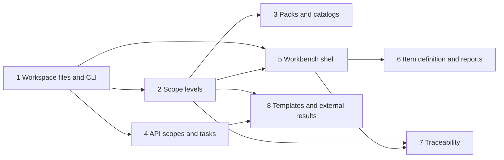

# Workbench breakdown: requirements and jobs

- Date: 2026-11-10
- Status: agreed direction (D32 to D39), cut into requirements and jobs. Nothing here is in `factory/backlog.md` yet; the owner moves lines there when a group should start.
- Reads with: [workbench-architecture.md](workbench-architecture.md) and [workbench-gui-first.md](workbench-gui-first.md), whose section 7 changes jobs 168, 187, 189 and 195 and adds 203 and 204.
- Job numbers start at 162 (161 is the highest used). Sizes: S is a day or two, M is about a week, L is two weeks or more.

## TLDR

- Eight groups, 43 jobs. Groups 1 to 4 are mostly model, store and API work and run under the current app.
- **Start with job 162** (workspace files in `aegis-model`). Its brief is [factory/jobs/162-workspace-files/spec.md](../../factory/jobs/162-workspace-files/spec.md).
- Group 5 begins with the toolkit spike (job 181). No new screen work goes into Slint after job 182 starts.
- Open backlog jobs are sorted into keep, split and drop in section 3.

## 1. Order and dependencies

Groups 2, 3 and 4 can run in parallel once group 1 is done. The spike (181) can run at any time; it depends on nothing.

## 2. Requirements and jobs

Every job follows the element recipe in [architecture.md](../architecture.md) III.9.3 where it adds an element kind, and ends with the local gate (`scripts/ci.sh`).

### Group 1: workspace files and CLI (D32)

| Req | Requirement |
|---|---|
| WSP-01 | A project can be written as a set of files (path, bytes) and read back to an equal project, byte for byte deterministic |
| WSP-02 | Every file has a `format`, `version`, `kind` envelope and is read with the existing size caps; a bad file is refused with its path and position |
| WSP-03 | A command-line tool converts between a snapshot and a folder, checks a folder, and prints the risk numbers as JSON |
| WSP-04 | The standalone app opens and saves a workspace folder; only changed files are written, each atomically |
| WSP-05 | A change made to the files outside the app is shown as a meaning diff before it is taken in |
| WSP-06 | A folder can be packed into one bundle file with a manifest of hashes, and unpacked after the hashes are checked |
| WSP-07 | The tool prints the meaning diff between two folders or two git revisions |

| Job | What | Size | Needs | Done when |
|---|---|---|---|---|
| **162-workspace-files** | `Project` to and from a file set in `aegis-model`; no disk access in the model | M | none | Every fixture and random projects round-trip to the same snapshot bytes; fuzz target runs clean |
| 163-aegis-cli | New crate `aegis-cli`, binary `aegis`: `convert`, `check`, `eval --json`; atomic folder writes | M | 162 | A fixture converts to a folder and back with identical bytes from the shell; `check` exits non-zero on a lint error |
| 164-standalone-workspace | Standalone mode opens a folder through the file set; save writes changed files; old project folders convert on open | L | 162 | The sample project is edited, saved and reopened with equal numbers; a killed save leaves the old files whole |
| 165-outside-changes | On window focus and on request, compare file hashes, load the new files, show `Project::diff`, apply or keep | M | 164 | A file edited by hand shows its diff; a broken file is reported and memory is unchanged |
| 166-bundle | `.aegis` bundle: pack, verify, unpack; path and size caps on unpack | S | 162 | A bundle with one changed byte is refused; a path that leaves the folder is refused |
| 167-meaning-diff-cli | `aegis diff A B` and `aegis diff --git REV` | S | 163 | The diff of two revisions lists the changed elements and the risk changes |
| 168-drop-history-pages | Remove History and Versions from standalone; a Changes list reads git log and tags | M | 164, 167 | A tag shows as a baseline and compares with the working folder |

### Group 2: scope levels (D33)

| Req | Requirement |
|---|---|
| SCP-01 | Systems exist as owners: each component is in one system; assets, threats, trees, conditions and assumptions belong to a system (extends SYS-01 to SYS-03) |
| SCP-02 | The file set has one folder per system |
| SCP-03 | A control has applications: target (system, component or interface) and status. Status is read from the application |
| SCP-04 | A workspace has named configurations: condition values, status overrides, an attacker profile override. One is active; reports name it |
| SCP-05 | The linter reports an element in the wrong home and a link that crosses systems where the ownership table forbids it |
| SCP-06 | Totals per system and for the workspace, each with explain-why |

| Job | What | Size | Needs | Done when |
|---|---|---|---|---|
| 169-systems-own | The open systems job (SYS-01 to SYS-03) with ownership of assets, threats, trees, conditions, assumptions | L | 162 | Old projects load as one system; every element reports its system |
| 170-system-folders | The file set writes `systems/<slug>/`; rename and remove a system | S | 169 | A two-system project round-trips; renaming a system moves its folder and nothing else |
| 171-control-applications | `ControlApplication`, status on it, ops with inverses, old projects load with equal numbers | L | 169 | A control off in one system and on in another gives different residual numbers in each |
| 172-configurations | Named configurations as elements; `SetActiveConfiguration`; evaluation reads the active one | M | 171 | Two configurations of the sample give the two expected risk tables; undo restores the first |
| 173-ownership-lint | Lint rules for SCP-05 | S | 169 | One finding per broken rule in a fixture built to break each |
| 174-rollup | Per-system and workspace totals in `aegis-client` | S | 169 | Totals equal the sum over systems for every fixture |

### Group 3: packs and catalogs (D34, D35)

| Req | Requirement |
|---|---|
| MTH-01 | A pack declares any number of factor ratings: factors, values, a combiner (sum, max, min, average, lookup), bands. Attack potential becomes one of them with no number changed |
| MTH-02 | A pack declares extra attributes on element kinds; they are stored, shown, diffed, exported, and ignored by the engine |
| MTH-03 | CVSS base exploitability as a built-in function a pack may select |
| MTH-04 | Packs for HEAVENS 2.0, ETSI TVRA and IEC 62443-3-2, written from public sources, each with a sample project |
| CAT-01 | Catalog references on attack steps, components, controls and requirements, by catalog ID, entry ID and version |
| CAT-02 | Cross-maps inside a catalog pack produce proposals (EMB3D property to threat to mitigation) |
| CAT-03 | A coverage view per catalog (for example the R155 Annex 5 table: covered, not applicable with a reason, open) |

| Job | What | Size | Needs | Done when |
|---|---|---|---|---|
| 175-factor-ratings | MTH-01 in the pack format and engine | L | none | The ISO pack's numbers are unchanged on every fixture; a test pack with a max combiner evaluates as written |
| 176-extra-attributes | MTH-02 | M | none | A pack attribute appears in the table, inspector, diff and XLSX with no code naming it |
| 177-cvss | MTH-03 | S | 175 | Published CVSS example vectors give the published scores |
| 178-more-packs | MTH-04, one pack per commit | M | 175, 176 | Each sample project evaluates to the hand-worked numbers in its note |
| 179-catalog-refs | CAT-01 | M | none | A step with an ATT&CK technique round-trips and is found by its ID |
| 180-catalog-proposals | CAT-02, CAT-03 | M | 179, 184 | EMB3D properties on a component propose threats on the suggestion branch |

### Group 4: API scopes and tasks (D36)

| Req | Requirement |
|---|---|
| API-01 | Tokens with a scope (`read`, `propose`, `write`) and, for `write`, a list of element kinds and systems; checked for every call (extends INT-07) |
| API-02 | A suggestion branch holds proposed ops apart from the project; accept and reject are ops with provenance (FND-05) |
| API-03 | Standalone mode issues a short-lived token to a task; the loopback API refuses calls without one |
| API-04 | Tasks: a command and a scope in the workspace file, run on request, output captured, a received workspace runs nothing until trusted |
| API-05 | A published example client in Python that reads risks and proposes a change |

| Job | What | Size | Needs | Done when |
|---|---|---|---|---|
| 183-scoped-tokens | API-01, API-03 | M | none | A `read` token is refused on `ApplyOp`; a `write` token for assets is refused on a threat |
| 184-suggestion-branch | API-02 (the open FND-05 job) | L | none | Proposed ops change no number until accepted; accept is one undo step |
| 185-tasks | API-04 | M | 183, 164 | A task with `propose` adds a suggestion; an untrusted folder's task does not start |
| 186-python-example | API-05, in `tools/`, not shipped | S | 183, 184 | The example runs against the sample workspace in CI |

### Group 5: workbench shell (D37)

| Req | Requirement |
|---|---|
| WBX-01 | The toolkit choice is recorded with measured frame time, memory, binary size and the RDP result |
| WBX-02 | A window with docks, tabs and splits, layout saved per workspace |
| WBX-03 | A project tree that mirrors the scope levels, with counts and risk marks |
| WBX-04 | A command palette and go to anything by visual ID, name or catalog ID |
| WBX-05 | The attack tree tab draws the `aegis-canvas` display list and edits through the same client commands |
| WBX-06 | The inspector shows the selection, its neighbours on the trace spine, and explain-why with go to cause |
| WBX-07 | Table tabs from `ColumnSpec` and the relation registry; a source view of every tab |
| WBX-08 | Settings with layers: each value shows its source and can be reset |
| WBX-09 | Problems, task output and changes in the bottom dock |
| WBX-10 | Every action reachable by keyboard; light and dark themes from token files |
| WBX-11 | One command table (id, label, icon, tooltip, shortcut) feeds menus, toolbar, palette and shortcut list; every menu item has an icon before its label and every icon a tooltip; a test fails on a command without either (job 182) |

| Job | What | Size | Needs | Done when |
|---|---|---|---|---|
| 181-shell-spike | WBX-01: a dock, the tree canvas, an inspector, a text editor tab, on macOS, Windows and Windows over RDP. Spike code is not kept (D8) | M | none | A decision record with the numbers; D37 updated |
| 182-workbench-skeleton | New crate `aegis-workbench`: WBX-02, WBX-03, WBX-04, WBX-10 | L | 181, 164 | The sample workspace opens; any element is reached from the palette |
| 187-tree-tab | WBX-05 | L | 182 | A tree is edited, undone and saved with no mouse |
| 188-inspector | WBX-06 | M | 187 | Go to cause from a risk lands on the deciding step |
| 189-table-tabs | WBX-07 (uses the open relation registry and table convention jobs) | L | 182 | Assets, threats and the risk register are edited in tabs |
| 190-settings-layers | WBX-08 | M | 171, 172, 182 | The settings mock-up works on the sample; reset removes an override |
| 191-bottom-dock | WBX-09 | M | 165, 185, 182 | A hand edit, a task proposal and a lint finding each appear and can be acted on |
| 203-embedded-versions | A git library inside the app: save version, mark baseline, restore; license check; no git installation needed (D40) | M | 164 | A machine with no git saves, tags, compares and restores |
| 204-guided-steps | New workspace, new system, new configuration, each three steps at most (D40) | M | 182, 200 | A new user creates a gateway system from a template without help |
| 192-retire-slint | Remove `aegis-shell` and the Slint license exception | S | 187 to 191, 195 | The owner has done one real TARA in the new shell |

### Group 6: item definition and reports (D38)

| Req | Requirement |
|---|---|
| DOC-01 | `item.md`: Markdown with a structure block; the block parses to the item elements and writes back in a fixed form |
| DOC-02 | `[[ID]]` links resolve, show the element, and follow a rename |
| DOC-03 | The diagram is laid out and drawn from the block by `aegis-canvas`; positions are hints stored next to the block |
| DOC-04 | Reports render through Typst templates; diagrams go in as SVG; Japanese text works |
| DOC-05 | A management summary: risk before and after treatment, highest residual risks, treatment status, accepted risks with the party, the configuration and revision (RPT-09) |

| Job | What | Size | Needs | Done when |
|---|---|---|---|---|
| 193-item-block | DOC-01, DOC-02 in `aegis-model` and the file set | L | 169 | Parse then write gives the same text; a bad line is reported with its number |
| 194-item-diagram | DOC-03 (the open architecture diagram job, fed by the block) | L | 193 | The sample item draws with its trust boundary; a snapshot test holds the display list |
| 195-item-tab | The Markdown tab with split preview | M | 182, 194 | The item mock-up works on the sample |
| 196-typst-reports | DOC-04; `krilla` layout removed when the outputs match | L | 194 | The sample report builds to PDF in English and Japanese; binary size change recorded |
| 197-management-summary | DOC-05 (the open RPT-09 job, as a tab and a report section) | M | 174 | Every number in the summary equals the engine's on every fixture |

### Group 7: traceability

The open jobs for TRC-01 to TRC-06 and REV-01 to REV-03 stay as written in the model and client. Their screens are built as workbench tabs.

| Job | What | Size | Needs |
|---|---|---|---|
| 198-trace-tabs | The trace graph and matrix as tabs over the relation registry; coverage columns | L | 189, the TRC jobs |

### Group 8: templates and external results (D39)

| Req | Requirement |
|---|---|
| TPL-01 | Library folders in three places (workspace, user, built in), searched in that order |
| TPL-02 | A system extends a template at a pinned version; the folder stores only what differs |
| TPL-03 | Update shows the diff first; detach copies everything in |
| TPL-04 | Five base templates: ECU, gateway, network device, sensor, backend |
| TPL-05 | External results: risks, goals and claims read from a pinned bundle, with a level mapping when the methodology differs (MTA-01, MTA-02) |

| Job | What | Size | Needs |
|---|---|---|---|
| 199-library-folders | TPL-01 | S | 162 |
| 200-extends | TPL-02, TPL-03 | L | 170, 171 |
| 201-base-templates | TPL-04, written from public sources | M | 200 |
| 202-external-results | TPL-05 | L | 166, 169 |

## 3. What happens to the open backlog

| Open jobs | Action |
|---|---|
| Model and client parts of: conditions, applicability, assumptions, attacker profile, shared steps, fragments, bypass trees, parties, pair rationale, functions, several goals per threat, misuse cases, glossary and documents, external references, requirements and verification, ReqIF | **Keep.** They do not depend on the shell. |
| Their `.slint` screens | **Split.** Build the Slint screen only if the consultancy needs it before job 192; otherwise the screen is built once, as a workbench tab. Decide per job when it is picked up. |
| Systems (SYS-01 to SYS-06), control status (CFG-10, CFG-11) | **Replaced** by jobs 169 to 174. |
| Relation registry, one table convention | **Keep and do early.** Jobs 188, 189 and 198 read them. |
| Design system pass in `theme.slint`, multi-link picker in `widgets.slint`, column chooser, canvas minimap, process map on the Overview | **Drop from Slint.** Their requirement moves to the workbench jobs. |
| Review notes | **Keep**, with the notes in `reviews/` of the folder. |
| Management summary, architecture diagram, suggestion branch, public API | **Merged** into jobs 197, 194, 184 and 183. |
| External results and composite projects (design session) | **Replaced** by job 202 and D33. |
| AI wave 1 and later | **Keep**, after job 184; providers are settings in standalone mode. |
| Server-only jobs (SSO, connectors, company library, offline bundle for sites) | **Unchanged**, waiting for a customer order. |

## 4. Rules for whoever picks up a job

1. Read the spec, then the two design documents, then the ADRs the spec names.
2. No code from a GPL crate. Zed's source may be read; nothing is copied.
3. A job that touches a number shows, with a test on the fixtures, that no saved number changed unless the spec says so.
4. A new file format gets size caps, a fuzz target and a round-trip property test, as ADR 0009 and 0011 did.
5. Write an ADR when the job makes a choice someone could reasonably have made differently.
