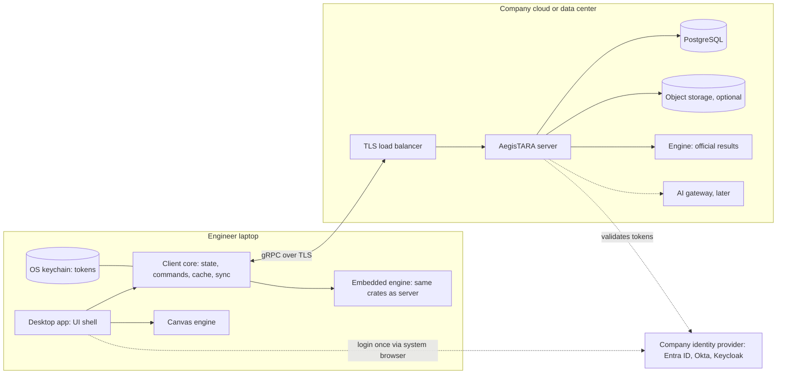
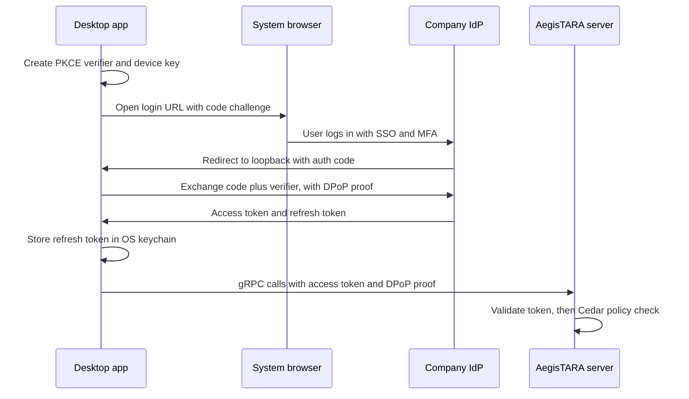

# Direction for v1: Desktop Client and Customer-Hosted Server

- Status: direction, not a final design. No code yet.
- Date: 2026-10-10
- Based on: [decisions.md](decisions.md) and [brainstorm.md](brainstorm.md)

## TLDR

1. **Shape:** a native Rust desktop app talks to a Rust server. The customer runs the server in its own cloud. The server is the source of truth.
2. **Same engine on both sides:** the desktop embeds the same risk engine for instant feedback. The server recomputes and stores the official result.
3. **Login:** company single sign-on (OIDC) through the system browser, once. Tokens live in the OS keychain and are bound to the device.
4. **Editing:** one editor per project at a time (an edit lock). Others watch live, read-only. Every change is an operation, so real-time co-editing can come later.
5. **UI toolkit:** Slint, chosen after a five-toolkit spike (see [spikes/RESULTS.md](../spikes/RESULTS.md)). iced is the fallback.
6. **Canvas trick:** the canvas engine produces a toolkit-neutral "display list". The same drawing goes to the screen and to SVG for PDF reports.
7. **Automotive v1:** the full ISO/SAE 21434 TARA flow for one item, UN R155 Annex 5 mapping, attack trees, explain-why, baselines, and a PDF report.
8. **Deployment:** one server container, PostgreSQL, the company identity provider, and a signed license file. No phone-home.

---

## 1. The big picture

---

## 2. Deployment at the customer

- **Single tenant:** one deployment per company. Simple isolation story. Keep an `org_id` in the schema anyway, so a hosted offering stays possible later.
- **Pieces:**
  - `aegis-server`: one static Rust binary, shipped as a container image.
  - PostgreSQL (any managed service works: Azure, AWS, GCP, or self-managed).
  - Object storage for large blobs: optional. PostgreSQL alone is fine at first.
  - The company identity provider through OIDC.
- **Install options:** Docker Compose for small teams. A Helm chart for Kubernetes. Plain VM install for air-gapped sites.
- **Operations:** health and readiness endpoints, Prometheus metrics, structured logs (`tracing`), and a documented backup and restore procedure.
- **High availability:** not in v1. One server instance plus managed PostgreSQL is enough for a large company. Later, add replicas with per-project routing (see brainstorm section 15).
- **Admin work happens in the desktop app** (admin role): users and groups, roles, projects, methodology packs, policies, audit view, license.

---

## 3. Client and server: who does what

| Concern | Desktop client | Server |
|---|---|---|
| Source of truth | No | Yes |
| Risk computation | Yes, for instant feedback and what-if | Yes, official result, stored with each version |
| Validation and lint | Yes, as you type | Yes, before accepting a change |
| Storage | Encrypted cache only, if policy allows | PostgreSQL, op log, snapshots, baselines |
| Permissions | Shows what you may do | Enforces it (Cedar policies) |
| Reports | Preview | Official, signed PDF |
| Packs and catalogs | Cached copy | Registry, installation, versions |

**Rule:** the engine is deterministic and versioned. Client and server must run the same engine version for a project. If they differ, the client shows server results only and asks the user to update.

**Data flow for an edit:**

1. The user acts in the UI. The UI creates a typed command.
2. The client core checks it with the embedded engine and shows the result at once (optimistic update).
3. The command goes to the server as an operation.
4. The server checks permission and the lock, validates, appends to the op log, and recomputes.
5. The server streams the accepted operation and new results to every open client.
6. If the server rejects it, the client rolls back and shows the reason.

---

## 4. Desktop UI toolkit

> **Update 2026-10-11:** the spike is done. Slint was chosen (decision D7). See [spikes/RESULTS.md](../spikes/RESULTS.md). The text below is the original pre-spike analysis.

Tauri was left out on purpose. It is a desktop app, but it draws its UI with a web view.
If web technology inside a desktop app is acceptable, Tauri would make the UI faster to build. Tell me if that changes your mind.

### Candidates

| | iced | GPUI + gpui-component | egui | Slint |
|---|---|---|---|---|
| Model | Elm style: message, update, view | Retained, GPU-first (from the Zed editor) | Immediate mode | Declarative markup |
| Look out of the box | Good | Very good (60+ components, dock layouts, virtual tables, charts) | Plain unless styled | Good |
| Big custom canvas | Canvas widget and custom wgpu shader widget | Custom elements, GPU drawn | Easy painter | Harder |
| Maturity | 0.14 (Dec 2025); used by the Kraken desktop app and the COSMIC desktop | Pre-1.0, thin docs, fast-moving API | Mature, widely used | 1.x, stable |
| Accessibility | Weak today | Unclear | Good (AccessKit) | Good |
| License | MIT | Apache-2.0 | MIT / Apache-2.0 | GPL-3.0, royalty-free with attribution, or commercial |
| Learning value | High: clean architecture | Medium | High: fast results | Medium |

### Recommendation (superseded by D7: Slint was chosen)

- **Lead: iced.** Its message-update-view loop maps directly onto our design: every UI action is a typed message, and a message becomes an operation for the server. Proven in a commercial trading app and a full desktop environment. MIT license.
- **Challenger: GPUI with gpui-component.** The most polished look and the richest pro widgets. The risk is API churn and thin documentation.
- **Fallback: egui.** Fastest to build. Good for internal tools and quick prototypes.
- **Slint** is a fine toolkit, but the large custom graph canvas is harder and its royalty-free license needs attribution.

### The spike (one week per candidate)

Build the same small prototype in iced and in GPUI:

- A canvas with 5,000 attack tree nodes: pan, zoom, select, drag. Target 60 frames per second.
- Drag a node from a palette onto the canvas.
- Docked side panels (properties, library).
- A virtual table with 10,000 rows.
- Light and dark theme, sharp text on Windows high-DPI screens.

Score each on: smoothness, look, code clarity, development speed, and how much we fought the toolkit. Record the result in the decision log.

### Keep the toolkit replaceable

- All app logic lives in a **client core** crate with no UI dependency: state, commands, sync, cache, undo.
- The UI shell is a thin layer on top. Switching toolkits later means rewriting only the shell.

---

## 5. The canvas engine and the display list

**[Edge]**

The canvas engine owns layout, hit testing, level of detail, and selection. It does not draw directly.
It produces a **display list**: rectangles, paths, text runs, icons, with style tokens.

Small adapters draw that list:

- on screen, with the chosen toolkit,
- to **SVG**, for the Typst PDF report,
- to PNG, for quick exports.

Result: diagrams in the executive report look exactly like the screen. The canvas is testable without a window (snapshot tests on the display list). And the toolkit stays replaceable.

---

## 6. Login and access

### Authentication

- **Company single sign-on via OIDC** (Entra ID, Okta, Ping, Keycloak, and others).
- The desktop app uses **Authorization Code with PKCE through the system browser and a loopback redirect** (RFC 8252, the standard for native apps). The user gets the company's normal login with MFA. The app never sees the password.
- **Device code flow** (RFC 8628) as a fallback for locked-down machines.
- **Local accounts** for small companies without an identity provider: Argon2id password hashing plus TOTP.

### Tokens

- Short-lived access token (about 10 minutes). Refresh token stored in the **OS keychain** (`keyring` crate: Windows Credential Manager, macOS Keychain, Linux Secret Service).
- Tokens **bound to a device key** with DPoP (RFC 9449). A stolen token is useless on another machine.
- Optional **device certificates** (mutual TLS) for high-security customers. The admin registers each laptop.

### Authorization

- **Cedar** policies on the server (Rust, Apache-2.0).
- Starting roles: Admin, Methodology Owner, Project Owner, Analyst, Reviewer, Viewer.
- Project membership plus classification labels (for example Internal, Confidential, Restricted).
- **Step-up login** for sensitive actions: accepting a risk, approving a baseline, exporting data.

### Sessions and audit

- Admin can see and revoke sessions. Idle timeout set by policy.
- Audit log: logins, exports, permission changes, approvals. Hash-chained.
- **Exports carry a watermark** with user and time. Exports are a data leak path, so they are logged and permission-controlled.

---

## 7. Editing model in v1: locks and live view

- **Edit lock per project.** The user takes the lock to edit. It is a lease (about 2 minutes) that the client renews in the background.
- If the client disconnects, the lease expires and the lock is released. Admins and project owners can break a lock.
- **Everyone else opens read-only** and sees changes live through the event stream.
- **What-if sandboxes** are always allowed, even without the lock. They are private branches. You can discard one or propose it as a change.
- **Later:** locks per module, then real-time co-editing. The op log makes both possible without a rewrite.
- **Offline:** v1 needs a connection to edit. A read-only offline cache is allowed if the admin policy permits it. Later: check out for offline work, merge on return.

---

## 8. Client-server protocol

- **gRPC over HTTP/2 with TLS** (`tonic` + `prost`).
  - Typed requests for commands and queries.
  - A server stream for live events: accepted operations, lock changes, recomputed results, notifications.
- **Schemas in Protobuf**, versioned. The server supports the current and the previous client version. A handshake at connect checks versions and features.
- **Risk:** some corporate proxies break HTTP/2 or gRPC. Fallback: gRPC-Web over HTTP/1.1 (`tonic-web`). Test this early with a real corporate network.
- **Public API for integrations** (later): REST + JSON with the same permissions.

---

## 9. Local data on the laptop

- The cache holds only projects the user opened.
- Encrypted at rest. The key is kept in the OS keychain.
- **Admin policy per classification:** cache allowed, cache with expiry, or no cache.
- **Remote wipe:** when access is revoked, the client deletes the cache at the next connection.
- No telemetry leaves the company. Crash reports stay local or go to the company server.
- Secrets in memory are wiped after use (`zeroize`).

---

## 10. Installers and updates

- Windows first, then macOS and Linux.
- Code signing: Authenticode on Windows, notarization on macOS.
- **Updates come from the company server, not from the internet.** The admin approves a client version on the server. Clients download that exact build from the server. The company controls rollout, and air-gapped sites work.
- Tooling options: Velopack (Rust crate; its packaging tool needs the .NET SDK at build time) or `cargo-packager`. Every update package is signed and checked before install.

---

## 11. Automotive v1 scope

### In v1

- **Item definition:** functions, components, interfaces, data flows, trust boundaries, operational environment, assumptions.
- **Assets** with security properties.
- **Damage scenarios** with impact rating in four categories: safety, financial, operational, privacy.
- **Threat scenarios** with a STRIDE helper and mapping to UN R155 Annex 5.
- **Attack trees** with AND, OR, and sequential AND.
- **Attack feasibility**, two methods:
  - Attack vector-based, for the early concept phase.
  - Attack potential-based, for detailed analysis.
- **Risk value** from a configurable matrix.
- **Risk treatment** decisions with rationale and approver.
- **Cybersecurity goals and claims**, linked to controls and requirements.
- **Explain-why** for every computed value.
- **Lint rules** for completeness and consistency.
- **Versions and baselines**, with diff between them.
- **Reports:** a Typst PDF (executive summary plus full TARA) and an Excel export.

### Content and copyright

- ISO text and tables are copyrighted. Do not ship them.
- The default pack uses public sources:
  - UN R155 Annex 5 (free to use).
  - Attack potential factors based on the Common Criteria evaluation methodology (CEM, ISO/IEC 18045), which is published for free. ISO/SAE 21434 bases its attack potential approach on it.
- The risk matrix ships as an editable example. Each company sets its own values from its licensed standard and its own process.

### Later (designed for, not built in v1)

- CVSS-based feasibility.
- Component-to-vehicle composition and supplier packages.
- Variants and markets.
- Living TARA with vulnerability feeds.
- CAL per ISO/SAE PAS 8475.
- A China GB 44495 lens.
- Imports: ReqIF, AUTOSAR ARXML, SysML v2.
- AI features ([ai-backlog.md](ai-backlog.md)).

---

## 12. Licensing our own product

- A **signed license file** (ed25519) uploaded by the admin: customer name, seats, expiry, enabled features.
- Checked **offline** by the server. No phone-home, so air-gapped sites work.
- Seat counting by active named users.
- A grace period on expiry, so engineering work never stops suddenly.

---

## 13. Proposed next steps

Pick any of these for the next task:

1. **UI spike:** build the iced and GPUI prototypes from section 4 and record the decision.
2. **Domain model v0:** write the core types for the automotive flow in Rust (`aegis-model`), with the operation types.
3. **Engine v0:** attack tree evaluation with pluggable attribute domains and explain-why traces, with property tests.
4. **Workspace skeleton:** Cargo workspace, crate layout, `cargo-deny` license policy, CI.
5. **Server and login skeleton:** tonic server, OIDC with PKCE from a minimal desktop window, keychain storage.
6. **Methodology pack format:** define the automotive pack as data and its test vectors.
