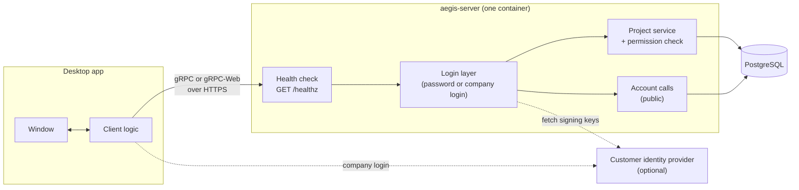

# 1. Architecture and data flow

## 1.1 Summary

The customer hosts the AegisTARA server in its own cloud account or data
center. The vendor hosts nothing and receives no data. Users work in a native
desktop app that connects to that server. The server keeps its data in a
PostgreSQL database that the customer runs. A second mode, standalone mode,
runs with no server at all: one desktop process keeps one project in a folder
on the user's disk. The license is a signed file that the product checks
offline. By default the product makes no connection to the vendor.

## 1.2 Deployment modes

| Mode | What runs where | Who operates it |
|---|---|---|
| Server mode | Desktop app on each user's computer. The `aegis-server` container, PostgreSQL and a TLS proxy in the customer's cloud or data center. Optionally the customer's identity provider for company login. | `Customer` runs the container, database, proxy and identity provider. |
| Standalone mode | One desktop process. It starts an embedded server that listens on `127.0.0.1` on a random port. Data is in a project folder on disk. There is no login. | The user, on their own computer. |

## 1.3 Components

| Component | Role | Runs as |
|---|---|---|
| Desktop app | Shows the project and sends every change to the server. | A normal program under the user's operating system account. |
| `aegis-server` | Checks login and permissions, holds project state, writes to the database. | A container, as a non-root user. |
| PostgreSQL | Stores all server data. | The customer's database service. |
| TLS proxy | Ends HTTPS in front of the server. | The customer's load balancer or reverse proxy. |
| Identity provider | Company login (OpenID Connect). Optional. | The customer's service. |

## 1.4 Data flows

| ID | From | To | What is sent | Protocol and protection | Who starts it |
|---|---|---|---|---|---|
| DF-01 | Desktop app | Server | Project reads and changes, login calls | gRPC over HTTP/2, or gRPC-Web over HTTP/1.1, inside HTTPS that ends at the `Customer` proxy. Stays inside the customer's network (or its VPN). | The user |
| DF-02 | Server | PostgreSQL | All project data, users, sessions, event log | Plain TCP on a private network by default. TLS when `AEGIS_DB_TLS` is `encrypt` or `verify`. Stays inside the customer's network. | The server |
| DF-03 | Desktop app | Identity provider | Company login (OpenID Connect) in the system browser; tokens come back | HTTPS. Only when company login is used. Goes where the customer's identity provider is, which may be outside its network. | The user |
| DF-04 | Server | Identity provider | A request for the provider's signing keys, used to check tokens; the provider's discovery document at start | HTTPS. Only with company login. No project data. Goes where the customer's identity provider is. | The server |
| DF-05 | Desktop app | Update address | A signed update manifest; the installer when the user asks for it | HTTPS to the address in `update_url`. Only when `update_url` or the environment variable `AEGIS_UPDATE_URL` is set (the variable wins). The manifest is signed and the installer is checked against it. The app never runs the installer. Leaves the customer's network. | The user |
| DF-06 | Desktop app | Embedded server | The same calls as DF-01 | gRPC on `127.0.0.1` only, random port, no login. Does not leave the computer. | The user |
| DF-07 | Desktop app | Local export folder | Reports and tables the user exports | Files written to a local folder. Leaves the network only if the user sends the files. | The user |

## 1.5 Trust boundaries

| Boundary | What is checked there |
|---|---|
| Network edge | `Customer` TLS proxy ends HTTPS. The server itself speaks plain HTTP. In the container it listens on all interfaces on port 50051. The supplied compose file publishes that port only on the host's loopback. `Customer` keeps the plain port off other networks. |
| Server login layer | Every call needs a valid login, except the public account calls and `GET /healthz`. |
| Project permission check | After login, each call is checked against the user's role in that project. |
| Database network | Only the server should reach PostgreSQL. `Customer` keeps it on a private network. |
| Desktop operating system account | The app runs with the rights of the user. The operating system protects the user's files. |

Standalone mode has a trade-off. It has no login. Any process of the same
operating system user on the same machine that finds the loopback port can act
as the user. The port is not reachable from the network.

## 1.6 What leaves the customer's network

By default, nothing. The product has no telemetry, no license server and no
vendor-hosted service. The license is a signed file that is checked offline.
A search of the source code for telemetry, analytics and error-reporting
services found none.

The only optional outbound flow is the update check (DF-05). A site without
internet leaves both `update_url` and `AEGIS_UPDATE_URL` empty and installs each release from an offline
bundle. Company login (DF-03, DF-04) talks to the customer's own identity
provider. Cloud AI providers are `Planned` and will be opt-in.

## 1.7 Where data is stored

| Place | What it holds | Who controls it |
|---|---|---|
| PostgreSQL | Projects, operation history, baselines, figures, users, sessions, settings, event log | `Customer` |
| Standalone project folder | `ops.jsonl` (history), `ops.meta`, `snapshots/`, `manifest.json` | The user |
| Desktop settings file | Server address, transport, last user name, export folder, update address, standalone folder and license paths, report profiles, language, appearance, panel width. It never holds a password or token. | The user |
| Operating system keychain, password login | The session token, only when the user ticks "keep me logged in" | The user, through the operating system |
| Operating system keychain, company login | A device key and a refresh token, always. Kept in memory only if the machine has no keychain | The user, through the operating system |
| Export folder | Reports and tables the user exports | The user |

## 1.8 Limits to know

- One server instance per database.
- TLS for clients is the customer's proxy, not the server (`Customer`).
- The product does not encrypt data at rest itself. Disk or database
  encryption is the customer's duty (`Customer`).
- Password login has no e-mail reset and no multi-factor login. Company login
  is the way to use the product in production.

## 1.9 Sources

- `docs/architecture.md`
- `docs/deployment.md`
- `docs/decisions.md`
- `docs/requirements.md`
- `deploy/Dockerfile`
- `deploy/compose.yaml`
- `crates/aegis-server/src/main.rs`
- `crates/aegis-server/src/health.rs`
- `crates/aegis-server/src/auth_layer.rs`
- `crates/aegis-auth/src/jwks.rs`
- `crates/aegis-client/src/settings.rs`
- `crates/aegis-shell/src/provider.rs`
- `crates/aegis-shell/src/launcher.rs`
- `crates/aegis-shell/src/standalone.rs`
- `crates/aegis-server/src/access.rs`
- `crates/aegis-server/src/store/folder.rs`
