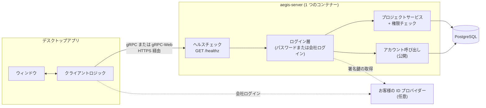

# 1. アーキテクチャとデータフロー

## 1.1 概要

AegisTARA サーバーは、お客様が自社のクラウドアカウントまたはデータセンターでホストします。ベンダーは何もホストせず、データも受け取りません。ユーザーは、そのサーバーに接続するネイティブのデスクトップアプリで作業します。サーバーは、お客様が運用する PostgreSQL データベースにデータを保存します。もう一つのモードであるスタンドアロンモードは、サーバーなしで動作します。1 つのデスクトッププロセスが、ユーザーのディスク上のフォルダーに 1 つのプロジェクトを保存します。ライセンスは署名付きファイルで、製品がオフラインで検証します。既定では、製品はベンダーへ接続しません。

## 1.2 デプロイモード

| モード | 何がどこで動くか | 誰が運用するか |
|---|---|---|
| サーバーモード | 各ユーザーのコンピューターでデスクトップアプリが動きます。お客様のクラウドまたはデータセンターで、`aegis-server` コンテナー、PostgreSQL、TLS プロキシが動きます。会社ログインを使う場合は、お客様の ID プロバイダーも動きます。 | `お客様`がコンテナー、データベース、プロキシ、ID プロバイダーを運用します。 |
| スタンドアロンモード | 1 つのデスクトッププロセスが動きます。このプロセスは、ランダムなポートの `127.0.0.1` で待ち受ける組み込みサーバーを起動します。データはディスク上のプロジェクトフォルダーにあります。ログインはありません。 | ユーザーが自分のコンピューターで運用します。 |

## 1.3 コンポーネント

| コンポーネント | 役割 | 実行形態 |
|---|---|---|
| デスクトップアプリ | プロジェクトを表示し、すべての変更をサーバーへ送ります。 | ユーザーのオペレーティングシステムアカウントで動く通常のプログラムです。 |
| `aegis-server` | ログインと権限を確認し、プロジェクトの状態を保持し、データベースへ書き込みます。 | コンテナーで、root 以外のユーザーとして動きます。 |
| PostgreSQL | サーバーのすべてのデータを保存します。 | お客様のデータベースサービスです。 |
| TLS プロキシ | サーバーの前段で HTTPS を終端します。 | お客様のロードバランサーまたはリバースプロキシです。 |
| ID プロバイダー | 会社ログイン (OpenID Connect) です。任意です。 | お客様のサービスです。 |

## 1.4 データフロー

| ID | 送信元 | 送信先 | 送られるもの | プロトコルと保護 | 開始者 |
|---|---|---|---|---|---|
| DF-01 | デスクトップアプリ | サーバー | プロジェクトの読み取りと変更、ログイン呼び出し | HTTP/2 上の gRPC、または HTTP/1.1 上の gRPC-Web を、`お客様`のプロキシで終端する HTTPS の中で使います。お客様のネットワーク (または VPN) の内側にとどまります。 | ユーザー |
| DF-02 | サーバー | PostgreSQL | すべてのプロジェクトデータ、ユーザー、セッション、イベントログ | 既定では、プライベートネットワーク上の平文 TCP です。`AEGIS_DB_TLS` が `encrypt` または `verify` のときは TLS を使います。お客様のネットワークの内側にとどまります。 | サーバー |
| DF-03 | デスクトップアプリ | ID プロバイダー | システムブラウザーでの会社ログイン (OpenID Connect)。トークンが返されます。 | HTTPS です。会社ログインを使うときだけです。お客様の ID プロバイダーがある場所へ送られ、そこはお客様のネットワークの外の場合があります。 | ユーザー |
| DF-04 | サーバー | ID プロバイダー | トークンの検証に使うプロバイダーの署名鍵の要求。起動時にはプロバイダーのディスカバリードキュメント | HTTPS です。会社ログインのときだけです。プロジェクトデータは含みません。お客様の ID プロバイダーがある場所へ送られます。 | サーバー |
| DF-05 | デスクトップアプリ | 更新アドレス | 署名付きの更新マニフェスト。ユーザーが求めたときはインストーラー | `update_url` のアドレスへの HTTPS です。`update_url` または環境変数 `AEGIS_UPDATE_URL` が設定されているときだけです (環境変数が優先されます)。マニフェストは署名されており、インストーラーはマニフェストと照合されます。アプリがインストーラーを実行することはありません。お客様のネットワークの外へ出ます。 | ユーザー |
| DF-06 | デスクトップアプリ | 組み込みサーバー | DF-01 と同じ呼び出し | `127.0.0.1` だけでの gRPC です。ポートはランダムで、ログインはありません。コンピューターの外へは出ません。 | ユーザー |
| DF-07 | デスクトップアプリ | ローカルのエクスポートフォルダー | ユーザーがエクスポートするレポートと表 | ローカルフォルダーへ書き出されるファイルです。ユーザーがファイルを送った場合にだけ、ネットワークの外へ出ます。 | ユーザー |

## 1.5 信頼境界

| 境界 | そこで確認すること |
|---|---|
| ネットワークの境界 | `お客様`の TLS プロキシが HTTPS を終端します。サーバー自体は平文の HTTP で通信します。コンテナーの中では、すべてのインターフェースのポート 50051 で待ち受けます。付属の compose ファイルは、そのポートをホストのループバックにだけ公開します。`お客様`は、その平文ポートを他のネットワークに出さないようにします。 |
| サーバーのログイン層 | 公開アカウント呼び出しと `GET /healthz` を除き、すべての呼び出しに有効なログインが必要です。 |
| プロジェクトの権限チェック | ログインの後、各呼び出しは、そのプロジェクトでのユーザーのロールに照らして確認されます。 |
| データベースのネットワーク | PostgreSQL に到達できるのはサーバーだけにします。`お客様`は、それをプライベートネットワークに置きます。 |
| デスクトップのオペレーティングシステムアカウント | アプリはユーザーの権限で動きます。オペレーティングシステムがユーザーのファイルを保護します。 |

スタンドアロンモードにはトレードオフがあります。ログインがありません。同じコンピューター上の同じオペレーティングシステムユーザーのプロセスは、ループバックのポートを見つければ、そのユーザーとして動作できます。そのポートにネットワークから到達することはできません。

## 1.6 お客様のネットワークから出るもの

既定では、何も出ません。製品には、テレメトリも、ライセンスサーバーも、ベンダーがホストするサービスもありません。ライセンスは署名付きファイルで、オフラインで検証されます。ソースコードでテレメトリ、分析、エラー報告のサービスを検索しましたが、見つかりませんでした。

任意の外向きフローは、更新の確認 (DF-05) だけです。インターネットのないサイトでは、`update_url` と `AEGIS_UPDATE_URL` の両方を空にし、各リリースをオフラインバンドルからインストールします。会社ログイン (DF-03、DF-04) は、お客様自身の ID プロバイダーと通信します。クラウド AI プロバイダーは`計画中`で、オプトインになります。

## 1.7 データの保存場所

| 場所 | 保持するもの | 管理者 |
|---|---|---|
| PostgreSQL | プロジェクト、操作履歴、ベースライン、図、ユーザー、セッション、設定、イベントログ | `お客様` |
| スタンドアロンのプロジェクトフォルダー | `ops.jsonl` (履歴)、`ops.meta`、`snapshots/`、`manifest.json` | ユーザー |
| デスクトップの設定ファイル | サーバーアドレス、トランスポート、最後に使ったユーザー名、エクスポートフォルダー、更新アドレス、スタンドアロンのフォルダーとライセンスのパス、レポートプロファイル、言語、外観、パネル幅。パスワードやトークンは保持しません。 | ユーザー |
| オペレーティングシステムのキーチェーン、パスワードログイン | セッショントークン。ユーザーが「ログイン状態を保持」にチェックを入れたときだけです。 | オペレーティングシステムを通じてユーザー |
| オペレーティングシステムのキーチェーン、会社ログイン | デバイス鍵とリフレッシュトークン。常に保存します。マシンにキーチェーンがない場合は、メモリ上にだけ保持します。 | オペレーティングシステムを通じてユーザー |
| エクスポートフォルダー | ユーザーがエクスポートするレポートと表 | ユーザー |

## 1.8 知っておくべき制限

- 1 つのデータベースにつき、サーバーインスタンスは 1 つです。
- クライアント向けの TLS は、サーバーではなくお客様のプロキシが担います (`お客様`)。
- 製品自体は保存データを暗号化しません。ディスクまたはデータベースの暗号化は、お客様の責任です (`お客様`)。
- パスワードログインには、メールによるリセットも多要素認証もありません。本番で製品を使う方法は、会社ログインです。

## 1.9 出典

- `docs/architecture.md`
- `docs/deployment.md`
- `docs/decisions.md`
- `docs/requirements.md`
- `deploy/Dockerfile`
- `deploy/compose.yaml`
- `crates/aegis-server/src/main.rs`
- `crates/aegis-server/src/health.rs`
- `crates/aegis-server/src/auth_layer.rs`
- `crates/aegis-auth/src/jwks.rs`
- `crates/aegis-client/src/settings.rs`
- `crates/aegis-shell/src/provider.rs`
- `crates/aegis-shell/src/launcher.rs`
- `crates/aegis-shell/src/standalone.rs`
- `crates/aegis-server/src/access.rs`
- `crates/aegis-server/src/store/folder.rs`
