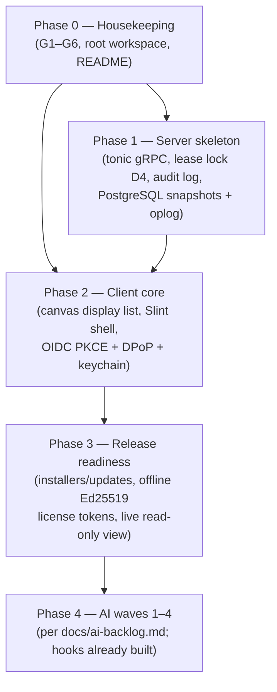

# AegisTARA — Project Status & Handoff Roadmap

- **Date:** 2026-10-25
- **Baseline Commit:** `b7ca167` (`026-choke-points-and-sensitivity`)
- **Audience:** the next maintainer or agent picking up this repository.
- **Companion documents:** [architecture.md](architecture.md) (full UML & activity reference for `crates/aegis-model`), [direction-v1.md](direction-v1.md) (product vision), [engineering-standards.md](engineering-standards.md) (binding rules), [decisions.md](decisions.md) (D1–D8), [ai-backlog.md](ai-backlog.md) (post-v1 AI features), [PROJECT_REVIEW.md](../PROJECT_REVIEW.md) (independent review, 2026-10-20).

---

## 1. Status Snapshot

**Product vision (v1):** a native desktop TARA client (Slint) talking to a customer-hosted single-tenant server (Rust + PostgreSQL), automotive first (ISO/SAE 21434, UN R155/R156), with deterministic risk computation, explain-why for every number, and sovereign (air-gapped-capable) deployment.

**Reality today:** the entire deterministic core is implemented and verified in a single crate, `crates/aegis-model`. No client, server, or workspace shell exists yet.

| Area | State | Evidence |
|---|---|---|
| Domain model & risk engine (`aegis-model`) | **Complete (jobs 001–026)** | Arena attack-tree DAG, typed `Op` mutations with inverse ops, provenance, methodology packs, risk matrices, attack potential, controls/residual risk, goals/claims |
| Analysis engines | **Complete** | Bottom-up `Evaluation<V>` + explain-why, lazy top-$k$ paths, choke points, greedy hitting sets, $\pm 1$ tipping-point sensitivity, linter (22 codes), version diff |
| Incremental evaluation cache | **Complete** | `TreeEvalCache` / `ProjectEvalCache` with rank-ordered re-propagation (5 ms budget, job 025) |
| Persistence | **Complete** | `aegis-project` snapshots + append-only `aegis-oplog`, string-key wire format, decode-time caps (R3) |
| Supply chain & CI | **Complete** | `deny.toml` policy + 8 fixtures, `.github/workflows/ci.yml` (job 008) |
| UI toolkit decision | **Complete** | 5 spikes evaluated; Slint selected (D7); HTML design mockups in `docs/design/` |
| Cargo workspace shell | **Missing** | No root `Cargo.toml`; `aegis-model` builds standalone |
| Desktop client (`aegis-client`) | **Not started** | Canvas display list, Slint shell |
| Server (`aegis-server`) | **Not started** | gRPC API, OIDC login, PostgreSQL, locks, audit |
| AI features | **Backlog only** | `docs/ai-backlog.md`; all v1 "AI-ready" hooks (provenance, typed ops, catalog IDs, engine-as-tool) already built |

### Factory jobs 001–026 (all merged, all reviews PASS)

| Jobs | Delivered | ADRs |
|---|---|---|
| 001–008 | Arena DAG, cycle detection, cargo-deny, parent-storage benchmark, evaluation, explain-why, property tests, CI | 0001–0007 |
| 009–016 | Domain entities, sparse ref-counts, save/load, methodology packs, threat↔tree links, provenance, cleanups, tree/provenance wire format | 0008–0014 |
| 017–024 | Risk determination, direct feasibility, controls & residual risk, linter, top-$k$ paths, project diff, attack potential, goals & claims | 0015–0022 |
| 025–026 | Incremental evaluation cache; choke points, hitting sets & sensitivity | 0023–0024 |

---

## 2. Where the Code Stands vs. the v1 Vision

The review's original phasing assumed separate `aegis-engine` and `aegis-store` crates. The implementation converged on **one crate**: evaluation lives in `aegis-model/src/eval.rs`, persistence in `aegis-model/src/store/`. This is deliberate and healthy — the *engine parity* requirement (same deterministic engine in client and server) is satisfied by compiling `aegis-model` into both. A crate split is optional and should only happen if compile times or coupling demand it.

`direction-v1.md` §13 next steps, scored against today:

1. UI spike — **done** (D7, Slint).
2. Domain model v0 — **done** (jobs 009–026 far exceed v0).
3. Engine v0 — **done** (evaluation, explain-why, property tests).
4. Workspace skeleton — **partially done**: cargo-deny + CI exist; root workspace missing.
5. Server and login skeleton — **not started**.
6. Methodology pack format — **done** (job 012, pack file shipped with the crate).

---

## 3. Open Gaps & Housekeeping (re-verified 2026-10-25)

| # | Gap | State | Suggested action |
|---|---|---|---|
| G1 | `README.md` still says *"Status: direction set. No code yet."* | Stale since job 001 | Rewrite status section; link `docs/architecture.md` |
| G2 | No root `Cargo.toml` workspace | Open | Add `[workspace]` with `members = ["crates/*"]` before crate #2 |
| G3 | Dangling worktrees: `claude/factory-next-58b95b` (mockups — content already in `docs/design/`), `claude/pipeline-tasks-3ca78e` (unreviewed) | Open | Confirm content is merged; delete worktrees/branches |
| G4 | Decision D4 (single-editor lock interpretation) | **Open** in `decisions.md` | Confirm before server work starts |
| G5 | Decision D7 (Slint royalty-free attribution: About dialog + website badge) | **Open** in `decisions.md` | Business decision: accept, buy commercial license, or fall back to iced |
| G6 | `direction-v1.md` §4 still calls iced the "lead" | Drift vs. D7 | Amend §4 to point at D7 |
| G7 | Node deletion/reparenting semantics for `AttackTree` | Not needed yet | Decide tombstones vs. index remap when the first delete op is specified |

---

## 4. Handoff Roadmap



### Phase 0 — Housekeeping (unblocks everything)
- Root workspace, README refresh, worktree cleanup, D4/D7 decisions, §4 drift fix.
- **Exit:** `cargo build` from the repo root; README describes the real state.

### Phase 1 — `aegis-server` skeleton
- tonic gRPC API per `direction-v1.md` §8; project lease lock (D4, 2-minute renewal); append-only op-log persistence in PostgreSQL; audit log for every op.
- Reuse `aegis-model` as the authoritative engine: validate + apply ops server-side, stream accepted ops to observers.
- **Rules to honor:** R3 (decode caps at every trust boundary), P4 (determinism), D10 (derived state stays rebuildable).
- **Exit:** headless server round-trip test: apply op → persisted → reload → identical `Project`.

### Phase 2 — `aegis-client` core + Slint shell
- Canvas engine emitting the toolkit-agnostic display list (`direction-v1.md` §5) so desktop, SVG export, and Typst PDF reports share one pipeline.
- Slint desktop shell (D7) on the mockups in `docs/design/`; optimistic local evaluation via `ProjectEvalCache` (5 ms budget, rule A1); OS keychain token storage, OIDC PKCE + DPoP login.
- **Exit:** edit a step rating in the GUI, see residual risk update within one frame.

### Phase 3 — Release readiness
- Installers + auto-update (§10), offline Ed25519 license tokens (§12), live read-only observers (§7).
- **Exit:** a sovereign (air-gapped) demo deployment.

### Phase 4 — AI features (post-v1, per `docs/ai-backlog.md`)
- Wave 1: smart catalog search, threat suggestions, damage writer, summary wording, wording cleanup.
- The v1 hooks AI needs are already in place: provenance (`ProvenanceSource::Ai`), typed invertible ops, catalog IDs, engine-as-tool, derivation traces, oplog audit.

---

## 5. Proposed Next Factory Backlog Entries

Format matches `factory/backlog.md` (`/factory next` runs the first unchecked item):

```text
- [ ] Create the root Cargo workspace (`members = ["crates/*"]`, shared `[workspace.dependencies]`) and refresh the README status section (G1, G2) (027-workspace-and-readme)
- [ ] Resolve dangling worktrees and document D4/D7 outcomes in docs/decisions.md (G3–G6) (028-decision-cleanup)
- [ ] Add the `aegis-server` crate: tonic gRPC service skeleton that validates and applies `Op`s through `aegis-model`, with the project lease lock (D4) (029-server-skeleton)
- [ ] Persist projects server-side: PostgreSQL-backed snapshot + op-log storage with audit records (R3 caps at the API boundary) (030-server-persistence)
- [ ] Add OIDC PKCE login with DPoP-bound tokens in the OS keychain (direction §6) (031-login)
- [ ] Build the headless canvas display-list engine for attack trees (direction §5) with SVG snapshot tests (032-canvas-display-list)
- [ ] Build the Slint desktop shell over the display list and `ProjectEvalCache` (D7, A1 5 ms budget) (033-slint-shell)
```

---

## 6. Handoff Quick Start

**Build & verify (mirrors CI):**

```bash
scripts/ci.sh                  # fmt, clippy -D warnings, all tests, doc build
scripts/deny.sh                # license/advisory policy (cargo-deny 0.20.2)
tools/deny-fixtures/run.sh     # 8 policy fixtures
```

**Orientation in 15 minutes:**

1. Read `docs/architecture.md` — every struct, field, method, and interaction in `aegis-model`, with Mermaid UML and per-activity call flows.
2. Skim `docs/decisions.md` (D1–D8) then the ADRs for the area you touch (`docs/adr/0001`–`0024`).
3. Treat `docs/engineering-standards.md` as binding: code comments cite its rules (`D*`, `A*`, `P*`, `Q*`, `R*`).

**Invariants that will bite you if broken:**

- **D10 — derived state is rebuildable.** `RefCounts`, `Evaluation`, caches are never source of truth; source state lives in `Project` arenas, `AttackTree`, `Methodology`.
- **Ops are validated and invertible.** Every mutation goes through `Project::validate` + `Project::apply`, which returns the inverse `Op`. Never mutate arenas directly.
- **R3 — cap before you allocate.** All deserialization paths enforce `Limit`/`BoundedReader`/`CapSeq` before allocation.
- **R6 — no entity names in lint/error output.** Deterministic, leak-free diagnostics.
- **A4 — never materialize all attack paths.** Use the lazy `AttackPaths` iterator.
- **P4 — determinism.** Same ops in → same bytes out; iteration order comes from arenas and `BTreeMap`s, never `HashMap`s.
- **Wire format uses string keys, never indices** — reordering a methodology pack must never change stored meaning.
