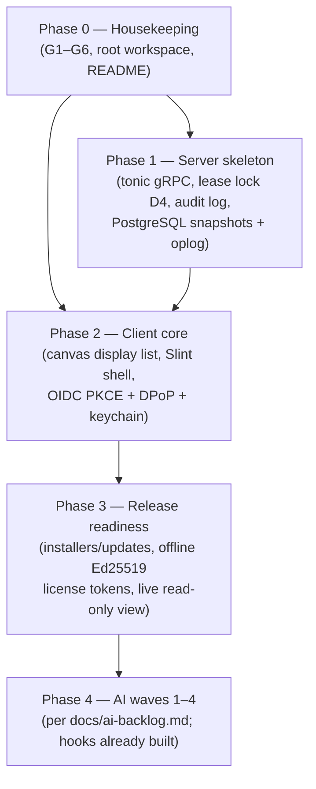

# AegisTARA — Project Status & Handoff Roadmap

- **Date:** 2026-10-25
- **Baseline Commit:** `202f296` (job `036-release-scaffolding`, branch `claude/beautiful-goldberg-4aog9p`). Earlier baseline: `b7ca167` (job 026).
- **Audience:** the next maintainer or agent picking up this repository.
- **Companion documents:** [architecture.md](architecture.md) (full UML & activity reference for `crates/aegis-model`), [direction-v1.md](direction-v1.md) (product vision), [engineering-standards.md](engineering-standards.md) (binding rules), [decisions.md](decisions.md) (D1–D9), [ai-backlog.md](ai-backlog.md) (post-v1 AI features), [PROJECT_REVIEW.md](../PROJECT_REVIEW.md) (independent review, 2026-10-20).

---

## 1. Status Snapshot

**Product vision (v1):** a native desktop TARA client (Slint) talking to a customer-hosted single-tenant server (Rust + PostgreSQL), automotive first (ISO/SAE 21434, UN R155/R156), with deterministic risk computation, explain-why for every number, and sovereign (air-gapped-capable) deployment.

**Reality today:** the deterministic core, the server, the login stack, the canvas engine, the client core, the desktop shell, offline licensing, live observers and release scaffolding are all built and tested end to end. One Cargo workspace holds eight crates. What is still missing is listed in section 3 and in the backlog (037 to 039). **The reviews (code, security, UX, UI) for jobs 027 to 036 have not been run yet**; the owner deferred them.

| Area | State | Evidence |
|---|---|---|
| Domain model, risk engine, analysis, persistence (`aegis-model`) | **Complete (jobs 001–026)** | See the table below |
| Cargo workspace, CI, supply chain | **Complete (027, 028)** | Root workspace, `scripts/ci.sh`, `scripts/deny.sh`, 9 policy fixtures, Postgres service in CI |
| Server (`aegis-server`, `aegis-proto`) | **Complete (029, 030)** | gRPC API, one actor per project, atomic batches, edit lease (D4), observers, MemoryStore and PostgresStore, hash-chained audit, `VerifyAudit` |
| Login (`aegis-auth`) | **Complete (031)** | OIDC code flow + PKCE, DPoP, JWKS cache, keychain, mock identity provider. Plain `http://` only (see 038) |
| Canvas (`aegis-canvas`) | **Complete (032)** | Linear-time layout (1M nodes in 51 ms), R-tree hit test, display list, SVG snapshots, keyboard navigation |
| Client core (`aegis-client`) | **Complete (033)** | Optimistic editing, undo as edits, lease handling, view model, 10 end-to-end tests against the real server |
| Desktop shell (`aegis-shell`) | **Complete (033)** | Slint window, software renderer, 6 headless UI tests with screenshots |
| Offline licensing (`aegis-license`) | **Complete (034)** | Ed25519 license files, grace period, seat ledger, issuer tool, server gate |
| Live observers | **Complete (035)** | Ops plus recomputed risks streamed to observers; the client cross-checks its own numbers |
| Release scaffolding | **Written, not exercised (036)** | Release profile, Dockerfile, Compose file, signed update manifest. The image was never built (no container daemon here) |
| TLS to PostgreSQL, `https://` for login and updates | **Open (037, 038)** | Blocks a real deployment, see section 3 |
| AI features | **Backlog only** | `docs/ai-backlog.md`; the v1 hooks are in place |

### Factory jobs

| Jobs | Delivered | ADRs |
|---|---|---|
| 001–008 | Arena DAG, cycle detection, cargo-deny, parent-storage benchmark, evaluation, explain-why, property tests, CI | 0001–0007 |
| 009–016 | Domain entities, sparse ref-counts, save/load, methodology packs, threat↔tree links, provenance, cleanups, tree/provenance wire format | 0008–0014 |
| 017–024 | Risk determination, direct feasibility, controls & residual risk, linter, top-k paths, project diff, attack potential, goals & claims | 0015–0022 |
| 025–026 | Incremental evaluation cache; choke points, hitting sets & sensitivity | 0023–0024 |
| 027–028 | Cargo workspace, README, decision cleanup | 0025 |
| 029–030 | Server skeleton, persistence and audit | 0026, 0027 |
| 031 | Login | 0028 |
| 032 | Canvas engine | 0029 |
| 033 | Client core and Slint shell | 0030, 0031 |
| 034 | License files | 0032 |
| 035 | Live observers | 0033 |
| 036 | Release scaffolding | 0034 |

Jobs 027 to 036 were built in one session on the branch above and have **not** been through the factory review stages (code, security, UX, UI).

---

## 2. Where the Code Stands vs. the v1 Vision

The implementation keeps evaluation and persistence in `aegis-model` and compiles the same crate into client and server, which satisfies the *engine parity* requirement. Around it:

| Crate | Role |
|---|---|
| `aegis-model` | Domain model, risk engine, analysis, persistence formats, `OpCodec`, `ENGINE_VERSION` |
| `aegis-proto` | gRPC messages and service (built with `protox`, no `protoc`) |
| `aegis-server` | The server binary and library: actors, leases, stores, audit, license gate |
| `aegis-auth` | Login: JOSE, PKCE, DPoP, JWKS, OIDC, keychain, request layers |
| `aegis-canvas` | Layout, hit testing, display list, SVG |
| `aegis-client` | Client core with no UI toolkit: workspace, session, view model, update checks |
| `aegis-shell` | The Slint window. The only crate allowed to depend on Slint (`deny.toml` ban) |
| `aegis-license` | License files and update manifests: verify, sign (feature), seat ledger |

`direction-v1.md` §13 next steps, scored against today:

1. UI spike: **done** (D7, Slint).
2. Domain model v0: **done**.
3. Engine v0: **done**.
4. Workspace skeleton: **done** (root workspace, CI, cargo-deny).
5. Server and login skeleton: **done** (029 to 031).
6. Methodology pack format: **done** (job 012).

Not yet built from the direction: reports (PDF, Typst), versions and baselines in the UI, the admin screens (users, groups, policies, audit view), SVG export from the UI, the AI waves.

---

## 3. Open Gaps & Housekeeping (updated 2026-10-25)

| # | Gap | State | Suggested action |
|---|---|---|---|
| G1 | README status | **Done** (027) | |
| G2 | Root workspace | **Done** (027) | |
| G3 | Dangling worktrees and branches | **Done** locally. The four merged remote branches are listed in D9 | Owner deletes them on GitHub |
| G4 | D4 (single-editor lock) | **Working assumption** in D9, built as written | Owner confirms |
| G5 | D7 (Slint attribution condition) | **Working assumption** in D9: About window plus website badge. `deny.toml` carries an exception and a ban that confines Slint to `aegis-shell` | Owner confirms, or deletes `crates/aegis-shell` |
| G6 | `direction-v1.md` §4 drift | **Done** (028) | |
| G7 | Node deletion semantics for `AttackTree` | Not needed yet | Decide when the first delete op is specified |
| G8 | **Reviews of jobs 027 to 036** (code, security, UX, UI) | **Not run** (deferred by the owner) | Run them before any release |
| G9 | `https://` for login, key sets and update fetching | **Open, backlog 038.** The server and client cannot talk to an `https://` identity provider yet | Needs a D5 review of rustls and the OS trust store |
| G10 | TLS to PostgreSQL | **Open, backlog 037** | Same D5 review |
| G11 | Seat counts reset when the server restarts | **Open, backlog 039** | Rebuild from the audit log |
| G12 | The server image and Compose file were never run | **Open** | Build the image on a machine with a container daemon, add a CI job, run the release checklist |
| G13 | `vendor.keys` and `update.keys` hold no key | **Open by design** | Owner generates the two production keys (`aegis-license keygen`) before the first release |
| G14 | Accessibility: no screen reader path for canvas items | **Open** | Part of the UX review |
| G15 | The shell shows no "numbers checked with the server" mark, no admin screens, no reports | **Open** | Product backlog |

---

## 4. Handoff Roadmap



> **Phases 0 to 3 are built** on the branch named above, with the open items in section 3. Only the review stages, the two TLS jobs and the first real deployment are left before Phase 4.

### Phase 0 — Housekeeping (unblocks everything) — done
- Root workspace, README refresh, worktree cleanup, D4/D7 decisions, §4 drift fix.
- **Exit:** `cargo build` from the repo root; README describes the real state.

### Phase 1 — `aegis-server` skeleton — done
- tonic gRPC API per `direction-v1.md` §8; project lease lock (D4, 2-minute renewal); append-only op-log persistence in PostgreSQL; audit log for every op.
- Reuse `aegis-model` as the authoritative engine: validate + apply ops server-side, stream accepted ops to observers.
- **Rules to honor:** R3 (decode caps at every trust boundary), P4 (determinism), D10 (derived state stays rebuildable).
- **Exit:** headless server round-trip test: apply op → persisted → reload → identical `Project`.

### Phase 2 — `aegis-client` core + Slint shell — done
- Canvas engine emitting the toolkit-agnostic display list (`direction-v1.md` §5) so desktop, SVG export, and Typst PDF reports share one pipeline.
- Slint desktop shell (D7) on the mockups in `docs/design/`; optimistic local evaluation via `ProjectEvalCache` (5 ms budget, rule A1); OS keychain token storage, OIDC PKCE + DPoP login.
- **Exit:** edit a step rating in the GUI, see residual risk update within one frame.

### Phase 3 — Release readiness — built, not yet exercised
- Installers + auto-update (§10), offline Ed25519 license tokens (§12), live read-only observers (§7).
- **Exit:** a sovereign (air-gapped) demo deployment. Needs 037 and 038 first.

### Phase 4 — AI features (post-v1, per `docs/ai-backlog.md`)
- Wave 1: smart catalog search, threat suggestions, damage writer, summary wording, wording cleanup.
- The v1 hooks AI needs are already in place: provenance (`ProvenanceSource::Ai`), typed invertible ops, catalog IDs, engine-as-tool, derivation traces, oplog audit.

---

## 5. Next Factory Backlog Entries

Jobs 027 to 036 are ticked in `factory/backlog.md`. What remains there:

```text
- [ ] TLS to PostgreSQL after a D5 review (037-postgres-tls)
- [ ] HTTPS client for login, JWKS and update fetching after a D5 review (038-https-client)
- [ ] Rebuild the seat ledger from the audit log after a restart (039-seat-ledger-persistence)
```

Suggested additions, in order:

1. Run the four reviews on jobs 027 to 036 (G8).
2. Build the server image in CI and run the release checklist once (G12).
3. Reports: Typst PDF and SVG export through the display list.
4. Admin screens: users, groups, policies, audit view, license (direction §6).
5. Versions and baselines in the UI.
6. Phase 4, AI wave 1.

---

## 6. Handoff Quick Start

**Build & verify (mirrors CI):**

```bash
scripts/ci.sh                  # fmt, clippy -D warnings, all tests, doc build
scripts/deny.sh                # license/advisory policy (cargo-deny 0.20.2)
tools/deny-fixtures/run.sh     # 9 policy fixtures
```

**Orientation in 15 minutes:**

1. Read `docs/architecture.md` — every struct, field, method, and interaction in `aegis-model`, with Mermaid UML and per-activity call flows.
2. Skim `docs/decisions.md` (D1–D9) then the ADRs for the area you touch (`docs/adr/0001`–`0034`).
3. Treat `docs/engineering-standards.md` as binding: code comments cite its rules (`D*`, `A*`, `P*`, `Q*`, `R*`).

**Running it:**

```bash
# A server for development (in memory, no login, no license check)
AEGIS_DEV_AUTH=1 AEGIS_DEV_LICENSE=1 cargo run -p aegis-server --features dev-license
# The window, as the development user "alice"
AEGIS_DEV_USER=alice cargo run -p aegis-shell      # other variables: crates/aegis-shell/src/main.rs
# Make keys and a license
cargo run -p aegis-license --features issuer -- keygen --key-id dev --out /tmp/dev.pk8
```

Production deployment: `docs/deployment.md`. Release steps: `docs/release-checklist.md`.

**Invariants that will bite you if broken:**

- **D10 — derived state is rebuildable.** `RefCounts`, `Evaluation`, caches are never source of truth; source state lives in `Project` arenas, `AttackTree`, `Methodology`.
- **Ops are validated and invertible.** Every mutation goes through `Project::validate` + `Project::apply`, which returns the inverse `Op`. Never mutate arenas directly.
- **R3 — cap before you allocate.** All deserialization paths enforce `Limit`/`BoundedReader`/`CapSeq` before allocation.
- **R6 — no entity names in lint/error output.** Deterministic, leak-free diagnostics.
- **A4 — never materialize all attack paths.** Use the lazy `AttackPaths` iterator.
- **P4 — determinism.** Same ops in → same bytes out; iteration order comes from arenas and `BTreeMap`s, never `HashMap`s.
- **Wire format uses string keys, never indices** — reordering a methodology pack must never change stored meaning.
